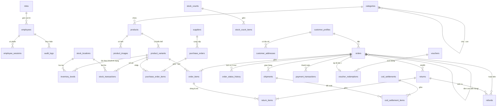
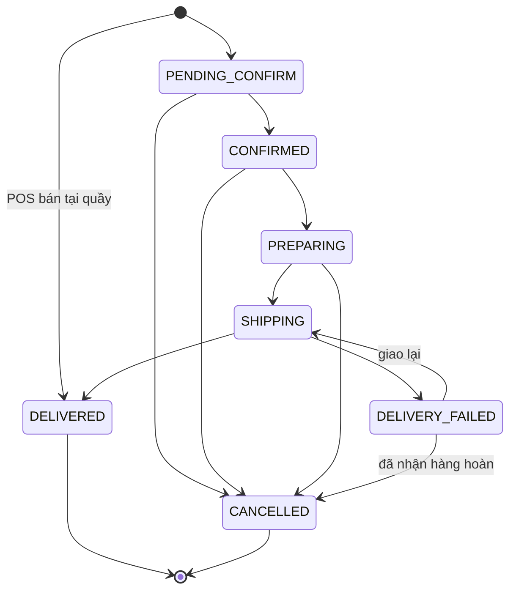
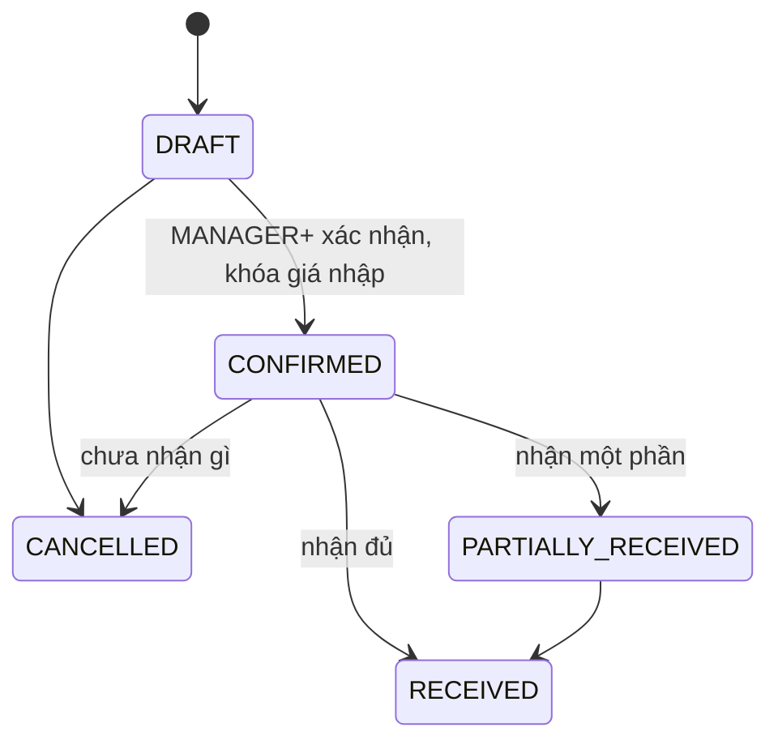
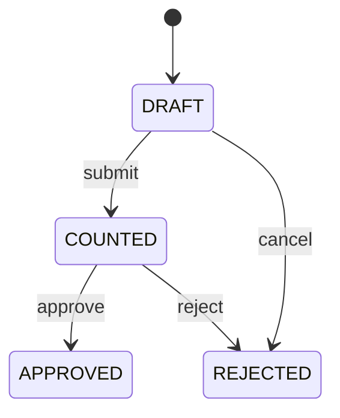
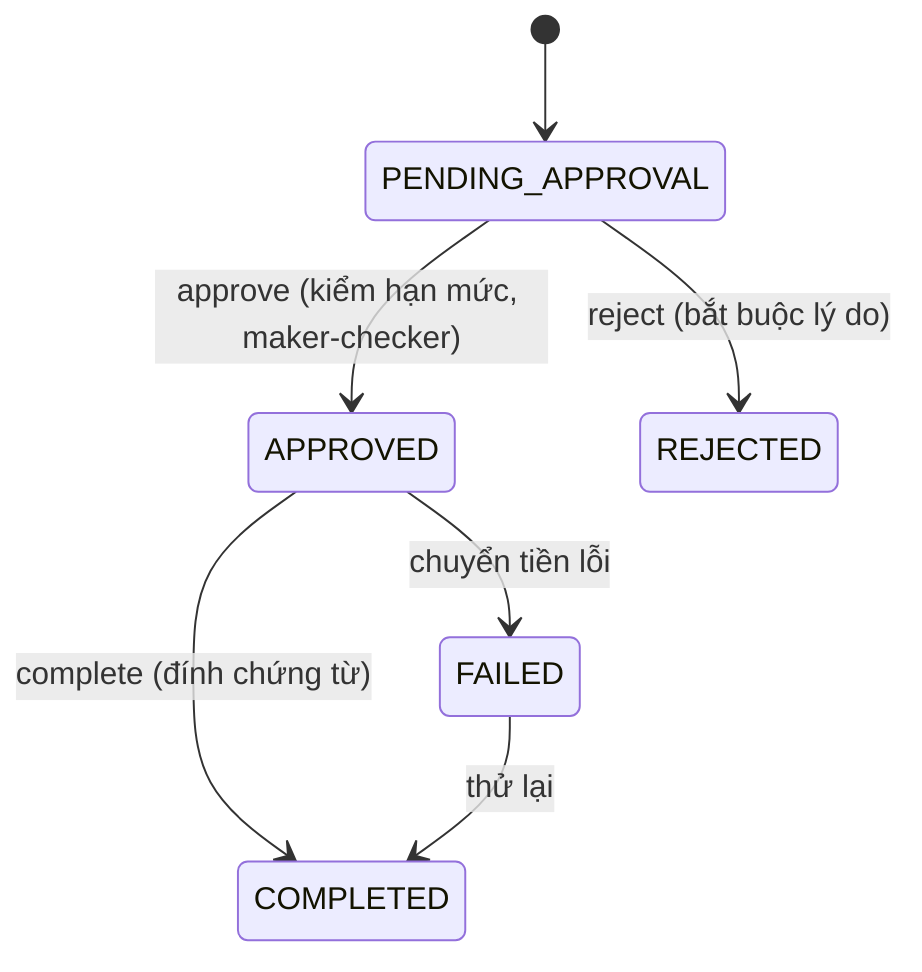

# PROJECT SUMMARY - DUNA MEN'S FASHION (PHÂN HỆ QUẢN TRỊ - ADMIN PORTAL)

Tài liệu này mô tả chi tiết toàn bộ kiến trúc, cơ sở dữ liệu, đặc tả API, quy tắc nghiệp vụ, validate, thông báo lỗi và kịch bản kiểm thử của **Phân hệ Quản trị bán hàng (Admin Portal)** thuộc dự án **DUNA Men's Fashion**. Tài liệu phục vụ trực tiếp cho việc viết Test Design, Test Report, Validate và phát triển Backend/Frontend khi không truy cập trực tiếp vào source code hoặc thông tin nhạy cảm.

---

## 📌 BẢNG TIẾN ĐỘ NÂNG CẤP (v2) — ĐỌC PHẦN NÀY TRƯỚC

> **Cập nhật gần nhất:** 03/11/2026 · **Phiên làm việc:** 2 (Triển khai Code M0–M7)
> **Mục tiêu:** rà soát toàn bộ tài liệu v1, sửa lỗi/mâu thuẫn, bổ sung phần còn thiếu để Backend, Frontend và QA dùng được ngay mà không phải đoán; triển khai code theo lộ trình M0–M7.

### Hướng dẫn cho AI / người tiếp quản (bắt buộc làm theo)

1. Tìm dòng **🔄 ĐANG LÀM** hoặc dòng **⬜** đầu tiên trong bảng tiến độ → làm tiếp từ đó.
2. **Không viết lại** phần đã ✅. Chỉ sửa khi phát hiện lỗi và phải ghi vào *Nhật ký thay đổi*.
3. Mỗi lần xong một hạng mục: đổi trạng thái trong bảng + thêm 1 dòng vào *Nhật ký*. Nếu sắp hết token mà chưa xong: ghi rõ **đã viết đến mục nào** vào cột "Ghi chú".
4. Quy ước thẻ: `[SỬA v2]` = sửa nội dung v1 · `[MỚI v2]` = thêm mới · `[ĐỀ XUẤT]` = thiết kế do bổ sung, cần chủ dự án duyệt · `CẦN XÁC NHẬN` = chưa chốt, đang dùng giả định mặc định.
5. Giữ văn phong tiếng Việt có dấu, bảng Markdown (ký tự `|` trong ô bảng phải viết `\|`), mã lỗi/thông báo lỗi viết trong dấu nháy kép.

### Trạng thái: ✅ Xong · 🔄 Đang làm · ⬜ Chưa làm

| Mã | Hạng mục | Vị trí trong tài liệu | Trạng thái | Ghi chú |
| ----- | ----- | ----- | ----- | ----- |
| **WP0** | Rà soát v1 & lập báo cáo lỗi | Chương 0 (ngay bên dưới) | ✅ Xong | 40 phát hiện (E-01 → E-40) |
| **WP1** | Sửa lỗi trực tiếp trong §1–§6 (thẻ `[SỬA v2]`) | §1, §2, §3, §5, §6 | ✅ Xong | 21 chỗ sửa (E-01→E-07, E-09, E-11→E-14, E-17, E-28) |
| **WP2** | Quy ước API chung, mã lỗi, Idempotency, định nghĩa Invariants còn thiếu | §7 | ✅ Xong | §7.1–§7.5 hoàn tất (31 mã lỗi, INV-05/10/11/16/18/19–22) |
| **WP3** | Schema bổ sung (bảng thiếu, cột thiếu, index, extension) | §8 | ✅ Xong | §8.1–§8.4: 17 bảng mới, 16 dòng cột bổ sung, index, quy tắc Prisma/migration |
| **WP4** | Ma trận phân quyền RBAC đầy đủ | §9 | ✅ Xong | §9.1–§9.5: 58 chức năng × 6 vai trò (+ seed role_permissions sinh tự động ở §9.5), bảng chuyển trạng thái theo vai trò, che dữ liệu |
| **WP5** | Máy trạng thái 3 trục đầy đủ + quy tắc liên trục | §10 | ✅ Xong | §10.1–§10.5: sơ đồ fulfillment, bảng payment & return, 8 quy tắc liên trục CR-01→08, ngoại lệ POS |
| **WP6a** | Đặc tả bổ sung: Auth & Nhân viên | §11.1 | ✅ Xong | §11.1.1–11.1.5: 11 endpoint auth, xoay vòng refresh, chính sách 2FA, 7 endpoint nhân viên |
| **WP6b** | Đặc tả bổ sung: Danh mục & Sản phẩm | §11.2 | ✅ Xong | §11.2.1–11.2.5: danh mục (reorder, đổi cha), 9 endpoint sản phẩm, quy tắc PUT variants/SKU/giá/ACTIVE, ảnh, import/export |
| **WP6c** | Đặc tả bổ sung: Kho, Nhập hàng, Kiểm kê | §11.3 | ✅ Xong | §11.3.1–11.3.4: tồn/sổ cái/chuyển tình trạng, NCC, vòng đời PO (CONFIRMED khóa giá), luồng kiểm kê (blind count, 1 phiếu mở/biến thể) |
| **WP6d** | Đặc tả bổ sung: Đơn hàng, Thanh toán, Vận chuyển | §11.4 | ✅ Xong | §11.4.1–11.4.6: 9 endpoint đơn, thuật toán tạo đơn 10 bước, hàm tính tiền duy nhất + phí ship, sửa đơn, webhook thanh toán 7 bước, hàng hoàn, in ấn |
| **WP6e** | Đặc tả bổ sung: Trả hàng, Hoàn tiền | §11.5 | ✅ Xong | §11.5.1–11.5.5: tách receive/inspect, hạn đổi trả, đổi hàng MVP (đơn con), số tiền hoàn theo lỗi, luồng refund đầy đủ |
| **WP6f** | Đặc tả bổ sung: Khách hàng, Voucher | §11.6 | ✅ Xong | §11.6.1–11.6.5: 9 endpoint CRM, phân hạng, gộp hồ sơ (merged_into_id), voucher: bảng validate, 7 bước kiểm tra, advisory lock per-customer |
| **WP6g** | Đặc tả bổ sung: Báo cáo, Đối soát COD, Chi phí | §11.7 | ✅ Xong | §11.7.1–11.7.5: 6 KPI định nghĩa, cảnh báo đỏ, chi phí + khóa sổ, đối soát COD từng vận đơn, đối soát cổng |
| **WP6h** | Đặc tả bổ sung: Cấu hình hệ thống, Thông báo, Job nền | §11.8 | ✅ Xong | §11.8.1–11.8.4: 29 khóa cấu hình, thông báo, 8 job nền, audit log |
| **WP7** | Kịch bản kiểm thử bổ sung (TC-ADM-13 → TC-ADM-49) | §12 | ✅ Xong | 37 test TC-ADM-13 → 49 (auth, state machine, kho, webhook, COD, trả/hoàn, voucher, VAT, P&L có số liệu cụ thể, bảo mật) |
| **WP8a** | Yêu cầu phi chức năng, bảo mật, vận hành | §13 | ✅ Xong | §13.1–13.7: hiệu năng, checklist bảo mật, PDPL/HĐĐT, backup RPO/RTO, quan sát, CI/CD + DoD, runbook |
| **WP8b** | Màn hình & chuẩn UI bổ sung | §14 | ✅ Xong | §14.1–14.4: chuẩn UI chung, bảng nhãn/màu 3 trục, 18 màn hình bổ sung, quy tắc UX luồng nhạy cảm |
| **WP8c** | Lộ trình MVP/Phase & danh sách câu hỏi cần xác nhận | §15 | ✅ Xong | §15.1–15.4: 8 mốc M0–M7 gắn test, backlog Phase 2, 14 quyết định thiết kế, 24 câu hỏi xác nhận |
| **WP9** | Rà soát chéo cuối (đánh số, tham chiếu chéo, bảng Markdown) | Toàn bộ | ✅ Xong | Đã kiểm tự động: 0 bảng lệch cột, 16 khối code cân bằng, TC-01→49 đủ, §-ref khớp. Còn việc sâu hơn ở WP10–WP13 |
| **WP10** | Mục lục API tổng hợp (method, path, permission, Idempotency, mã lỗi) để sinh OpenAPI | Phụ lục A (chưa tạo) | ⬜ Chưa làm | Gom từ §3 và §11; kiểm tra mỗi endpoint đã có permission ở §9.5 |
| **WP11** | Đọc lại lần 2 toàn bộ §3 gốc (3.3.x, 3.5.3, 3.7…) để bắt lỗi nhỏ còn sót và đối chiếu với §10–§11 | §3 | ⬜ Chưa làm | WP1 chủ yếu sửa lỗi nghiêm trọng; chưa soi từng câu chữ nhỏ |
| **WP12** | Render thử các sơ đồ Mermaid (§8.5, §10.2, §11.3.3, §11.3.4, §11.5.5) và rà văn phong | Toàn bộ | ⬜ Chưa làm | Cần công cụ render Markdown |
| **WP13** | Chốt các câu hỏi §15.4 với chủ dự án/kế toán/pháp lý, rồi cập nhật các giả định tương ứng | §15.4 | ⬜ Cần người quyết định | Chặn M0–M3: Q-01→Q-04, Q-13, Q-18→Q-24 |

### Tiến độ triển khai mã nguồn Backend & Core Invariants (M0–M7 theo §15.1)

| Mốc | Tên mốc & Phạm vi | Phần tài liệu liên quan | Trạng thái | Test phải qua | Ghi chú (đã làm đến đâu / còn thiếu gì) |
| ----- | ----- | ----- | ----- | ----- | ----- |
| **M0** | **Nền tảng (Platform Foundation)** | §2, §7, §8, §9, §11.1, §11.8.1, §13 | ✅ Xong | `TC-ADM-04`, `13`–`19`, `42`, `45`, `46` (11/11 tests pass) | **Đã hoàn thành 100%:** Hạ tầng NestJS Modular Monolith, PostgreSQL 18, Redis 8, Prisma + migration SQL tay (`f_unaccent`, partial index `idx_employee_sessions_active`, CHECK constraints, trigger `trg_audit_logs_immutable` bảo vệ INV-07). Seed đầy đủ 6 roles, 66 permissions, ma trận phân quyền §9.5, kho WH-MAIN, 30 keys cấu hình §11.8.1. Auth bảo mật cao: Argon2id chống dò tài khoản median < 50ms (TC-14), 2FA TOTP AES-256-GCM replay prevention RFC 6238 (TC-15), refresh rotation revoke cả họ token (TC-16), thu hồi phiên từ xa qua Redis blacklist (TC-17), khóa 5 lần thử (TC-13), chặn sửa OWNER/ADMIN và bảo vệ OWNER cuối (TC-18), vô hiệu hóa nhân viên & buộc đổi mật khẩu (TC-19). RBAC deny-by-default (TC-04). Idempotency DB phân lập per-(employee, endpoint, key) chuẩn INV-04 (TC-42). DTO whitelist chống mass assignment INV-16 (TC-45). Rate limit sliding window Redis (TC-46). Đã kiểm thử xanh toàn bộ 11 test suites trên DB/Redis thật. |
| **M1** | **Danh mục & Sản phẩm** | §3.3, §11.2 | ⬜ Chưa làm | `TC-ADM-11`, `12`, `40`, `41`, `43` | Sẵn sàng triển khai tiếp: Danh mục (cây phân cấp, reorder, đổi cha), Sản phẩm & biến thể (PUT không xóa SKU, SKU bất biến INV-17, giá hiệu lực, điều kiện ACTIVE INV-12), kiểm tra magic bytes ảnh INV-18, import/export CSV chống CSV injection INV-15. |
| **M2** | **Kho** | §3.4, §11.3, §6.1 | ⬜ Chưa làm | `TC-ADM-01` (phần giá vốn), `24`–`28` | Tồn kho đa tình trạng (INV-01), sổ cái 2 biến động (D-01), NCC, PO (CONFIRMED khóa giá D-07), kiểm kê delta (D-02, INV-08), đối chiếu sổ cái. |
| **M3** | **Đơn hàng, Voucher, Khách hàng** | §3.5–§3.7, §10, §11.4 (trừ webhook), §11.6 | ⬜ Chưa làm | `TC-ADM-02`, `03`, `09`, `20`–`23`, `34`, `36`, `47` | Báo giá & tính tiền (D-03), tạo đơn 10 bước, giữ hàng nguyên tử 200 req đồng thời (INV-03), máy trạng thái (INV-06), voucher 7 bước advisory lock, CRM. |
| **M4** | **Thanh toán, Vận chuyển, COD** | §11.4.5–11.4.6, §11.7.4–11.7.5 | ⬜ Chưa làm | `TC-ADM-07`, `29`, `30`, `31`, `44` | Webhook thanh toán idempotent + HMAC (INV-19, D-11), xác nhận chuyển khoản, vận đơn, hàng hoàn nhận lại kho (D-08), đối soát COD từng vận đơn (D-05). |
| **M5** | **Trả hàng, Đổi hàng, Hoàn tiền** | §3.5.3, §11.5 | ⬜ Chưa làm | `TC-ADM-08`, `32`, `33`, `35`, `48` | Phiếu trả/đổi (tách receive/inspect), đổi hàng đơn con 0đ (D-09), hoàn tiền maker-checker (INV-21, D-10), hạn mức refund_limit. |
| **M6** | **Báo cáo, Chi phí, Thông báo** | §3.8, §11.7, §11.8 | ⬜ Chưa làm | `TC-ADM-10`, `37`, `49` | Dashboard, 6 KPI doanh thu theo delivered_at (D-04), chi phí + khóa sổ kế toán, cảnh báo, thông báo, 8 cron job nền. |
| **M7** | **Hardening & go-live** | §3.6, §13 | ⬜ Chưa làm | `TC-ADM-05`, `38`, `39`, load test, 49/49 TC | Ẩn danh hóa PII triệt để (INV-11, INV-22), pen-test OWASP ASVS L2, load test k6, diễn tập khôi phục RPO/RTO (D-12). |

### Nhật ký thay đổi

- **02/11/2026 · Phiên 1:** Đọc toàn bộ v1 (≈890 dòng). Tra cứu pháp lý: Luật Bảo vệ dữ liệu cá nhân 91/2025/QH15 có hiệu lực từ 01/01/2026 và Nghị định 356/2025/NĐ-CP thay thế Nghị định 13/2023/NĐ-CP; Nghị định 70/2025/NĐ-CP (hiệu lực 01/06/2025) yêu cầu hóa đơn điện tử khởi tạo từ máy tính tiền với hộ kinh doanh doanh thu từ 1 tỷ đồng/năm. Hoàn thành WP0.
- **02/11/2026 · Phiên 1:** WP1 lô 1 xong — sửa §1 (INV pointer), §2.1 (refund_limit, employees, sessions), §2.2 (tax_rate_pct), §2.3 (stock_transactions + ma trận tx_type, inventory_levels), §2.4 (orders, order_items), §2.5 (idempotency_keys).
- **02/11/2026 · Phiên 1:** WP1 lô 2 xong — sửa §3.1.1 (thứ tự kiểm tra đăng nhập), §3.3.4 (CSV injection), §3.4.1 (giá vốn bình quân), §3.4.2 (kiểm kê), §3.5.2 (con trỏ §10), §3.6 (ẩn danh hóa + căn cứ pháp lý), §3.8 (công thức P&L), §5 (TC-ADM-12), §6.1 (đối chiếu sổ cái).
- **02/11/2026 · Phiên 1:** WP2 xong — §7 (quy ước API, 31 mã lỗi, Idempotency chi tiết, định nghĩa INV-05/10/11/16/18 và INV-19→22). WP1 đánh dấu ✅.
- **02/11/2026 · Phiên 1:** WP3 xong — §8 (payment_transactions, payment_webhook_events, cod_settlement_items, shipping_rate_rules, voucher_redemptions, customer_addresses, size_guides, tags, password_reset_tokens, employee_recovery_codes, import_jobs, notifications, document_sequences, system_settings; cột bổ sung; chỉ mục; quy tắc migration).
- **02/11/2026 · Phiên 1:** WP4 xong — §9 (ma trận RBAC 50 dòng, định nghĩa R/W/A, quy tắc ADMIN không tác động OWNER/ADMIN, quyền chuyển trạng thái, che dữ liệu theo vai trò).
- **02/11/2026 · Phiên 1:** WP5 xong — §10 (máy trạng thái 3 trục đầy đủ, ngoại lệ POS_INSTANT_SALE, giới hạn giao lại, bước xác nhận hàng hoàn, công thức số lượng được trả, CR-01→CR-08).
- **02/11/2026 · Phiên 1:** WP6a xong — §11.1 (auth đầy đủ: 2FA setup/confirm/recovery, refresh rotation + reuse detection, forgot/reset/change password, quản lý nhân viên, bảo vệ OWNER cuối).
- **02/11/2026 · Phiên 1:** WP6b xong — §11.2 (danh mục & sản phẩm: PUT variants không xóa, SKU bất biến, giá hiệu lực, điều kiện ACTIVE, upload ảnh kiểm magic bytes, import preview/commit bằng import_jobs).
- **02/11/2026 · Phiên 1:** WP6c xong — §11.3 (cặp chuyển tình trạng hợp lệ, thiệt hại hàng lỗi, NCC, PO lifecycle với CONFIRMED khóa giá, receive nguyên tử, kiểm kê submit/reject/cancel, hao hụt/thừa kiểm kê).
- **02/11/2026 · Phiên 1:** WP6d xong — §11.4 (quote endpoint, tạo đơn 10 bước, calculateOrderTotals, bảng admin_provinces/admin_wards, POS nullable địa chỉ, sửa đơn, manual-confirm, webhook INV-19, receive-return, in ấn).
- **02/11/2026 · Phiên 1:** Sửa chéo (phát hiện khi viết §11.5): 'Thiệt hại hàng lỗi' chỉ tính lần chuyển SELLABLE→DEFECTIVE để tránh tính 2 lần với hàng trả (§3.4.1, §3.8 mục 9, §11.3.1); thêm vào §8.2 cột products.is_returnable, orders nullable cho POS, bảng admin_provinces/admin_wards.
- **02/11/2026 · Phiên 1:** WP6e xong — §11.5 (trả/đổi/hoàn tiền: tách /receive và /inspect, unit_refund_amount chốt khi tạo phiếu, đổi hàng bằng đơn con doanh thu 0, quy tắc số tiền hoàn theo bên có lỗi, maker-checker, payout_info mã hóa, complete + chứng từ).
- **02/11/2026 · Phiên 1:** WP6f xong — §11.6 (CRM: total_spent dẫn xuất, ngưỡng hạng, khóa COD, merge không hoàn tác; Voucher: validate tạo/sửa, thứ tự 7 bước kiểm tra + thông báo, is_stackable, per-customer atomic, hoàn lượt idempotent).
- **02/11/2026 · Phiên 1:** WP6g xong — §11.7 (6 KPI có công thức, quy tắc kỳ trước & mẫu số 0, bảng cảnh báo đỏ, expenses + accounting_lock_date, đối soát COD theo cod_settlement_items, công nợ COD, đối soát cổng).
- **02/11/2026 · Phiên 1:** WP6h xong — §11.8 (bảng 29 khóa cấu hình có ★ nhạy cảm, shipping-rate-rules, sự kiện thông báo, 8 job nền idempotent, audit viewer + partition). Sửa chéo §11.4.2: Telesales chuyển khoản tạo ở PENDING_CONFIRM, tự CONFIRMED khi PAID (khớp CR-01). WP6 hoàn tất.
- **02/11/2026 · Phiên 1:** WP7 xong — §12 (37 kịch bản mới TC-ADM-13→49, có số liệu kiểm tay cho TC-24 giá vốn, TC-36 VAT, TC-37 P&L). Nâng số lượng từ 35 lên 37 (thêm TC-48 đổi size, TC-49 khóa sổ); cập nhật con trỏ ở §5 và bảng tiến độ.
- **02/11/2026 · Phiên 1:** WP8a xong — §13 (mục tiêu hiệu năng, checklist bảo mật 12 nhóm, tuân thủ Luật BVDLCN 91/2025/QH15 + NĐ 356/2025 + NĐ 70/2025, sao lưu/khôi phục, quan sát, CI/CD, Definition of Done, danh mục runbook).
- **02/11/2026 · Phiên 1:** WP8b xong — §14 (chuẩn UI: 4 trạng thái, định dạng VN, WCAG AA, không optimistic update với tiền/tồn; bảng nhãn/màu; 18 màn hình còn thiếu; quy tắc UX tạo đơn/duyệt/export/tablet kho).
- **02/11/2026 · Phiên 1:** WP8c xong — §15 (8 mốc triển khai gắn với test pass, backlog Phase 2, 14 quyết định thiết kế D-01→D-14, 23 câu hỏi cần xác nhận Q-01→Q-23 kèm giả định và hạn chót).
- **02/11/2026 · Phiên 1:** WP9 (đợt 1) — kiểm tra tự động: 0 bảng lệch cột, 14 khối code cân bằng, TC-ADM-01→49 đủ & không trùng, INV-01→22 nhất quán. Sửa: đánh số §6.1–§6.4 cho khớp tham chiếu, §4.10→§4 mục 10, thêm Q-24 (FIFO vs bình quân), cập nhật TC-ADM-07 theo luồng receive-return.
- **02/11/2026 · Phiên 1:** WP9 (đợt 2) — thêm §9.5 (seed role_permissions sinh tự động từ ma trận: OWNER 66, ADMIN 61, MANAGER 51, SALES 14, WAREHOUSE 18, ACCOUNTANT 22 permission) và §8.5 (ERD Mermaid 32 quan hệ). Đính chính: ma trận §9.2 có 58 chức năng (không phải 50).
- **02/11/2026 · Phiên 1:** WP9 xong. Thêm WP10–WP13 (⬜) làm việc nên tiếp theo. **Trạng thái bàn giao:** WP0–WP9 hoàn tất; chưa làm WP10–WP13.
- **03/11/2026 · Phiên 2:** Triển khai code Mốc M0 (Nền tảng — Platform Foundation) hoàn tất 100%. Dựng toàn bộ hạ tầng Backend NestJS Modular Monolith, PostgreSQL 18, Redis 8, Prisma + migration SQL tay (`f_unaccent`, trigger `trg_audit_logs_immutable` bảo vệ INV-07 append-only, partial unique index `idx_employee_sessions_active`, CHECK constraints), seed 6 roles / 66 permissions / warehouse / 30 settings. Triển khai đầy đủ module Auth (Argon2id chống dò tài khoản median < 50ms, 2FA TOTP AES-256-GCM replay protection RFC 6238, refresh rotation revoke cả họ token khi bị tái sử dụng, thu hồi phiên từ xa qua Redis blacklist, khóa sau 5 lần thử, chặn sửa OWNER/ADMIN và bảo vệ OWNER cuối, vô hiệu hóa nhân viên & buộc đổi mật khẩu), RBAC deny-by-default, Idempotency per-(employee, endpoint, key) chuẩn INV-04, Audit log che PII (INV-22), DTO whitelist chống mass assignment (INV-16), Rate limiting sliding window Redis. Toàn bộ 11 test suites E2E (TC-ADM-04, 13–19, 42, 45, 46) chạy xanh 100% trên PostgreSQL và Redis thật. Đã cập nhật bảng tiến độ. Sẵn sàng sang M1.
<!-- LOG-END -->

---

## Chương 0. Báo cáo rà soát v1 → v2

Mức độ: 🔴 Nghiêm trọng (sai tiền / sai tồn kho / hở bảo mật / SQL hoặc logic không chạy được) · 🟠 Quan trọng (thiếu đặc tả khiến dev phải tự đoán) · 🟡 Cải thiện.

| ID | Mức | Vấn đề phát hiện trong v1 | Xử lý tại |
| ----- | ----- | ----- | ----- |
| E-01 | 🔴 | Sổ cái kho: `ORDER_RESERVE`/`ORDER_RELEASE` chỉ đổi `reserved` nhưng `qty_change` cấm bằng 0 và cronjob đối chiếu dùng `Σ qty_change = on_hand` → báo động giả hoặc ghi sai bút toán. | §2.3, §6.1 |
| E-02 | 🔴 | Kiểm kê: so với `on_hand` hiện tại nhưng lại gán tuyệt đối `on_hand = counted_qty` → ghi đè các giao dịch phát sinh giữa lúc đếm và lúc duyệt; không chặn trường hợp thấp hơn `reserved`. | §3.4.2 |
| E-03 | 🔴 | Công thức P&L: thiếu doanh thu phí ship, chưa tách VAT, COGS dùng `returned_qty` hiện tại (lệch kỳ), hàng trả lỗi không có khoản thiệt hại, "Tiền thực nhận" chưa trừ hoàn tiền/phí hãng. | §3.8, §11.7 |
| E-04 | 🔴 | Có webhook thanh toán và đối soát cổng nhưng **không có bảng** giao dịch thanh toán / sự kiện webhook; không có cơ chế chống trùng, kiểm chữ ký, lệch số tiền. | §8, §11.4 |
| E-05 | 🔴 | Chỉ có máy trạng thái trục `fulfillment`; **thiếu trục `payment` và `return`** và các quy tắc liên trục (đơn trả trước chưa PAID không được giao...). | §10 |
| E-06 | 🔴 | Ẩn danh hóa chỉ xử lý `customer_profiles`; PII vẫn nằm trong `orders` (tên, SĐT, địa chỉ) và `audit_logs` (before/after) → không đạt yêu cầu xóa dữ liệu. Căn cứ pháp lý đã đổi. | §3.6, §11.6, §15 |
| E-07 | 🔴 | Đăng nhập: kiểm tra trạng thái tài khoản trước mật khẩu (lộ tồn tại/trạng thái tài khoản); email không tồn tại thì không có bản ghi để tăng `failed_login_count`; thiếu luồng cài 2FA lần đầu, xoay vòng refresh token, quên/đổi mật khẩu. | §3.1, §11.1 |
| E-08 | 🔴 | Bảng được tham chiếu nhưng chưa định nghĩa: `voucher_redemptions`, `size_guides`, `settings`, `customer_addresses`, `tags`, `users`. | §8 |
| E-09 | 🔴 | Invariant `INV-05`, `INV-10`, `INV-11`, `INV-16`, `INV-18` được dẫn chiếu nhưng chưa định nghĩa; đánh số nhảy cóc. | §1, §7.4 |
| E-10 | 🔴 | Không có ma trận phân quyền; ký hiệu `RWA` không được giải nghĩa; chưa nói rõ ADMIN có được tác động ADMIN/OWNER khác (đổi trạng thái, thu hồi phiên) hay không. | §9, §11.1 |
| E-11 | 🔴 | `idempotency_keys` khóa chính chỉ là `key` (đụng nhau giữa nhân viên/endpoint), không xử lý request đồng thời, không so sánh payload. | §2.5, §7.3 |
| E-12 | 🔴 | Dòng `TC-ADM-12` bị hỏng bảng Markdown (ký tự `\|` chưa escape, thiếu cột). | §5 |
| E-13 | 🟠 | `roles.refund_limit` là `NOT NULL DEFAULT 0` nhưng yêu cầu "OWNER/ADMIN không giới hạn" → không biểu diễn được. | §2.1 |
| E-14 | 🟠 | `products.tax_rate_pct`: `CHECK ( BETWEEN 0 AND 100)` thiếu tên cột → SQL lỗi. | §2.2 |
| E-15 | 🟠 | Không rõ giá niêm yết đã gồm VAT chưa → `tax_amount`/`grand_total` mâu thuẫn; thiếu quy tắc làm tròn; thiếu phân bổ giảm giá theo dòng (cần để hoàn tiền từng phần). | §2.4, §11.4 |
| E-16 | 🟠 | `orders` thiếu mốc thời gian (`confirmed_at`, `shipped_at`, `delivered_at`, `cancelled_at`) dù báo cáo doanh thu và hạn đổi trả cần. | §2.4 |
| E-17 | 🟠 | Giá vốn bình quân: chưa nói `OnHand` gồm kho/tình trạng nào; hàng trả về và hàng lỗi ảnh hưởng giá vốn ra sao. | §3.4.1 |
| E-18 | 🟠 | PO: thiếu endpoint tạo/xác nhận/hủy; WAREHOUSE nhận hàng nhưng không có quyền xem giá → cần khóa giá khi xác nhận PO. | §11.3 |
| E-19 | 🟠 | Giao thất bại: thiếu bước "xác nhận đã nhận hàng hoàn" trước khi hủy đơn; chưa có giới hạn số lần giao lại. | §10, §11.4 |
| E-20 | 🟠 | Trả hàng: một đơn có thể có nhiều phiếu trả nhưng `orders.return_status` chỉ có 1 giá trị; đổi size chưa xử lý chênh lệch giá/tồn; chưa rõ ai duyệt phiếu trả. | §10, §11.5 |
| E-21 | 🟠 | Hoàn tiền: thiếu bước `COMPLETED` (chuyển tiền thực), maker-checker, giới hạn "≤ đã thu − đã hoàn", quy tắc chọn phương thức. | §11.5 |
| E-22 | 🟠 | COD: thiếu `cod_settlement_items` (đối soát từng vận đơn); `payment_status` của đơn COD mơ hồ. | §8, §10, §11.7 |
| E-23 | 🟠 | Voucher: thiếu thông báo lỗi; công thức PERCENT/FIXED/FREE_SHIP chưa chặt; `is_stackable` mơ hồ; `per_customer_limit` chưa có cơ chế atomic; chưa chặn sửa điều khoản sau khi đã dùng. | §8, §11.6 |
| E-24 | 🟠 | Phí ship "tự động tính" nhưng không có bảng quy tắc; chưa nói `store_shipping_cost` cập nhật khi nào. | §8, §11.4 |
| E-25 | 🟠 | Chuyển trạng thái đơn đồng thời (2 nhân viên cùng bấm) chưa có khóa lạc quan; đơn nhiều dòng có nguy cơ deadlock do thứ tự khóa. | §7.4, §11.4 |
| E-26 | 🟠 | Có cấu hình "thời gian giữ hàng" nhưng không có job nhả hàng khi đơn online chưa thanh toán quá hạn. | §11.8 |
| E-27 | 🟠 | Sản phẩm: `PUT` mà biến thể bị bỏ khỏi mảng thì sao; đổi SKU sau khi có giao dịch; điều kiện chuyển `ACTIVE`; thiếu endpoint/thông báo xóa sản phẩm. Danh mục: đổi cha có thể làm cây vượt 3 cấp. | §11.2 |
| E-28 | 🟠 | Chống CSV Injection: tiền tố `'` áp cho mọi chuỗi bắt đầu bằng `-` sẽ biến số âm thành văn bản → chỉ áp cho ô kiểu chuỗi. | §3.3.4, §5 |
| E-29 | 🟠 | Import: thiếu giới hạn dung lượng/số dòng, cách liên kết preview ↔ commit, quy tắc tạo mới hay cập nhật theo SKU. | §11.2 |
| E-30 | 🟠 | Che dữ liệu chưa áp cho export/tìm kiếm/audit; `cost_price` và `unit_cost_snap` cần ẩn với SALES/WAREHOUSE; audit before/after có thể chứa secret/PII. | §7.4, §9 |
| E-31 | 🟠 | Phiên: ADMIN có thể thu hồi phiên của OWNER; thiếu API liệt kê phiên; chưa nêu nơi lưu access token, CSRF cho endpoint dùng cookie. | §11.1 |
| E-32 | 🟠 | Khách hàng: thiếu ngưỡng hạng, job tính lại hạng, mở khóa COD thủ công, API gộp hồ sơ, trừ chi tiêu khi hoàn tiền. | §11.6 |
| E-33 | 🟠 | Pháp lý: Nghị định 13/2023 đã bị thay thế (Luật 91/2025/QH15 + Nghị định 356/2025/NĐ-CP, hiệu lực 01/01/2026); thiếu mục hóa đơn điện tử cho kênh POS. | §3.6, §15 |
| E-34 | 🟡 | Thiếu quy ước API chung: phân trang, định dạng lỗi, mã lỗi máy đọc được, rate limit, CORS. | §7 |
| E-35 | 🟡 | Thiếu phi chức năng: backup/RPO/RTO, logging, giám sát, security header, mã hóa TOTP secret, chỉ mục DB, tìm không dấu (`unaccent`, `pg_trgm`); Prisma không hỗ trợ `CHECK`/partial index → phải viết migration SQL. | §8, §13 |
| E-36 | 🟡 | UI thiếu màn hình: quên mật khẩu, cài 2FA, hồ sơ/bảo mật, hàng đợi duyệt hoàn tiền, chi tiết PO/Return/COD, log webhook, thông báo, mẫu in; thiếu trạng thái loading/empty/error. | §14 |
| E-37 | 🟡 | Chỉ có 12 kịch bản test; thiếu auth, máy trạng thái, thanh toán, COD, trả hàng, báo cáo, bảo mật upload/import. | §12 |
| E-38 | 🟡 | Thông báo/email chỉ nhắc ở kiến trúc, không có danh sách sự kiện. | §11.8 |
| E-39 | 🟡 | `expenses`: chi phí lương cần hạn chế xem; xóa mềm cần lý do; `SHIPPING_SUBSIDY` dễ trùng `store_shipping_cost` (đếm 2 lần). | §9, §11.7 |
| E-40 | 🟡 | Chưa có lộ trình MVP/Phase và danh sách câu hỏi mở tập trung. | §15 |

---


## 1. Tổng quan hệ thống Quản trị

* **Tên ứng dụng**: DUNA Men's Fashion – Admin & Backoffice System.

* **Mục đích**: Hệ thống quản trị thương mại điện tử và bán lẻ thời trang nam toàn diện, bao gồm: xác thực & bảo mật 2 lớp (2FA), phân quyền RBAC 6 cấp, quản lý danh mục, sản phẩm & biến thể (Size × Màu), quản lý kho & sổ cái tồn kho (Stock Ledger), nhập hàng & nhà cung cấp, kiểm kê kho, xử lý đơn hàng đa kênh (Website/Telesales/POS) theo 3 trục trạng thái, quản lý đổi trả & hoàn tiền, quản lý khách hàng (CRM & chống bom hàng COD), khuyến mãi (Voucher), quản lý chi phí, báo cáo tài chính/đối soát, cấu hình hệ thống và nhật ký kiểm toán (Audit Log).

* **Công nghệ & Kiến trúc**:

  * **Kiến trúc**: Modular Monolith, Admin Portal chạy trên subdomain độc lập (ví dụ: `admin.duna.vn`), giao tiếp với Backend qua RESTful API `/api/v1/admin/*`.

  * **Backend**: NestJS (Node.js / TypeScript), xác thực JWT (Access Token ngắn hạn + Refresh Token xoay vòng lưu trong `httpOnly` Cookie) kết hợp TOTP (2FA).

  * **Database**: PostgreSQL + Prisma ORM (kết hợp Raw SQL có khóa dòng `SELECT ... FOR UPDATE` cho các giao dịch kho, tiền và voucher).

  * **Frontend**: Next.js (App Router, TypeScript, Tailwind CSS), thiết kế theo chuẩn Professional SaaS Dashboard / Premium Minimalism, hỗ trợ responsive từ `360px` (điện thoại) đến `768px` (máy tính bảng kiểm kho) và `1440px+` (màn hình quản trị).

  * **Hạ tầng phụ trợ**: Redis (Rate limiting, Session blacklist, BullMQ queue gửi email/thông báo), S3/Cloudinary (lưu trữ ảnh sản phẩm & chứng từ), Docker Compose.

* **Các Bất biến Kỹ thuật (Technical Invariants) áp dụng trong Admin**:

  * `INV-01` (Tiền tệ): Lưu VND bằng số nguyên `BIGINT` (đơn vị: đồng). Tuyệt đối không dùng `FLOAT`/`DOUBLE`. Thứ tự tính toán cố định: `Tổng tiền hàng (Subtotal) -> Trừ Giảm giá/Voucher -> Cộng Phí vận chuyển -> Tính Thuế VAT (nếu tách riêng) -> Tổng thanh toán (Grand Total)`.

  * `INV-02` (Server là nguồn sự thật): Mọi phép tính tiền, giá vốn, thuế, phí ship, điều kiện voucher trên đơn tạo nội bộ (POS/Telesales) đều do Server tính lại từ DB. Bỏ qua mọi số tiền do Client tự tính gửi lên.

  * `INV-03` (Tồn kho): Mỗi biến thể có `on_hand` (tồn thực tế), `reserved` (đang giữ cho đơn chờ), `available = on_hand - reserved` (khả dụng). Mọi biến động phải ghi vào sổ cái `stock_transactions` (chỉ thêm - append-only).

  * `INV-04` (Idempotency): Các thao tác nhạy cảm (tạo đơn, nhập kho, duyệt kiểm kê, hoàn tiền, áp voucher) bắt buộc truyền header `Idempotency-Key` để chống gửi lặp request.

  * `INV-06` (Máy trạng thái): Đơn hàng vận hành trên 3 trục độc lập (`fulfillment_status`, `payment_status`, `return_status`). Mọi chuyển đổi trái bảng quy tắc đều bị chặn ở tầng Backend.

  * `INV-07` (Không xóa cứng): Tuyệt đối không `DELETE` vật lý đối với đơn hàng, giao dịch kho, thanh toán, khách hàng đã mua hoặc nhân viên đã từng thao tác.

  * `INV-08` & `INV-09` (Phân quyền & Nhật ký): Deny-by-default. Kiểm tra permission tại từng API. Ghi `audit_logs` (kèm dữ liệu `before`/`after`) trong cùng Database Transaction với thao tác nghiệp vụ.

  * `INV-14` (Thời gian): Lưu `TIMESTAMPTZ` (UTC) trong DB; mọi bộ lọc báo cáo và hiển thị quy đổi về múi giờ `Asia/Ho_Chi_Minh` (`UTC+7`).

  * **[SỬA v2]** `INV-05`, `INV-10`, `INV-11`, `INV-16`, `INV-18` được tài liệu gốc dẫn chiếu nhưng chưa định nghĩa → đã định nghĩa tại **§7.4**. Bổ sung `INV-19` → `INV-22` (webhook an toàn & idempotent, khóa lạc quan, tách quyền người lập/người duyệt, che PII trong nhật ký). Các số `INV-12`, `INV-13`, `INV-15`, `INV-17` **để trống** (có thể thuộc phân hệ Storefront) — không tự ý sử dụng.

* **Vai trò và điều hướng sau đăng nhập**:

  * `OWNER` / `ADMIN` / `MANAGER`: Điều hướng mặc định về `/admin/dashboard`.

  * `SALES`: Điều hướng mặc định về `/admin/orders`.

  * `WAREHOUSE`: Điều hướng mặc định về `/admin/inventory`.

  * `ACCOUNTANT`: Điều hướng mặc định về `/admin/reports/finance`.

## 2. Cơ sở dữ liệu chi tiết (Database Schema - Phân hệ Quản trị)

Database: `duna_commerce` (PostgreSQL). Mọi bảng đều có `created_at TIMESTAMPTZ NOT NULL DEFAULT NOW()` và `updated_at TIMESTAMPTZ NOT NULL DEFAULT NOW()`.

### 2.1. Nhóm bảng Phân quyền & Nhân sự

#### `roles` (Vai trò hệ thống)

| Cột | Kiểu dữ liệu | Ràng buộc | Mô tả | 
| ----- | ----- | ----- | ----- | 
| `id` | `SERIAL` | `PK` | ID vai trò | 
| `code` | `VARCHAR(30)` | `NOT NULL, UNIQUE` | Mã: `OWNER`, `ADMIN`, `MANAGER`, `SALES`, `WAREHOUSE`, `ACCOUNTANT` | 
| `name` | `VARCHAR(100)` | `NOT NULL` | Tên hiển thị tiếng Việt | 
| `refund_limit` | `BIGINT` | `NULL, CHECK (refund_limit IS NULL OR refund_limit >= 0)` | **[SỬA v2]** Hạn mức được phép duyệt hoàn tiền (VND) cho **mỗi phiếu hoàn**. `NULL` = không giới hạn (`OWNER`/`ADMIN`); `0` = không được duyệt; `> 0` áp dụng cho `MANAGER` (chỉnh trong §Cài đặt, chỉ `OWNER` được sửa) | 

#### `permissions` & `role_permissions` (Quyền hạn chi tiết)

| Cột | Kiểu dữ liệu | Ràng buộc | Mô tả | 
| ----- | ----- | ----- | ----- | 
| `id` | `SERIAL` | `PK` | ID quyền | 
| `code` | `VARCHAR(100)` | `NOT NULL, UNIQUE` | Ví dụ: `product.read`, `product.write`, `cost_price.read`, `stock_count.approve` | 
| `module` | `VARCHAR(50)` | `NOT NULL` | Phân hệ: `PRODUCT`, `INVENTORY`, `ORDER`, `CUSTOMER`, `VOUCHER`, `FINANCE`, `SYSTEM` | 

#### `employees` (Nhân viên quản trị)

| Cột | Kiểu dữ liệu | Ràng buộc | Mô tả | 
| ----- | ----- | ----- | ----- | 
| `id` | `BIGSERIAL` | `PK` | ID nhân viên | 
| `employee_code` | `VARCHAR(20)` | `NOT NULL, UNIQUE` | Mã nhân viên tự sinh (VD: `EMP-0001`) | 
| `email` | `VARCHAR(150)` | `NOT NULL, UNIQUE` | Email đăng nhập | 
| `password_hash` | `VARCHAR(255)` | `NOT NULL` | Mật khẩu băm bằng `argon2id` (hoặc `bcrypt` cost >= 12) | 
| `full_name` | `VARCHAR(120)` | `NOT NULL` | Họ và tên đầy đủ (1 ô duy nhất theo chuẩn VN) | 
| `phone` | `VARCHAR(15)` | `NOT NULL, UNIQUE` | SĐT chuẩn hóa `0xxxxxxxxx` | 
| `role_id` | `INT` | `NOT NULL, FK -> roles(id)` | Vai trò hiện tại | 
| `status` | `VARCHAR(20)` | `NOT NULL, DEFAULT 'ACTIVE'` | `ACTIVE` (Đang làm việc), `LOCKED` (Khóa tạm), `DISABLED` (Nghỉ việc) | 
| `is_2fa_enabled` | `BOOLEAN` | `NOT NULL, DEFAULT FALSE` | Bắt buộc `TRUE` đối với `OWNER` và `ADMIN` | 
| `totp_secret` | `VARCHAR(255)` | `NULL` | Chuỗi bí mật TOTP đã mã hóa | 
| `failed_login_count` | `INT` | `NOT NULL, DEFAULT 0` | Số lần đăng nhập sai liên tiếp | 
| `locked_until` | `TIMESTAMPTZ` | `NULL` | Thời điểm mở khóa tự động khi nhập sai quá 5 lần | 
| `disabled_reason` | `TEXT` | `NULL` | Lý do khóa hoặc cho nghỉ việc | 
| `must_change_password` | `BOOLEAN` | `NOT NULL, DEFAULT TRUE` | **[MỚI v2]** Buộc đổi mật khẩu ở lần đăng nhập đầu hoặc sau khi được reset |
| `password_changed_at` | `TIMESTAMPTZ` | `NULL` | Lần đổi mật khẩu gần nhất (token phát hành trước mốc này bị vô hiệu) |
| `last_login_at` | `TIMESTAMPTZ` | `NULL` | Lần đăng nhập thành công gần nhất |
| `last_totp_step` | `BIGINT` | `NULL` | Bước thời gian 30s của mã TOTP đã dùng gần nhất — chống dùng lại mã (replay) |

#### `employee_sessions` (Quản lý phiên đăng nhập)

| Cột | Kiểu dữ liệu | Ràng buộc | Mô tả | 
| ----- | ----- | ----- | ----- | 
| `id` | `UUID` | `PK` | Session ID | 
| `employee_id` | `BIGINT` | `NOT NULL, FK -> employees(id)` | Nhân viên sở hữu phiên | 
| `refresh_token_hash` | `VARCHAR(255)` | `NOT NULL` | Hash của Refresh Token | 
| `ip_address` | `VARCHAR(45)` | `NOT NULL` | Địa chỉ IP đăng nhập | 
| `user_agent` | `TEXT` | `NULL` | Thiết bị / Trình duyệt | 
| `expires_at` | `TIMESTAMPTZ` | `NOT NULL` | Thời hạn phiên | 
| `revoked_at` | `TIMESTAMPTZ` | `NULL` | Thời điểm bị đăng xuất từ xa / thu hồi | 
| `family_id` | `UUID` | `NOT NULL` | **[MỚI v2]** Nhóm refresh token cùng một chuỗi xoay vòng; phát hiện dùng lại token cũ thì thu hồi cả nhóm |
| `last_used_at` | `TIMESTAMPTZ` | `NOT NULL` | Lần dùng gần nhất — phục vụ hết hạn do không hoạt động (idle timeout) |
| `revoke_reason` | `VARCHAR(30)` | `NULL` | `LOGOUT`, `REMOTE_REVOKE`, `EMPLOYEE_DISABLED`, `PASSWORD_CHANGED`, `TOKEN_REUSE` |

### 2.2. Nhóm bảng Danh mục, Sản phẩm & Biến thể

#### `categories` (Danh mục sản phẩm)

| Cột | Kiểu dữ liệu | Ràng buộc | Mô tả | 
| ----- | ----- | ----- | ----- | 
| `id` | `SERIAL` | `PK` | ID danh mục | 
| `parent_id` | `INT` | `NULL, FK -> categories(id) ON DELETE RESTRICT` | Danh mục cha (tối đa 3 cấp) | 
| `name` | `VARCHAR(120)` | `NOT NULL` | Tên danh mục (Áo thun, Áo polo, Quần tây...) | 
| `slug` | `VARCHAR(150)` | `NOT NULL, UNIQUE` | Đường dẫn tĩnh không dấu (VD: `ao-polo-nam`) | 
| `level` | `SMALLINT` | `NOT NULL, DEFAULT 1, CHECK (level BETWEEN 1 AND 3)` | Cấp danh mục (1, 2, 3) | 
| `sort_order` | `INT` | `NOT NULL, DEFAULT 0` | Thứ tự hiển thị | 
| `is_visible` | `BOOLEAN` | `NOT NULL, DEFAULT TRUE` | Hiển thị hay ẩn trên Storefront | 
| `seo_title` | `VARCHAR(70)` | `NULL` | Tiêu đề SEO | 
| `seo_description` | `VARCHAR(160)` | `NULL` | Mô tả SEO | 

#### `products` (Sản phẩm gốc)

| Cột | Kiểu dữ liệu | Ràng buộc | Mô tả | 
| ----- | ----- | ----- | ----- | 
| `id` | `BIGSERIAL` | `PK` | ID sản phẩm | 
| `product_code` | `VARCHAR(30)` | `NOT NULL, UNIQUE` | Mã sản phẩm (VD: `DN-POLO-001`) | 
| `name` | `VARCHAR(255)` | `NOT NULL` | Tên sản phẩm | 
| `slug` | `VARCHAR(280)` | `NOT NULL, UNIQUE` | Slug không dấu | 
| `category_id` | `INT` | `NOT NULL, FK -> categories(id) ON DELETE RESTRICT` | Danh mục chính | 
| `brand` | `VARCHAR(100)` | `NOT NULL, DEFAULT 'DUNA'` | Thương hiệu | 
| `material` | `VARCHAR(200)` | `NULL` | Chất liệu (VD: `95% Cotton Compact, 5% Spandex`) | 
| `care_instructions` | `TEXT` | `NULL` | Hướng dẫn giặt & bảo quản | 
| `description` | `TEXT` | `NULL` | Mô tả chi tiết (đã qua HTML Sanitizer) | 
| `size_guide_id` | `INT` | `NULL, FK -> size_guides(id)` | Bảng quy đổi kích cỡ | 
| `status` | `VARCHAR(20)` | `NOT NULL, DEFAULT 'DRAFT'` | `DRAFT`, `ACTIVE`, `HIDDEN`, `DISCONTINUED` | 
| `tax_rate_pct` | `SMALLINT` | `NOT NULL, DEFAULT 8, CHECK (tax_rate_pct BETWEEN 0 AND 100)` | Thuế suất VAT (%). **[SỬA v2]** Đã sửa lỗi SQL thiếu tên cột. Giá trị mặc định khi tạo mới lấy từ cấu hình `default_tax_rate_pct` (§11.8) thay vì hard-code 8; thuế suất phải đổi được theo chính sách (**CẦN XÁC NHẬN KẾ TOÁN**) | 
| `seo_title` | `VARCHAR(70)` | `NULL` | Tiêu đề SEO | 
| `seo_description` | `VARCHAR(160)` | `NULL` | Mô tả SEO | 
| `deleted_at` | `TIMESTAMPTZ` | `NULL` | Soft delete (chỉ cho phép khi chưa có giao dịch) | 

#### `product_variants` (Biến thể Size × Màu)

| Cột | Kiểu dữ liệu | Ràng buộc | Mô tả | 
| ----- | ----- | ----- | ----- | 
| `id` | `BIGSERIAL` | `PK` | ID biến thể | 
| `product_id` | `BIGINT` | `NOT NULL, FK -> products(id) ON DELETE RESTRICT` | Sản phẩm gốc | 
| `sku` | `VARCHAR(50)` | `NOT NULL, UNIQUE` | Mã SKU duy nhất (VD: `DN-POLO-001-BLK-L`) | 
| `barcode` | `VARCHAR(50)` | `NULL, UNIQUE` | Mã vạch EAN13 / Code128 | 
| `color_name` | `VARCHAR(50)` | `NOT NULL` | Tên màu (VD: `Đen`, `Trắng`, `Xanh Navy`) | 
| `color_hex` | `VARCHAR(7)` | `NULL` | Mã màu hiển thị (VD: `#000000`) | 
| `size_code` | `VARCHAR(20)` | `NOT NULL` | Kích cỡ (`S`, `M`, `L`, `XL`, `XXL` hoặc `28`–`36`) | 
| `price` | `BIGINT` | `NOT NULL, CHECK (price >= 0)` | Giá niêm yết (VND) | 
| `sale_price` | `BIGINT` | `NULL, CHECK (sale_price >= 0 AND sale_price <= price)` | Giá khuyến mãi (VND) | 
| `sale_start_at` | `TIMESTAMPTZ` | `NULL` | Thời điểm bắt đầu giảm giá | 
| `sale_end_at` | `TIMESTAMPTZ` | `NULL` | Thời điểm kết thúc giảm giá | 
| `cost_price` | `BIGINT` | `NOT NULL, DEFAULT 0, CHECK (cost_price >= 0)` | Giá vốn bình quân gia quyền hiện tại (VND) | 
| `weight_gram` | `INT` | `NOT NULL, DEFAULT 300, CHECK (weight_gram > 0)` | Trọng lượng (gram) để tính phí vận chuyển | 
| `is_active` | `BOOLEAN` | `NOT NULL, DEFAULT TRUE` | Trạng thái kinh doanh của riêng biến thể | 
| *Unique Constraint* |  | `UNIQUE(product_id, color_name, size_code)` | Chống tạo trùng cặp Màu + Size trong cùng 1 sản phẩm | 

#### `product_images` (Hình ảnh sản phẩm)

| Cột | Kiểu dữ liệu | Ràng buộc | Mô tả | 
| ----- | ----- | ----- | ----- | 
| `id` | `BIGSERIAL` | `PK` | ID ảnh | 
| `product_id` | `BIGINT` | `NOT NULL, FK -> products(id) ON DELETE CASCADE` | Sản phẩm | 
| `color_name` | `VARCHAR(50)` | `NULL` | Gán ảnh theo màu sắc cụ thể (NULL là ảnh dùng chung) | 
| `url` | `VARCHAR(500)` | `NOT NULL` | Đường dẫn ảnh WebP/AVIF | 
| `alt_text` | `VARCHAR(255)` | `NOT NULL` | Văn bản thay thế phục vụ SEO/Accessibility | 
| `is_primary` | `BOOLEAN` | `NOT NULL, DEFAULT FALSE` | Ảnh đại diện chính của sản phẩm | 
| `sort_order` | `INT` | `NOT NULL, DEFAULT 0` | Thứ tự sắp xếp | 

#### `price_history` (Lịch sử thay đổi giá)

| Cột | Kiểu dữ liệu | Ràng buộc | Mô tả | 
| ----- | ----- | ----- | ----- | 
| `id` | `BIGSERIAL` | `PK` | ID lịch sử | 
| `variant_id` | `BIGINT` | `NOT NULL, FK -> product_variants(id)` | Biến thể bị đổi giá | 
| `old_price` | `BIGINT` | `NOT NULL` | Giá bán cũ | 
| `new_price` | `BIGINT` | `NOT NULL` | Giá bán mới | 
| `old_sale_price` | `BIGINT` | `NULL` | Giá KM cũ | 
| `new_sale_price` | `BIGINT` | `NULL` | Giá KM mới | 
| `reason` | `VARCHAR(255)` | `NULL` | Lý do điều chỉnh giá | 
| `changed_by` | `BIGINT` | `NOT NULL, FK -> employees(id)` | Nhân viên thực hiện | 

### 2.3. Nhóm bảng Quản lý Kho & Sổ cái (Inventory & Stock Ledger)

#### `stock_locations` (Kho / Chi nhánh)

| Cột | Kiểu dữ liệu | Ràng buộc | Mô tả | 
| ----- | ----- | ----- | ----- | 
| `id` | `SERIAL` | `PK` | ID kho | 
| `code` | `VARCHAR(20)` | `NOT NULL, UNIQUE` | Mã kho (Mặc định: `WH-MAIN`) | 
| `name` | `VARCHAR(100)` | `NOT NULL` | Tên kho hàng | 
| `is_default` | `BOOLEAN` | `NOT NULL, DEFAULT FALSE` | Kho mặc định khi xuất bán | 

#### `inventory_levels` (Mức tồn kho theo biến thể & tình trạng)

| Cột | Kiểu dữ liệu | Ràng buộc | Mô tả | 
| ----- | ----- | ----- | ----- | 
| `id` | `BIGSERIAL` | `PK` | ID bản ghi tồn | 
| `variant_id` | `BIGINT` | `NOT NULL, FK -> product_variants(id) ON DELETE RESTRICT` | Biến thể | 
| `location_id` | `INT` | `NOT NULL, FK -> stock_locations(id) ON DELETE RESTRICT` | Kho lưu trữ | 
| `condition_status` | `VARCHAR(20)` | `NOT NULL, DEFAULT 'SELLABLE'` | `SELLABLE` (Bán được), `INSPECTING` (Chờ kiểm), `DEFECTIVE` (Hỏng/Lỗi) | 
| `on_hand` | `INT` | `NOT NULL, DEFAULT 0, CHECK (on_hand >= 0)` | Số lượng thực tế đang nằm trong kho | 
| `reserved` | `INT` | `NOT NULL, DEFAULT 0, CHECK (reserved >= 0)` | Số lượng đang giữ cho đơn hàng chưa xuất kho | 
| `low_stock_threshold` | `INT` | `NOT NULL, DEFAULT 5, CHECK (low_stock_threshold >= 0)` | Ngưỡng cảnh báo sắp hết hàng riêng cho từng biến thể | 
| *Constraint* |  | `CHECK (on_hand >= reserved)` và `CHECK (condition_status = 'SELLABLE' OR reserved = 0)` | **[SỬA v2]** Bỏ ý "trừ khi bật cấu hình tồn âm" của v1 vì mâu thuẫn với `CHECK (on_hand >= 0)`: **MVP không hỗ trợ bán âm / đặt trước (backorder)**. `reserved` chỉ khác 0 ở tình trạng `SELLABLE` | 
| *Unique* |  | `UNIQUE(variant_id, location_id, condition_status)` | Duy nhất theo Biến thể + Kho + Tình trạng | 

#### `stock_transactions` (Sổ cái giao dịch kho - Append-Only)

| Cột | Kiểu dữ liệu | Ràng buộc | Mô tả | 
| ----- | ----- | ----- | ----- | 
| `id` | `BIGSERIAL` | `PK` | ID bút toán kho | 
| `variant_id` | `BIGINT` | `NOT NULL, FK -> product_variants(id)` | Biến thể | 
| `location_id` | `INT` | `NOT NULL, FK -> stock_locations(id)` | Kho | 
| `condition_status` | `VARCHAR(20)` | `NOT NULL` | Tình trạng hàng (`SELLABLE`, `INSPECTING`, `DEFECTIVE`) | 
| `tx_type` | `VARCHAR(30)` | `NOT NULL` | `PO_RECEIVE`, `ORDER_RESERVE`, `ORDER_RELEASE`, `ORDER_SHIP`, `RETURN_RECEIVE`, `CONDITION_TRANSFER`, `COUNT_ADJUST`, `MANUAL_ADJUST` | 
| `qty_change` | `INT` | `NOT NULL` | **[SỬA v2]** Biến động **`on_hand`** (`+`/`-`; bằng `0` với `ORDER_RESERVE`/`ORDER_RELEASE` vì chỉ đổi `reserved`) | 
| `balance_after` | `INT` | `NOT NULL` | Tồn `on_hand` ngay sau giao dịch |
| `reserved_change` | `INT` | `NOT NULL, DEFAULT 0` | **[MỚI v2]** Biến động `reserved` (`+` khi giữ hàng, `-` khi nhả/xuất kho) |
| `reserved_after` | `INT` | `NOT NULL` | **[MỚI v2]** `reserved` ngay sau giao dịch |
| `transfer_group_id` | `UUID` | `NULL` | **[MỚI v2]** Gom 2 dòng của một lần `CONDITION_TRANSFER` (trừ ở tình trạng nguồn, cộng ở tình trạng đích) |
| `unit_cost` | `BIGINT` | `NULL` | Giá vốn đơn vị tại thời điểm giao dịch | 
| `reference_type` | `VARCHAR(30)` | `NOT NULL` | `PURCHASE_ORDER`, `ORDER`, `RETURN`, `STOCK_COUNT`, `MANUAL` | 
| `reference_id` | `VARCHAR(50)` | `NOT NULL` | Mã phiếu tham chiếu | 
| `reason` | `TEXT` | `NOT NULL` | Lý do thực hiện | 
| `created_by` | `BIGINT` | `NULL, FK -> employees(id)` | Nhân viên thực hiện (`NULL` nếu hệ thống tự động) | 

* **[SỬA v2] Ràng buộc bảng `stock_transactions`:** `CHECK (qty_change <> 0 OR reserved_change <> 0)`; chỉ mục `(variant_id, location_id, condition_status, id)` và `(reference_type, reference_id)`. Tính **append-only** phải được thực thi ở tầng DB: `REVOKE UPDATE, DELETE, TRUNCATE ON stock_transactions FROM app_user` kèm trigger `BEFORE UPDATE OR DELETE` ném lỗi (không chỉ dựa vào quy ước code).

* **[SỬA v2] Ma trận tác động của từng `tx_type`** (tính trên bộ ba `variant_id + location_id + condition_status`):

| `tx_type` | `qty_change` (on_hand) | `reserved_change` | Ghi chú | 
| ----- | ----- | ----- | ----- | 
| `PO_RECEIVE` | `+n` | `0` | Chỉ vào `SELLABLE` | 
| `ORDER_RESERVE` | `0` | `+n` | Chỉ `SELLABLE`; điều kiện `on_hand - reserved >= n` | 
| `ORDER_RELEASE` | `0` | `-n` | Hủy đơn / hết hạn giữ hàng | 
| `ORDER_SHIP` | `-n` | `-n` | Xuất kho (kể cả đơn POS bán tại quầy: ghi cả `ORDER_RESERVE` rồi `ORDER_SHIP` trong cùng transaction) | 
| `RETURN_RECEIVE` | `+n` | `0` | Hàng trả/hoàn về luôn vào `INSPECTING` | 
| `CONDITION_TRANSFER` | `-n` ở tình trạng nguồn, `+n` ở tình trạng đích | `0` | Luôn ghi **2 dòng** chung `transfer_group_id` | 
| `COUNT_ADJUST` | `±n` | `0` | Từ phiếu kiểm kê đã duyệt | 
| `MANUAL_ADJUST` | `±n` | `0` | `reason` tối thiểu 10 ký tự | 

#### `suppliers`, `purchase_orders`, `purchase_order_items` (Nhà cung cấp & Nhập hàng)

* `suppliers`: `id (PK)`, `code (UNIQUE)`, `name (NOT NULL)`, `phone`, `email`, `tax_code`, `address`, `is_active`.

* `purchase_orders`:

  * `id (PK)`, `po_code (UNIQUE, VD: PO-202605-001)`, `supplier_id (FK)`, `location_id (FK)`.

  * `status`: `DRAFT` (Nháp), `PARTIALLY_RECEIVED` (Nhận một phần), `RECEIVED` (Đã nhận đủ), `CANCELLED` (Đã hủy).

  * `total_amount (BIGINT, CHECK >= 0)`, `note`, `created_by (FK)`, `received_at`.

* `purchase_order_items`:

  * `id (PK)`, `po_id (FK)`, `variant_id (FK)`, `ordered_qty (INT > 0)`, `received_qty (INT >= 0, CHECK <= ordered_qty)`, `unit_cost (BIGINT >= 0)`.

#### `stock_counts` & `stock_count_items` (Kiểm kê kho)

* `stock_counts`:

  * `id (PK)`, `count_code (UNIQUE, VD: SC-202605-01)`, `location_id (FK)`.

  * `status`: `DRAFT` (Đang tạo), `COUNTED` (Đã đếm xong - chờ duyệt), `APPROVED` (Đã duyệt & điều chỉnh), `REJECTED` (Từ chối/Hủy).

  * `created_by (FK - WAREHOUSE)`, `approved_by (FK - MANAGER/ADMIN/OWNER)`, `approved_at`, `note`.

* `stock_count_items`:

  * `id (PK)`, `stock_count_id (FK)`, `variant_id (FK)`, `system_qty (INT - tồn hệ thống lúc chốt kiểm)`, `counted_qty (INT >= 0 - số đếm thực tế)`, `diff_qty (INT = counted_qty - system_qty)`, `reason`.

### 2.4. Nhóm bảng Đơn hàng, Thanh toán, Vận chuyển & Đổi trả

#### `orders` (Đơn hàng)

| Cột | Kiểu dữ liệu | Ràng buộc | Mô tả | 
| ----- | ----- | ----- | ----- | 
| `id` | `BIGSERIAL` | `PK` | ID nội bộ | 
| `order_code` | `VARCHAR(25)` | `NOT NULL, UNIQUE` | Mã đơn công khai không đoán được tuần tự (VD: `DUNA-2605-8F9K2M`) | 
| `channel` | `VARCHAR(20)` | `NOT NULL, DEFAULT 'WEBSITE'` | `WEBSITE`, `POS`, `TELESALES` | 
| `customer_id` | `BIGINT` | `NULL, FK -> customer_profiles(id)` | Khách hàng (`NULL` nếu khách vãng lai chưa gộp hồ sơ) | 
| `created_by_emp_id` | `BIGINT` | `NULL, FK -> employees(id)` | Nhân viên tạo đơn (nếu kênh `POS` / `TELESALES`) | 
| `recipient_name` | `VARCHAR(120)` | `NOT NULL` | Họ tên người nhận | 
| `recipient_phone` | `VARCHAR(15)` | `NOT NULL` | SĐT người nhận | 
| `province_code` | `VARCHAR(20)` | `NOT NULL` | Mã Tỉnh/Thành phố (chuẩn hành chính 2 cấp mới) | 
| `ward_code` | `VARCHAR(20)` | `NOT NULL` | Mã Phường/Xã (chuẩn hành chính 2 cấp mới) | 
| `street_address` | `VARCHAR(255)` | `NOT NULL` | Số nhà, tên đường, thôn/xóm | 
| `address_snapshot` | `TEXT` | `NOT NULL` | Chuỗi địa chỉ đầy đủ snapshot tại thời điểm đặt | 
| `fulfillment_status` | `VARCHAR(30)` | `NOT NULL, DEFAULT 'PENDING_CONFIRM'` | Trục 1: `PENDING_CONFIRM`, `CONFIRMED`, `PREPARING`, `SHIPPING`, `DELIVERED`, `DELIVERY_FAILED`, `CANCELLED` | 
| `payment_status` | `VARCHAR(30)` | `NOT NULL, DEFAULT 'UNPAID'` | Trục 2: `UNPAID`, `PENDING`, `PAID`, `PARTIALLY_REFUNDED`, `REFUNDED`, `FAILED` | 
| `return_status` | `VARCHAR(30)` | `NOT NULL, DEFAULT 'NONE'` | Trục 3: `NONE`, `REQUESTED`, `APPROVED`, `REJECTED`, `RECEIVED_INSPECTING`, `REFUNDED`, `EXCHANGED`, `CLOSED` | 
| `payment_method` | `VARCHAR(30)` | `NOT NULL` | `COD`, `BANK_TRANSFER_VIETQR`, `VNPAY`, `MOMO`, `ZALOPAY`, `CASH_POS` | 
| `subtotal_amount` | `BIGINT` | `NOT NULL, CHECK >= 0` | Tổng tiền hàng trước giảm giá | 
| `discount_amount` | `BIGINT` | `NOT NULL, DEFAULT 0, CHECK >= 0` | Tổng giảm giá từ Voucher/Khuyến mãi | 
| `shipping_fee` | `BIGINT` | `NOT NULL, DEFAULT 0, CHECK >= 0` | Phí vận chuyển khách trả | 
| `store_shipping_cost` | `BIGINT` | `NOT NULL, DEFAULT 0, CHECK >= 0` | Phí vận chuyển thực tế cửa hàng trả cho hãng vận chuyển | 
| `tax_amount` | `BIGINT` | `NOT NULL, DEFAULT 0, CHECK >= 0` | Tiền thuế VAT | 
| `grand_total` | `BIGINT` | `NOT NULL, CHECK >= 0` | Tổng thanh toán cuối cùng | 
| `voucher_id` | `BIGINT` | `NULL, FK -> vouchers(id)` | Voucher đã áp dụng | 
| `voucher_code_snap` | `VARCHAR(30)` | `NULL` | Mã voucher snapshot | 
| `customer_note` | `VARCHAR(500)` | `NULL` | Ghi chú của khách hàng | 
| `internal_note` | `TEXT` | `NULL` | Ghi chú nội bộ của nhân viên Admin | 
| `cancel_reason` | `VARCHAR(500)` | `NULL` | Lý do hủy đơn | 
| `tax_invoice_info` | `JSONB` | `NULL` | Thông tin xuất hóa đơn đỏ (Tên công ty, MST, Địa chỉ, Email) | 
| `version` | `INT` | `NOT NULL, DEFAULT 0` | **[MỚI v2]** Khóa lạc quan: mọi lần đổi trạng thái dùng `UPDATE ... WHERE id = :id AND version = :v`, sai phiên bản → `409 Conflict` (`INV-20`) | 
| `parent_order_id` | `BIGINT` | `NULL, FK -> orders(id)` | **[MỚI v2]** Đơn gốc nếu đây là đơn đổi hàng / giao bù | 
| `shipping_fee_original` | `BIGINT` | `NOT NULL, DEFAULT 0, CHECK >= 0` | **[MỚI v2]** Phí ship theo bảng giá trước khi áp `FREE_SHIP`/miễn phí ship (`shipping_fee <= shipping_fee_original`) | 
| `price_includes_vat` | `BOOLEAN` | `NOT NULL, DEFAULT TRUE` | **[MỚI v2]** Snapshot cấu hình lúc đặt: giá niêm yết đã gồm VAT (**CẦN XÁC NHẬN KẾ TOÁN**) | 
| `paid_amount` | `BIGINT` | `NOT NULL, DEFAULT 0, CHECK >= 0` | **[MỚI v2]** Tổng tiền đã thu thực tế (online `SUCCESS`, POS, COD đã `MATCHED`) | 
| `refunded_amount` | `BIGINT` | `NOT NULL, DEFAULT 0, CHECK (refunded_amount >= 0 AND refunded_amount <= paid_amount)` | **[MỚI v2]** Tổng tiền đã hoàn (`refunds.status = 'COMPLETED'`) | 
| `confirmed_at`, `shipped_at`, `delivered_at`, `cancelled_at` | `TIMESTAMPTZ` | `NULL` | **[MỚI v2]** Mốc thời gian trục fulfillment. `delivered_at` là **mốc ghi nhận doanh thu** và mốc bắt đầu hạn đổi trả | 

* **[SỬA v2] Ràng buộc tiền & làm tròn trên `orders`** (`INV-01`):

  * `CHECK (grand_total = subtotal_amount - discount_amount + shipping_fee + CASE WHEN price_includes_vat THEN 0 ELSE tax_amount END)`.

  * Giá **đã gồm VAT** (`price_includes_vat = TRUE`): `tax_amount = Σ ROUND(line_net × rate / (100 + rate))` với `line_net = line_total − discount_allocated`. Thuế được **tách ra từ giá**, không cộng thêm vào `grand_total`.

  * Giá **chưa gồm VAT** (`FALSE`): `tax_amount = Σ ROUND(line_net × rate / 100)` và **cộng thêm** vào `grand_total`.

  * `ROUND` = half-up về đồng, thực hiện **ở cấp dòng** rồi cộng lại; không làm tròn ở cấp đơn. Phí vận chuyển chưa tính VAT riêng trong MVP (**CẦN XÁC NHẬN KẾ TOÁN**).

#### `order_items` (Chi tiết dòng đơn hàng - Snapshot bắt buộc)

| Cột | Kiểu dữ liệu | Ràng buộc | Mô tả | 
| ----- | ----- | ----- | ----- | 
| `id` | `BIGSERIAL` | `PK` | ID dòng đơn | 
| `order_id` | `BIGINT` | `NOT NULL, FK -> orders(id) ON DELETE RESTRICT` | Đơn hàng | 
| `variant_id` | `BIGINT` | `NOT NULL, FK -> product_variants(id) ON DELETE RESTRICT` | Biến thể | 
| `product_name_snap` | `VARCHAR(255)` | `NOT NULL` | Tên sản phẩm tại thời điểm đặt | 
| `sku_snap` | `VARCHAR(50)` | `NOT NULL` | Mã SKU tại thời điểm đặt | 
| `color_snap` | `VARCHAR(50)` | `NOT NULL` | Màu sắc tại thời điểm đặt | 
| `size_snap` | `VARCHAR(20)` | `NOT NULL` | Kích cỡ tại thời điểm đặt | 
| `qty` | `INT` | `NOT NULL, CHECK (qty > 0)` | Số lượng đặt | 
| `returned_qty` | `INT` | `NOT NULL, DEFAULT 0, CHECK (returned_qty >= 0 AND returned_qty <= qty)` | Số lượng đã trả lại | 
| `list_price_snap` | `BIGINT` | `NOT NULL, CHECK >= 0` | Giá niêm yết lúc đặt | 
| `unit_price_snap` | `BIGINT` | `NOT NULL, CHECK >= 0` | Giá bán thực tế (sau KM sản phẩm) lúc đặt | 
| `unit_cost_snap` | `BIGINT` | `NOT NULL, CHECK >= 0` | **Giá vốn (COGS)** tại thời điểm đặt (INV-10) | 
| `tax_rate_snap` | `SMALLINT` | `NOT NULL, DEFAULT 8` | % VAT tại thời điểm đặt | 
| `line_total` | `BIGINT` | `NOT NULL, CHECK >= 0` | `qty * unit_price_snap` | 
| `discount_allocated` | `BIGINT` | `NOT NULL, DEFAULT 0, CHECK (discount_allocated >= 0 AND discount_allocated <= line_total)` | **[MỚI v2]** Phần giảm giá của đơn/voucher phân bổ cho dòng (tỷ lệ theo `line_total`, phần dư gán cho dòng cuối) để `Σ discount_allocated = orders.discount_amount`. Dùng để hoàn tiền từng phần chính xác | 
| `tax_amount_snap` | `BIGINT` | `NOT NULL, DEFAULT 0` | **[MỚI v2]** Tiền VAT của dòng tại thời điểm đặt | 

#### `order_status_history` (Lịch sử chuyển trạng thái 3 trục)

| Cột | Kiểu dữ liệu | Ràng buộc | Mô tả | 
| ----- | ----- | ----- | ----- | 
| `id` | `BIGSERIAL` | `PK` | ID lịch sử | 
| `order_id` | `BIGINT` | `NOT NULL, FK -> orders(id)` | Đơn hàng | 
| `axis` | `VARCHAR(20)` | `NOT NULL` | `FULFILLMENT`, `PAYMENT`, `RETURN` | 
| `from_status` | `VARCHAR(30)` | `NULL` | Trạng thái cũ | 
| `to_status` | `VARCHAR(30)` | `NOT NULL` | Trạng thái mới | 
| `reason` | `TEXT` | `NULL` | Lý do / Ghi chú chuyển trạng thái | 
| `changed_by_emp_id` | `BIGINT` | `NULL, FK -> employees(id)` | Nhân viên thực hiện (`NULL` nếu hệ thống/khách) | 

#### `shipments`, `returns`, `return_items`, `refunds`, `cod_settlements`

* `shipments`: `id`, `order_id (FK)`, `carrier_code` (`GHN`, `GHTK`, `VIETTEL_POST`, `JT`, `SELF`), `tracking_number (UNIQUE)`, `cod_amount (BIGINT)`, `shipping_fee (BIGINT)`, `delivery_attempts (INT DEFAULT 0)`, `shipped_at`, `delivered_at`.

* `returns`: `id`, `return_code (UNIQUE)`, `order_id (FK)`, `type` (`RETURN_REFUND` / `EXCHANGE`), `status`, `reason`, `requested_by`, `approved_by_emp_id (FK)`, `inspection_note`.

* `return_items`: `id`, `return_id (FK)`, `order_item_id (FK)`, `qty (INT > 0)`, `inspection_result` (`SELLABLE` / `DEFECTIVE`), `exchange_variant_id (FK NULL)`.

* `refunds`: `id`, `refund_code (UNIQUE)`, `order_id (FK)`, `return_id (FK NULL)`, `amount (BIGINT > 0)`, `method` (`BANK_TRANSFER`, `GATEWAY_REVERSAL`, `CASH`), `status` (`PENDING_APPROVAL`, `APPROVED`, `COMPLETED`, `REJECTED`), `requested_by_emp_id (FK)`, `approved_by_emp_id (FK)`, `proof_image_url`.

* `cod_settlements` (Đối soát COD): `id`, `settlement_code (UNIQUE)`, `carrier_code`, `total_cod_expected (BIGINT)`, `total_cod_received (BIGINT)`, `carrier_fee_deducted (BIGINT)`, `status` (`PENDING`, `MATCHED`, `DISCREPANCY`), `reconciled_by (FK)`, `reconciled_at`.

### 2.5. Nhóm bảng Khách hàng, Khuyến mãi, Chi phí & Hệ thống

#### `customer_profiles` (Hồ sơ khách hàng)

| Cột | Kiểu dữ liệu | Ràng buộc | Mô tả | 
| ----- | ----- | ----- | ----- | 
| `id` | `BIGSERIAL` | `PK` | ID hồ sơ khách hàng | 
| `customer_code` | `VARCHAR(20)` | `NOT NULL, UNIQUE` | Mã KH (`CUS-00001`) | 
| `user_id` | `BIGINT` | `NULL, UNIQUE, FK -> users(id)` | Tài khoản đăng nhập (`NULL` nếu khách mua vãng lai) | 
| `full_name` | `VARCHAR(120)` | `NOT NULL` | Họ và tên | 
| `phone` | `VARCHAR(15)` | `NOT NULL, UNIQUE` | SĐT chuẩn hóa (dùng để định danh gộp khách vãng lai & tính tỷ lệ bom hàng) | 
| `email` | `VARCHAR(150)` | `NULL` | Email | 
| `group_code` | `VARCHAR(20)` | `NOT NULL, DEFAULT 'MEMBER'` | `MEMBER`, `SILVER`, `GOLD`, `VIP` | 
| `is_manual_group` | `BOOLEAN` | `NOT NULL, DEFAULT FALSE` | Nếu `TRUE` thì không tự động hạ/nâng hạng theo chi tiêu | 
| `total_orders` | `INT` | `NOT NULL, DEFAULT 0` | Tổng số đơn giao thành công | 
| `total_spent` | `BIGINT` | `NOT NULL, DEFAULT 0` | Tổng chi tiêu tích lũy (VND) | 
| `failed_delivery_count` | `INT` | `NOT NULL, DEFAULT 0` | Số lần giao thất bại / bom hàng COD | 
| `cod_blocked` | `BOOLEAN` | `NOT NULL, DEFAULT FALSE` | Chặn thanh toán COD với khách có rủi ro cao | 
| `marketing_consent` | `BOOLEAN` | `NOT NULL, DEFAULT FALSE` | Đồng ý nhận tin quảng cáo (tách biệt với tin giao dịch) | 
| `status` | `VARCHAR(20)` | `NOT NULL, DEFAULT 'ACTIVE'` | `ACTIVE`, `LOCKED`, `ANONYMIZED` (Đã ẩn danh hóa theo yêu cầu xóa dữ liệu) | 

#### `vouchers` & `voucher_redemptions` (Khuyến mãi)

* `vouchers`:

  * `id (PK)`, `code (VARCHAR(30) UNIQUE)`, `name (VARCHAR(150) NOT NULL)`.

  * `discount_type`: `PERCENT` (Giảm %), `FIXED_AMOUNT` (Giảm tiền VND), `FREE_SHIP` (Miễn phí ship).

  * `discount_value (BIGINT NOT NULL, CHECK > 0)` (Nếu `PERCENT` thì `1..100`).

  * `min_order_subtotal (BIGINT NOT NULL DEFAULT 0)`, `max_discount_amount (BIGINT NULL)`.

  * `usage_limit (INT NOT NULL CHECK > 0)`, `used_count (INT NOT NULL DEFAULT 0, CHECK (used_count >= 0 AND used_count <= usage_limit))`.

  * `per_customer_limit (INT NOT NULL DEFAULT 1, CHECK > 0)`.

  * `target_customer_groups (VARCHAR[])`, `applicable_category_ids (INT[])`, `applicable_product_ids (BIGINT[])`.

  * `is_stackable (BOOLEAN DEFAULT FALSE)` (Có cho phép cộng dồn với KM khác không).

  * `start_at (TIMESTAMPTZ NOT NULL)`, `end_at (TIMESTAMPTZ NOT NULL)`, `is_active (BOOLEAN DEFAULT TRUE)`.

#### `expenses` (Chi phí vận hành)

* `id (PK)`, `expense_code (UNIQUE)`, `category` (`PAYMENT_GATEWAY_FEE`, `PLATFORM_FEE`, `SHIPPING_SUBSIDY`, `PACKAGING`, `MARKETING`, `SALARY`, `RENT`, `OTHER`), `amount (BIGINT NOT NULL CHECK > 0)`, `incurred_date (DATE NOT NULL)`, `description (TEXT NOT NULL)`, `attachment_url (VARCHAR)`, `recorded_by (FK -> employees)`, `deleted_at (TIMESTAMPTZ NULL)`.

#### `audit_logs` & `idempotency_keys`

* `audit_logs`: `id (BIGSERIAL PK)`, `actor_emp_id (FK NULL)`, `actor_role (VARCHAR)`, `action (VARCHAR(100) NOT NULL)`, `entity_type (VARCHAR(50) NOT NULL)`, `entity_id (VARCHAR(50) NOT NULL)`, `before_state (JSONB NULL)`, `after_state (JSONB NULL)`, `reason (TEXT NULL)`, `ip_address (VARCHAR(45))`, `session_id (UUID NULL)`, `created_at (TIMESTAMPTZ NOT NULL DEFAULT NOW())`.

* `idempotency_keys` **[SỬA v2]**: `id (BIGSERIAL PK)`, `key (VARCHAR(100) NOT NULL)`, `employee_id (BIGINT NOT NULL)`, `endpoint (VARCHAR(200) NOT NULL)`, `request_hash (VARCHAR(64) NOT NULL)`, `status (VARCHAR(12) NOT NULL: IN_PROGRESS | COMPLETED)`, `response_status (INT NULL)`, `response_body (JSONB NULL)`, `created_at`, `expires_at (TIMESTAMPTZ NOT NULL, mặc định +24 giờ)`; ràng buộc **`UNIQUE (employee_id, endpoint, key)`**. Cách xử lý chi tiết ở §7.3.

## 3. Đặc tả Chức năng, API, Validate & Xử lý theo Module

> **[MỚI v2]** Mỗi module trong §3 được **bổ sung** ở §11 (endpoint còn thiếu, quy tắc, thông báo lỗi). Quy ước chung về API, định dạng lỗi, phân trang và Idempotency nằm ở **§7**; ma trận phân quyền đầy đủ ở **§9**; máy trạng thái 3 trục ở **§10**. Khi có mâu thuẫn giữa §3 và các chương bổ sung, **chương bổ sung (đã gắn thẻ v2) được ưu tiên**.

### 3.1. Module Xác thực, Phiên & Phân quyền (Auth & RBAC)

#### 3.1.1. Đăng nhập Quản trị (`POST /api/v1/admin/auth/login`)

* **Vai trò**: Chưa đăng nhập.

* **Input (JSON)**:

  * `email`: string, bắt buộc, định dạng email, max 150 ký tự.

  * `password`: string, bắt buộc, min 8 max 128 ký tự.

  * `totpCode`: string, optional ở bước 1, bắt buộc (6 chữ số) nếu tài khoản là `OWNER`/`ADMIN` hoặc đã bật 2FA.

* **Validate & Thông báo lỗi**:

  * Thiếu email hoặc mật khẩu -> `400 Bad Request`: `"Vui lòng nhập đầy đủ email và mật khẩu."`

  * Tài khoản không tồn tại hoặc sai mật khẩu -> Tăng `failed_login_count` lên 1. Trả `401 Unauthorized`: `"Email hoặc mật khẩu không chính xác."`

  * `failed_login_count >= 5` -> Cập nhật `locked_until = NOW() + 15 minutes`, ghi `audit_logs` (`LOGIN_LOCKOUT`). Trả `423 Locked`: `"Tài khoản tạm khóa 15 phút do đăng nhập sai quá 5 lần."`

  * Tài khoản có `status = 'DISABLED'` hoặc `'LOCKED'` -> `403 Forbidden`: `"Tài khoản của bạn đã bị vô hiệu hóa. Vui lòng liên hệ Chủ cửa hàng."`

  * Tài khoản thuộc vai trò `OWNER` hoặc `ADMIN` nhưng chưa truyền `totpCode` -> `202 Accepted` kèm `{ require2FA: true, message: "Vui lòng nhập mã xác thực 2 lớp (TOTP)." }`.

  * Sai `totpCode` -> `401 Unauthorized`: `"Mã xác thực 2 lớp (2FA) không hợp lệ hoặc đã hết hạn."`

* **Xử lý**:

  * Reset `failed_login_count = 0`, `locked_until = NULL`.

  * Tạo bản ghi trong `employee_sessions`, sinh `accessToken` (15 phút) và `refreshToken` (7 ngày) gắn vào `httpOnly`, `Secure`, `SameSite=Strict` cookie.

  * Ghi `audit_logs` hành động `ADMIN_LOGIN_SUCCESS`.

* **Thành công**: Trả thông tin nhân viên, danh sách `permissions` và URL điều hướng theo vai trò.

* **[SỬA v2] Thứ tự kiểm tra bắt buộc** (chống dò tài khoản và brute-force — khắc phục E-07):

  1. Rate limit Redis theo `IP` và theo `email` đã chuẩn hóa (mặc định 10 lần/15 phút/IP, 5 lần/15 phút/email). Vượt ngưỡng → `429 Too Many Requests` kèm `Retry-After`: `"Bạn thao tác quá nhanh. Vui lòng thử lại sau."`

  2. Tìm nhân viên theo email. **Không tồn tại** → vẫn chạy một lần băm `argon2id` giả (để thời gian phản hồi như nhau) rồi trả `401` cùng thông báo với sai mật khẩu. Không có bản ghi để tăng `failed_login_count` nên bộ đếm nằm ở Redis theo `email + IP`.

  3. Nếu `locked_until > NOW()` → `423 Locked`.

  4. Kiểm tra mật khẩu; sai → tăng `failed_login_count`, đủ 5 lần thì khóa 15 phút.

  5. **Chỉ sau khi mật khẩu đúng** mới kiểm tra `status` (`DISABLED`/`LOCKED` → `403`), để không lộ trạng thái tài khoản cho người không biết mật khẩu.

  6. 2FA: đã bật → bắt buộc `totpCode`. Vai trò `OWNER`/`ADMIN` chưa cài 2FA → trả `200 { enroll2FA: true, setupToken }` (token phạm vi hẹp, chỉ gọi được API cài 2FA, hạn 10 phút) — xem §11.1.

  7. TOTP chấp nhận lệch ±1 bước (30 giây) nhưng **không chấp nhận bước đã dùng** (`last_totp_step`). TOTP sai cũng tính vào `failed_login_count`.

  8. `must_change_password = TRUE` → đăng nhập thành công nhưng token chỉ có phạm vi đổi mật khẩu; các API khác trả `403` mã `PASSWORD_CHANGE_REQUIRED`.

#### 3.1.2. Thu hồi phiên từ xa (`POST /api/v1/admin/auth/sessions/:sessionId/revoke`)

* **Vai trò**: Chính chủ tài khoản, hoặc `OWNER` / `ADMIN`.

* **Xử lý**: Cập nhật `revoked_at = NOW()` trong `employee_sessions` và đẩy `sessionId` vào Redis Blacklist để vô hiệu hóa ngay lập tức mọi Access Token thuộc phiên đó.

### 3.2. Module Nhân viên & Phân quyền (`Employees`)

#### 3.2.1. Tạo mới Nhân viên (`POST /api/v1/admin/employees`)

* **Vai trò**: `OWNER` (`RWA`), `ADMIN` (`RW` - nhưng không được tạo/gán quyền `OWNER`).

* **Input**: `fullName`, `email`, `phone`, `roleCode`, `initialPassword`.

* **Validate & Thông báo lỗi**:

  * `ADMIN` cố tình truyền `roleCode = 'OWNER'` -> `403 Forbidden`: `"Quản trị viên không có quyền tạo hoặc cấp quyền Chủ cửa hàng (OWNER)."`

  * SĐT không đúng chuẩn Việt Nam (`^(0|\+84)(3|5|7|8|9)[0-9]{8}$`) -> `400 Bad Request`: `"Số điện thoại không hợp lệ (phải gồm 10 số theo đầu số nhà mạng Việt Nam)."`

  * Trùng `email` hoặc `phone` -> `409 Conflict`: `"Email hoặc số điện thoại đã được sử dụng bởi nhân viên khác."`

  * Mật khẩu yếu (< 8 ký tự, thiếu chữ hoa/thường/số/ký tự đặc biệt) -> `400 Bad Request`: `"Mật khẩu phải từ 8 ký tự, bao gồm chữ hoa, chữ thường, chữ số và ký tự đặc biệt."`

* **Xử lý**: Chuẩn hóa SĐT về dạng `0xxxxxxxxx`, băm mật khẩu bằng `argon2id`, sinh mã `EMP-xxxx`, lưu DB và ghi `audit_logs`.

#### 3.2.2. Đổi vai trò / Vô hiệu hóa Nhân viên (`PATCH /api/v1/admin/employees/:id/status-role`)

* **Vai trò**: `OWNER`, `ADMIN`.

* **Input**: `roleCode`, `status` (`ACTIVE` / `DISABLED`), `reason` (bắt buộc).

* **Validate & Chặn bảo mật (INV-08)**:

  * Tự nâng quyền hoặc tự khóa chính mình -> `400 Bad Request`: `"Bạn không thể tự thay đổi quyền hoặc tự khóa tài khoản của chính mình."`

  * Hạ quyền hoặc khóa `OWNER` cuối cùng đang hoạt động -> `400 Bad Request`: `"Không thể khóa hoặc hạ quyền Chủ cửa hàng (OWNER) cuối cùng của hệ thống."`

  * Thiếu `reason` khi khóa/đổi quyền -> `400 Bad Request`: `"Bắt buộc nhập lý do khi thay đổi quyền hạn hoặc trạng thái nhân viên."`

* **Xử lý**: Cập nhật bảng `employees`, nếu `status = 'DISABLED'` thì tự động thu hồi toàn bộ phiên trong `employee_sessions`, ghi `audit_logs` kèm `before_state` và `after_state`.

### 3.3. Module Danh mục, Sản phẩm & Biến thể (`Catalog & Products`)

#### 3.3.1. Tạo / Cập nhật Danh mục (`POST / PATCH /api/v1/admin/categories`)

* **Vai trò**: `OWNER`, `ADMIN`, `MANAGER`.

* **Input**: `name`, `parentId` (optional), `slug` (optional - tự sinh từ `name` nếu trống), `sortOrder`, `isVisible`, `seoTitle`, `seoDescription`.

* **Validate & Thông báo lỗi**:

  * Chọn `parentId` có `level >= 3` -> `400 Bad Request`: `"Cây danh mục chỉ hỗ trợ tối đa 3 cấp."`

  * Chọn `parentId` là chính nó hoặc danh mục con của nó -> `400 Bad Request`: `"Không thể chọn danh mục con làm danh mục cha (lỗi vòng lặp)." `

  * Trùng `slug` -> `409 Conflict`: `"Đường dẫn (slug) danh mục đã tồn tại."`

#### 3.3.2. Xóa Danh mục (`DELETE /api/v1/admin/categories/:id`)

* **Vai trò**: `OWNER`, `ADMIN`, `MANAGER`.

* **Input Query**: `transferToCategoryId` (optional).

* **Validate & Xử lý**:

  * Nếu danh mục còn danh mục con -> `400 Bad Request`: `"Không thể xóa danh mục đang chứa danh mục con."`

  * Nếu danh mục đang chứa sản phẩm và không truyền `transferToCategoryId` -> `400 Bad Request`: `"Danh mục đang có sản phẩm. Vui lòng chọn danh mục đích để chuyển sản phẩm sang trước khi xóa."`

  * Nếu có `transferToCategoryId`: Chuyển toàn bộ sản phẩm sang danh mục mới trong cùng transaction rồi xóa danh mục cũ, ghi `audit_logs`.

#### 3.3.3. Tạo / Cập nhật Sản phẩm & Lưới Biến thể (`POST / PUT /api/v1/admin/products`)

* **Vai trò**: `OWNER`, `ADMIN`, `MANAGER`.

* **Input**:

  * Thông tin chung: `productCode`, `name`, `categoryId`, `material`, `careInstructions`, `description`, `sizeGuideId`, `status`, `taxRatePct`, `tags[]`, `seoTitle`, `seoDescription`.

  * Mảng biến thể `variants[]`: `sku`, `barcode`, `colorName`, `colorHex`, `sizeCode`, `price`, `salePrice`, `saleStartAt`, `saleEndAt`, `lowStockThreshold`, `weightGram`.

* **Validate & Thông báo lỗi**:

  * `price < 0` hoặc không phải số nguyên -> `400 Bad Request`: `"Giá bán phải là số nguyên không âm (đơn vị VND)."`

  * `salePrice > price` -> `400 Bad Request`: `"Giá khuyến mãi không được lớn hơn giá niêm yết."`

  * Có `salePrice` nhưng `saleEndAt <= saleStartAt` -> `400 Bad Request`: `"Thời gian kết thúc khuyến mãi phải sau thời gian bắt đầu."`

  * Trùng cặp `(colorName, sizeCode)` trong mảng `variants[]` -> `400 Bad Request`: `"Biến thể Màu [X] - Size [Y] bị trùng lặp."`

  * Trùng `sku` hoặc `barcode` trong hệ thống -> `409 Conflict`: `"Mã SKU hoặc Barcode [X] đã tồn tại trên hệ thống."`

* **Xử lý**:

  * Sanitize trường `description` bằng thư viện chuyên dụng (loại bỏ `<script>`, `onerror`, `iframe`...) theo `INV-18`.

  * Tạo sản phẩm và các biến thể; tự động khởi tạo các dòng tồn kho tương ứng trong `inventory_levels` (`on_hand = 0`, `reserved = 0`, `condition_status = 'SELLABLE'`).

  * Nếu là cập nhật (`PUT`) và có thay đổi `price` hoặc `salePrice` -> Tự động ghi bản ghi vào `price_history` và `audit_logs`.

#### 3.3.4. Import / Export Sản phẩm bằng Excel/CSV (`POST /api/v1/admin/products/import`)

* **Vai trò**: `OWNER`, `ADMIN`, `MANAGER`.

* **Xử lý Import**:

  * Bước 1 (`mode=preview`): Đọc file, kiểm tra từng dòng (thiếu tên, giá âm, trùng SKU, sai mã danh mục), trả về danh sách dòng hợp lệ và danh sách lỗi chi tiết theo từng số dòng (`rowNumber`, `field`, `errorMessage`) mà chưa ghi vào DB.

  * Bước 2 (`mode=commit`): Chỉ thực thi khi người dùng xác nhận các dòng hợp lệ.

* **Xử lý Export (Chống CSV Injection)**:

  * Mọi chuỗi xuất ra Excel/CSV nếu bắt đầu bằng các ký tự `=`, `+`, `-`, `@`, `\t`, `\r` đều phải được tiền tố bằng dấu nháy đơn `'` để ngăn chặn thực thi công thức độc hại khi mở bằng Excel.

  * **[SỬA v2]** Quy tắc chỉ áp cho ô **kiểu chuỗi**. Ô kiểu số (giá, số lượng, `qty_change = -5`...) phải xuất ra là **số**, không thêm `'` (nếu không, số âm bị biến thành văn bản và không cộng được trong Excel). Áp dụng cả cho dữ liệu xuất từ báo cáo, sổ cái kho, danh sách khách hàng, audit log.

### 3.4. Module Quản lý Kho hàng & Sổ cái (`Inventory & Stock Ledger`)

#### 3.4.1. Tạo & Nhận hàng từ Phiếu nhập kho (`POST /api/v1/admin/purchase-orders/:id/receive`)

* **Vai trò**: `OWNER`, `ADMIN`, `MANAGER`, `WAREHOUSE`.

* **Headers bắt buộc**: `Idempotency-Key` (`INV-04`).

* **Input**: Mảng `items[]` gồm `{ variantId, receiveQty, unitCost }`, `note`.

* **Validate & Thông báo lỗi**:

  * Phiếu nhập ở trạng thái `CANCELLED` hoặc `RECEIVED` -> `400 Bad Request`: `"Phiếu nhập đã hoàn tất hoặc đã hủy, không thể nhận thêm hàng."`

  * `receiveQty <= 0` hoặc `received_qty + receiveQty > ordered_qty` -> `400 Bad Request`: `"Số lượng thực nhận vượt quá số lượng đặt trên phiếu nhập."`

  * `unitCost < 0` hoặc không phải số nguyên -> `400 Bad Request`: `"Đơn giá nhập không hợp lệ."` **[SỬA v2]** `WAREHOUSE` không có quyền nhập giá: server **bỏ qua** `unitCost` do client gửi và dùng `unit_cost` đã khóa trên PO (khóa khi PO chuyển `CONFIRMED`, §11.3). Chỉ `MANAGER`/`ADMIN`/`OWNER` được nhập `unitCost` khác giá PO, bắt buộc kèm `reason` và ghi `audit_logs`.

* **Xử lý (Trong 1 Database Transaction)**:

  1. Khóa dòng biến thể và tồn kho (`SELECT ... FOR UPDATE`).

  2. Tính lại **Giá vốn bình quân gia quyền** (`INV-10`):
     

     $$
     \text{New Cost} = \text{ROUND}\left(\frac{(\text{Current OnHand} \times \text{Old Cost}) + (\text{Receive Qty} \times \text{Unit Cost})}{\text{Current OnHand} + \text{Receive Qty}}\right)
     $$

  3. Cộng `on_hand = on_hand + receiveQty` tại trạng thái `SELLABLE`.

  4. Ghi bút toán vào `stock_transactions` (`tx_type = 'PO_RECEIVE'`, `qty_change = +receiveQty`).

  5. Cập nhật trạng thái phiếu nhập thành `PARTIALLY_RECEIVED` hoặc `RECEIVED`.

  6. Ghi `audit_logs`.

  > **[SỬA v2] Phạm vi tính giá vốn bình quân (`INV-10`)** — khắc phục E-17:
  >
  > * `Current OnHand` = tổng `on_hand` của biến thể ở **mọi kho**, tình trạng **`SELLABLE` + `INSPECTING`** (hàng `DEFECTIVE` không tham gia). `Old Cost` = `product_variants.cost_price`.
  > * Nếu `Current OnHand = 0` thì `New Cost = Unit Cost` của lô nhập. `ROUND` = half-up về đồng. Phải khóa dòng biến thể (`FOR UPDATE`) **trước** khi đọc `cost_price`.
  > * Hàng trả về (`RETURN_RECEIVE`) tính như một lần nhập với `Unit Cost = order_items.unit_cost_snap` (giá vốn lúc bán).
  > * Chuyển `INSPECTING → DEFECTIVE` hoặc `SELLABLE → DEFECTIVE` làm giảm `OnHand` ở mức giá vốn hiện hành (không đổi `cost_price` của phần còn lại). **Thiệt hại hàng lỗi** (`qty × cost_price`) chỉ phát sinh với lần chuyển `SELLABLE → DEFECTIVE`; hàng **trả về** bị lỗi không tính thêm vì COGS đã không được hoàn (§11.3.1, §3.8).
  > * `unit_cost_snap` của đơn được chốt **một lần lúc tạo đơn** và không bao giờ sửa (`INV-10`). Ghi nhận COGS lúc tạo đơn thay vì lúc xuất kho là giản lược có chủ đích (**CẦN XÁC NHẬN KẾ TOÁN**, §15).

#### 3.4.2. Kiểm kê kho & Duyệt chênh lệch (`POST /api/v1/admin/stock-counts/:id/approve`)

* **Vai trò**:

  * Tạo phiếu & Nhập số lượng đếm (`POST /stock-counts`, `PUT /stock-counts/:id/items`): `WAREHOUSE`, `MANAGER`, `ADMIN`, `OWNER`.

  * Duyệt phiếu kiểm kê (`POST /stock-counts/:id/approve`): **Chỉ `MANAGER`, `ADMIN`, `OWNER`** (`WAREHOUSE` gọi endpoint này sẽ bị chặn `403 Forbidden`).

* **Xử lý khi Duyệt kiểm kê**:

  * **[SỬA v2]** Mỗi lần lưu số đếm của một dòng (`PUT /stock-counts/:id/items`), **server** tự ghi `system_qty = on_hand` tại đúng thời điểm đó và `counted_at = NOW()`, rồi tính `diff_qty = counted_qty - system_qty`. Client không được gửi `system_qty`/`diff_qty`.

  * **[SỬA v2]** Khi duyệt, với mỗi dòng có `diff_qty != 0`: áp **chênh lệch** (không gán tuyệt đối) `on_hand = on_hand + diff_qty` trong 1 transaction có `FOR UPDATE`, sinh bút toán `COUNT_ADJUST` với `qty_change = diff_qty`, ghi `audit_logs` người duyệt. Nhờ đó các giao dịch phát sinh giữa lúc đếm và lúc duyệt không bị ghi đè (khắc phục E-02).

  * Chặn nếu `on_hand + diff_qty < reserved` → `409 Conflict`: `"Số lượng đếm của [SKU] thấp hơn số đang giữ cho đơn hàng. Hãy xử lý đơn đang giữ hàng hoặc kiểm đếm lại."`

  * Phiếu `COUNTED` quá `stock_count_expire_hours` (mặc định 24 giờ) mà chưa duyệt → các dòng có giao dịch kho phát sinh sau `counted_at` bị đánh dấu "cần đếm lại" và không cho duyệt.

  * Tách quyền (`INV-21`): người duyệt **khác** người lập phiếu; riêng `OWNER` được tự duyệt (ghi `audit_logs` cờ `SELF_APPROVED`). Chênh lệch giá trị (`|diff_qty| × cost_price`) vượt `stock_count_approve_value_limit` thì chỉ `ADMIN`/`OWNER` được duyệt.

  * Chuyển trạng thái phiếu: `DRAFT → COUNTED` (`POST /stock-counts/:id/submit`) → `APPROVED` (`/approve`) hoặc `REJECTED` (`/reject`, bắt buộc `reason`). `APPROVED`/`REJECTED` là trạng thái cuối, không sửa được.

#### 3.4.3. Điều chỉnh tồn thủ công & Chuyển trạng thái hàng (`POST /api/v1/admin/inventory/adjust`)

* **Vai trò**: `OWNER`, `ADMIN`, `MANAGER`.

* **Input**: `variantId`, `locationId`, `conditionStatus`, `qtyChange` (hoặc chuyển từ `INSPECTING` sang `SELLABLE` / `DEFECTIVE`), `reason` (bắt buộc, min 10 ký tự).

* **Validate**:

  * Thiếu `reason` -> `400 Bad Request`: `"Bắt buộc nhập lý do chi tiết khi điều chỉnh tồn kho."`

  * Nếu `on_hand + qtyChange < reserved` -> `400 Bad Request`: `"Không thể giảm tồn kho thực tế xuống thấp hơn số lượng đang giữ cho đơn hàng (reserved)."`

### 3.5. Module Quản lý Đơn hàng, Đổi trả & Hoàn tiền (`Orders, Returns & Refunds`)

#### 3.5.1. Tạo đơn hàng nội bộ - Telesales / POS (`POST /api/v1/admin/orders`)

* **Vai trò**: `OWNER`, `ADMIN`, `MANAGER`, `SALES`.

* **Headers bắt buộc**: `Idempotency-Key`.

* **Input**:

  * `channel`: `'TELESALES'` hoặc `'POS'`.

  * `customerId` (optional) hoặc thông tin người nhận (`recipientName`, `recipientPhone`, `provinceCode`, `wardCode`, `streetAddress`).

  * `items[]`: `{ variantId, qty }` (Mọi giá tiền client gửi lên nếu có đều bị Server bỏ qua - `INV-02`).

  * `voucherCode` (optional), `paymentMethod`, `internalNote`, `customerNote`.

* **Validate & Thông báo lỗi**:

  * Giỏ hàng rỗng -> `400 Bad Request`: `"Đơn hàng phải có ít nhất 1 sản phẩm."`

  * Khách hàng có `cod_blocked = TRUE` và chọn `paymentMethod = 'COD'` -> `400 Bad Request`: `"Khách hàng này có lịch sử bom hàng nhiều lần, hệ thống đã chặn COD. Vui lòng yêu cầu thanh toán chuyển khoản trước."`

  * Tồn kho khả dụng không đủ (`available < qty`) -> `409 Conflict`: `"Biến thể [SKU - Màu - Size] chỉ còn [X] sản phẩm khả dụng, không đủ số lượng yêu cầu."`

* **Xử lý (Atomic Transaction)**:

  1. Thực thi câu lệnh giữ hàng nguyên tử cho từng biến thể (`INV-03`):

     ```
     UPDATE inventory_levels
     SET reserved = reserved + :qty, updated_at = NOW()
     WHERE variant_id = :variantId AND location_id = :locId AND condition_status = 'SELLABLE'
       AND (on_hand - reserved) >= :qty;
     
     ```

     Nếu số dòng cập nhật `< 1` -> Rollback toàn bộ transaction và báo hết hàng.

  2. Lấy giá bán hiện hành, giá khuyến mãi (nếu trong hạn), `cost_price` hiện tại và `tax_rate_pct` từ DB để snapshot vào `order_items`.

  3. Kiểm tra và tính giảm giá `voucherCode` (nếu có), tăng `vouchers.used_count = used_count + 1` có điều kiện `used_count < usage_limit`.

  4. Nếu là đơn `POS` thanh toán tại quầy thành công ngay: Trừ luôn `on_hand` và `reserved`, ghi `stock_transactions` (`ORDER_SHIP`), đặt `fulfillment_status = 'DELIVERED'`, `payment_status = 'PAID'`.

  5. Nếu là đơn `TELESALES`: Ghi `stock_transactions` (`ORDER_RESERVE`), đặt `fulfillment_status = 'CONFIRMED'`.

#### 3.5.2. Chuyển trạng thái Xử lý đơn hàng (`POST /api/v1/admin/orders/:id/transition`)

* **Vai trò**: Phụ thuộc từng bước chuyển theo bảng Máy trạng thái (`INV-06`).

* **Input**: `targetStatus`, `reason` (bắt buộc khi Hủy hoặc Giao thất bại), `trackingNumber` & `carrierCode` (bắt buộc khi chuyển sang `SHIPPING`), `confirmOrderCode` (bắt buộc gõ lại mã đơn nếu hủy đơn đã thanh toán).

* **Quy tắc Validate & Xử lý theo từng bước chuyển**:

| Từ trạng thái | Sang trạng thái | Quyền tối thiểu | Validate bắt buộc | Tác động Kho (`INV-03`) & Tiền (`INV-05`) | 
| ----- | ----- | ----- | ----- | ----- | 
| `PENDING_CONFIRM` | `CONFIRMED` | `SALES` | Còn hàng đã reserve | Giữ chắc chắn hàng trong `reserved` | 
| `PENDING_CONFIRM` | `CANCELLED` | `SALES` | Có `reason` | Giảm `reserved`, ghi `ORDER_RELEASE`; hoàn lượt voucher; nếu `PAID` -> tự tạo phiếu `refunds` (`PENDING_APPROVAL`) | 
| `CONFIRMED` | `PREPARING` | `WAREHOUSE` | — | Không đổi số tồn | 
| `CONFIRMED` / `PREPARING` | `CANCELLED` | `MANAGER` (`SALES` bị chặn `403`) | Có `reason`; nếu đã `PAID` phải truyền đúng `confirmOrderCode` | Giảm `reserved`, ghi `ORDER_RELEASE`; hoàn lượt voucher; nếu `PAID` -> tạo yêu cầu hoàn tiền | 
| `PREPARING` | `SHIPPING` | `WAREHOUSE` | Bắt buộc có `carrierCode` & `trackingNumber` | **Xuất kho**: Giảm cả `on_hand` và `reserved`, ghi `ORDER_SHIP`; nếu `COD` -> tạo bản ghi theo dõi công nợ thu hộ | 
| `SHIPPING` | `DELIVERED` | `WAREHOUSE` / Webhook | — | Cập nhật `total_orders`, `total_spent` và xét nâng hạng cho khách hàng; nếu `COD` -> chuyển sang chờ đối soát | 
| `SHIPPING` | `DELIVERY_FAILED` | `WAREHOUSE` / Webhook | Có `reason` | Tăng `delivery_attempts` | 
| `DELIVERY_FAILED` | `SHIPPING` | `WAREHOUSE` | Giao lại | — | 
| `DELIVERY_FAILED` | `CANCELLED` | `MANAGER` | Hàng hoàn đã về kho | Cộng lại tồn vào trạng thái `INSPECTING` (chờ kiểm) hoặc `SELLABLE`/`DEFECTIVE` theo kết quả kiểm; tăng `failed_delivery_count` của khách (nếu >= ngưỡng cấu hình thì bật `cod_blocked = TRUE`) | 

* **Chặn thao tác sai quy tắc**:

  * Mọi yêu cầu chuyển trạng thái không nằm trong bảng trên (ví dụ: từ `SHIPPING` nhảy thẳng sang `CANCELLED` khi chưa qua `DELIVERY_FAILED` và nhận lại hàng, hoặc từ `CANCELLED` mở lại thành `CONFIRMED`) đều bị từ chối với mã `400 Bad Request`: `"Chuyển trạng thái đơn hàng từ [A] sang [B] không hợp lệ theo quy tắc nghiệp vụ."`

* **[SỬA v2]** Bảng trên **chỉ là trục `fulfillment`**. Trục `payment`, trục `return`, ngoại lệ đơn `POS`, quy tắc liên trục (đơn trả trước phải `PAID` mới được giao...), khóa lạc quan `version` và số lần giao lại tối đa được định nghĩa đầy đủ tại **§10**.

#### 3.5.3. Xử lý Trả hàng / Đổi size & Duyệt Hoàn tiền (`Returns & Refunds`)

* **Endpoints**:

  * Tạo yêu cầu trả/đổi: `POST /api/v1/admin/orders/:id/returns` (`SALES` trở lên).

  * Nhận hàng trả & Kiểm định: `POST /api/v1/admin/returns/:returnId/inspect` (`WAREHOUSE` trở lên).

  * Duyệt hoàn tiền: `POST /api/v1/admin/refunds/:refundId/approve` (`MANAGER`, `ADMIN`, `OWNER`).

* **Validate & Xử lý**:

  * Chỉ cho phép mở yêu cầu trả/đổi khi đơn ở trạng thái `DELIVERED` và còn trong thời hạn đổi trả (cấu hình trong `settings`, mặc định 7 hoặc 15 ngày).

  * Số lượng trả `returnQty` không được vượt quá `qty - returned_qty` trên dòng `order_items`.

  * Khi nhận hàng trả về kho: Mặc định ghi nhận vào `inventory_levels` với `condition_status = 'INSPECTING'`. Sau khi nhân viên kho kiểm tra:

    * Nếu hàng còn nguyên tem mác (`SELLABLE`): Chuyển tồn từ `INSPECTING` sang `SELLABLE` (mới được bán tiếp).

    * Nếu hàng rách/bẩn/lỗi (`DEFECTIVE`): Chuyển sang `DEFECTIVE` (không cộng vào tồn bán được).

  * **Kiểm tra hạn mức duyệt hoàn tiền**:

    * Nếu `refund.amount > role.refund_limit` của `MANAGER` đang đăng nhập -> Trả `403 Forbidden`: `"Số tiền hoàn [X ₫] vượt quá hạn mức phê duyệt của Quản lý ([Y ₫]). Yêu cầu này cần ADMIN hoặc OWNER phê duyệt."`

### 3.6. Module Khách hàng (`Customers - CRM`)

* **Endpoints**: `GET / POST / PATCH /api/v1/admin/customers`, `POST /api/v1/admin/customers/:id/anonymize`.

* **Phân quyền hiển thị dữ liệu cá nhân (`INV-11`)**:

  * `OWNER`, `ADMIN`, `MANAGER`, `SALES`: Xem đầy đủ Họ tên, SĐT, Email, Địa chỉ.

  * `WAREHOUSE`: API tự động lược bỏ Email/Lịch sử chi tiêu, chỉ trả Họ tên, SĐT nhận hàng và Địa chỉ giao hàng phục vụ đóng gói.

  * `ACCOUNTANT`: API tự động che SĐT (ví dụ: `098****321`) và địa chỉ chi tiết.

* **Gộp hồ sơ khách vãng lai (Guest Merge)**:

  * Khi khách vãng lai tạo tài khoản và xác thực SĐT, hoặc khi Admin gộp hồ sơ trùng SĐT: Toàn bộ `orders` cũ có cùng `recipient_phone` được liên kết về `customer_profiles.id` chính, tính lại `total_orders` và `total_spent`.

* **Ẩn danh hóa dữ liệu (Anonymization)** — **[SỬA v2]** căn cứ pháp lý cập nhật: Luật Bảo vệ dữ liệu cá nhân số 91/2025/QH15 và Nghị định 356/2025/NĐ-CP (hiệu lực từ 01/01/2026, thay thế Nghị định 13/2023/NĐ-CP). Thời hạn xử lý yêu cầu của chủ thể dữ liệu và các ngoại lệ lưu trữ bắt buộc: **CẦN XÁC NHẬN PHÁP LÝ** (§15):

  * Khi khách yêu cầu xóa dữ liệu cá nhân và được `OWNER`/`ADMIN` thực thi:

  * Không xóa bản ghi `customer_profiles` hay `orders` (`INV-07`).

  * **[SỬA v2] Điều kiện chặn:** khách còn đơn chưa kết thúc (`fulfillment_status` không thuộc `DELIVERED`/`CANCELLED`) hoặc còn phiếu trả/hoàn tiền chưa `CLOSED`/`COMPLETED` → `400 Bad Request`: `"Khách hàng còn đơn hàng hoặc yêu cầu trả/hoàn tiền chưa hoàn tất, chưa thể ẩn danh hóa."`

  * Trên `customer_profiles`: `full_name = 'Khách hàng đã ẩn danh'`, `phone = 'ANON_' || id` (lưu ý cột `VARCHAR(15)` nên `id` tối đa 10 chữ số), `email = NULL`, `marketing_consent = FALSE`, `status = 'ANONYMIZED'`; xóa toàn bộ `customer_addresses`; vô hiệu hóa tài khoản `users` liên kết (nếu có).

  * **[MỚI v2] Xử lý PII ở bảng khác (v1 bỏ sót — E-06):** trên **mọi** `orders` của khách, thay `recipient_name`, `recipient_phone`, `street_address`, `address_snapshot` bằng giá trị đã ẩn danh (giữ `province_code`, `ward_code` để thống kê); giữ nguyên số tiền, `order_items`, `order_status_history`. `tax_invoice_info` của đơn đã xuất hóa đơn **được giữ** theo nghĩa vụ lưu trữ chứng từ kế toán/thuế (**CẦN XÁC NHẬN PHÁP LÝ**). `audit_logs` là bảng chỉ thêm nên **không sửa**: thay vào đó `INV-22` bắt buộc ghi before/after đã che PII ngay từ đầu.

  * Ghi `audit_logs` (`CUSTOMER_ANONYMIZED`, kèm lý do và căn cứ yêu cầu). Sổ sách doanh thu, giá vốn và lịch sử đơn hàng vẫn nguyên vẹn. Thao tác **không thể hoàn tác**; UI bắt buộc gõ lại mã khách hàng để xác nhận.

### 3.7. Module Khuyến mãi (`Vouchers`)

* **Endpoints**: `GET / POST / PATCH /api/v1/admin/vouchers`.

* **Vai trò**: `OWNER` (`RWA`), `ADMIN` & `MANAGER` (`RW`), `SALES` & `ACCOUNTANT` (`R`).

* **Validate khi tạo/sửa Voucher**:

  * `code`: Chỉ chấp nhận chữ in hoa và số `[A-Z0-9_-]{4,30}`, không trùng lặp.

  * Nếu `discountType = 'PERCENT'`: `discountValue` phải từ `1` đến `100`, bắt buộc nhập `maxDiscountAmount > 0` để tránh lỗ vốn với đơn hàng lớn.

  * `endAt` phải lớn hơn `startAt`.

* **Cơ chế chống vượt lượt dùng (Atomic Redemption)**:

  * Khi áp mã vào đơn hàng, thực thi câu lệnh SQL nguyên tử:

    ```
    UPDATE vouchers
    SET used_count = used_count + 1, updated_at = NOW()
    WHERE id = :voucherId
      AND is_active = TRUE
      AND NOW() BETWEEN start_at AND end_at
      AND used_count < usage_limit;
    
    ```

  * Khi đơn hàng có gắn voucher bị chuyển sang `CANCELLED`: Giảm `used_count = GREATEST(0, used_count - 1)` và đánh dấu bản ghi trong `voucher_redemptions` là `REVERTED` trong cùng transaction hủy đơn.

### 3.8. Module Báo cáo Tài chính, Chi phí & Đối soát (`Reports, Expenses & Reconciliation`)

* **Vai trò**: `OWNER` (`RWA`), `ACCOUNTANT` (`RW`), `ADMIN` & `MANAGER` (`R`). `SALES` và `WAREHOUSE` bị chặn hoàn toàn (`403 Forbidden`).

* **Định nghĩa thời điểm ghi nhận Doanh thu**:

  * Chỉ các đơn hàng có `fulfillment_status = 'DELIVERED'` (hoặc đơn POS hoàn tất tại quầy) mới được tính vào **Doanh thu thực hiện**.

  * Mọi bộ lọc từ ngày `fromDate` đến `toDate` được quy đổi chính xác theo biên ngày của múi giờ `Asia/Ho_Chi_Minh` (`00:00:00.000 +07:00` đến `23:59:59.999 +07:00` - `INV-14`).

  * **[SỬA v2]** Mốc ghi nhận doanh thu là `orders.delivered_at` (đơn POS: thời điểm thanh toán tại quầy, ghi vào cùng cột). Không dùng `created_at`/`updated_at` của đơn.

* **Công thức tính toán chuẩn trên Server (`INV-10`)**:

  **[SỬA v2] Công thức chuẩn** (khắc phục E-03). Ký hiệu: `D` = tập đơn có `delivered_at` nằm trong kỳ (giờ VN); `R` = tập dòng trả hàng đã hoàn tất (phiếu đã hoàn tiền/đổi xong) có thời điểm hoàn tất trong kỳ. **Mỗi khoản được ghi nhận ở kỳ phát sinh của chính nó**, không sửa ngược số liệu kỳ cũ.

  1. `Gross Sales (Doanh thu hàng hóa gộp)` = Σ `line_total` của các dòng thuộc `D`.

  2. `Discounts (Giảm giá)` = Σ `orders.discount_amount` của `D`.

  3. `Returns (Hàng bán bị trả lại)` = Σ (`returned_qty × unit_price_snap` − phần `discount_allocated` tương ứng theo tỷ lệ) của `R`.

  4. `Net Sales (sau giảm trừ)` = (1) − (2) − (3).

  5. `VAT Output (Thuế GTGT đầu ra)` = Σ `tax_amount_snap` của `D` − thuế tương ứng của `R`. Nếu `price_includes_vat = TRUE`: `Net Revenue (Doanh thu thuần chưa VAT)` = (4) − (5). Nếu `FALSE`: `Net Revenue` = (4).

  6. `COGS (Giá vốn hàng bán)` = Σ (`qty × unit_cost_snap`) của `D` − Σ (`returned_qty × unit_cost_snap`) của `R` có `inspection_result = 'SELLABLE'`. Hàng trả bị `DEFECTIVE` **không** được hoàn COGS.

  7. `Gross Profit (Lợi nhuận gộp)` = `Net Revenue` − `COGS`.

  8. `Shipping Income (Thu phí vận chuyển từ khách)` = Σ `orders.shipping_fee` của `D` (tách riêng để không bị bỏ sót).

  9. `Operating Expenses (Chi phí vận hành)` = Σ `expenses.amount` (chưa xóa mềm) trong kỳ + Σ `store_shipping_cost` của `D` + `store_shipping_cost` của các đơn giao thất bại bị hủy trong kỳ + **Thiệt hại hàng lỗi** (`qty × cost_price` của các lần chuyển `SELLABLE → DEFECTIVE` trong kỳ) + **Hao hụt kiểm kê** (§11.3.4). Không nhập tay vào `expenses` loại `SHIPPING_SUBSIDY` đối với khoản đã nằm trong `store_shipping_cost` (tránh tính 2 lần).

  10. `Estimated Net Profit (Lợi nhuận ròng ước tính)` = `Gross Profit` + `Shipping Income` − `Operating Expenses`.

  11. `Cash Received (Tiền thực nhận)` = Σ giao dịch online `SUCCESS` (theo thời điểm nhận webhook) + Σ thu tại quầy POS + Σ dòng đối soát COD `MATCHED` (tiền hãng đã chuyển, sau khi trừ phí hãng) trong kỳ đối soát. `Cash Out (Tiền chi hoàn)` = Σ `refunds.status = 'COMPLETED'` trong kỳ. `Net Cash Flow` = Cash Received − Cash Out. Đơn COD đã giao nhưng chưa `MATCHED` nằm ở **Công nợ COD phải thu**, **không** cộng vào Tiền thực nhận.

## 4. Danh sách Màn hình Giao diện Quản trị (Admin UI Screens)

 1. **`/admin/login`**: Form đăng nhập Email/Password, màn hình nhập mã 6 số TOTP (2FA), thông báo khóa tài khoản tạm thời khi nhập sai.

 2. **`/admin/dashboard`**:

    * Bộ lọc kỳ báo cáo (Hôm nay, 7 ngày, Tháng này, Năm nay, Tùy chỉnh).

    * 6 KPI Cards có hiển thị % tăng/giảm so với kỳ trước và icon `(i)` giải thích công thức.

    * Khối Cảnh báo vận hành (Red Alerts): Đơn kẹt quá 24h chưa xử lý, Biến thể lệch sổ cái tồn kho, Webhook thanh toán lỗi, Đơn COD giao thất bại chờ nhận hàng hoàn.

    * Biểu đồ Doanh thu thuần vs Lợi nhuận gộp; Biểu đồ tỷ trọng phương thức thanh toán; Bảng Top 10 biến thể bán chạy / bán chậm; Bảng biến thể chạm ngưỡng sắp hết hàng (`available <= low_stock_threshold`).

 3. **`/admin/categories`**: Cây danh mục đa cấp, kéo-thả đổi thứ tự, bật/tắt hiển thị, modal xóa danh mục kèm ô chọn danh mục đích để chuyển sản phẩm.

 4. **`/admin/products` & `/admin/products/[id]`**:

    * Bảng danh sách sản phẩm có bộ lọc nâng cao, tìm kiếm không dấu, thao tác hàng loạt (ẩn/hiện, đổi danh mục), nút Import/Export Excel.

    * Form Sản phẩm: Trình soạn thảo mô tả, cấu hình bảng size, trình tạo biến thể dạng Lưới (Matrix Size × Màu) cho phép nhập nhanh SKU, Barcode, Giá bán, Giá KM, Ngưỡng báo tồn; khu vực upload ảnh gán theo từng màu; Tab xem `price_history` (ai sửa giá, lúc nào, giá cũ -> giá mới).

 5. **`/admin/inventory`**:

    * Tab **Tồn kho hiện tại**: Hiển thị chi tiết theo từng SKU biến thể (`on_hand`, `reserved`, `available`) và tách theo 3 cột tình trạng (`SELLABLE`, `INSPECTING`, `DEFECTIVE`).

    * Tab **Sổ cái kho (`Stock Ledger`)**: Bảng tra cứu lịch sử `stock_transactions` chỉ đọc, lọc theo SKU, loại giao dịch, người thực hiện, mã chứng từ.

    * Tab **Nhập hàng (`Purchase Orders`)**: Quản lý nhà cung cấp, tạo phiếu PO, màn hình nhận hàng một phần/toàn bộ.

    * Tab **Kiểm kê (`Stock Counts`)**: Giao diện tối ưu cho máy tính bảng tại kho (hỗ trợ quét barcode), hiển thị cột lệch tồn và nút **Phê duyệt điều chỉnh** (chỉ hiện với `MANAGER`/`ADMIN`/`OWNER`).

 6. **`/admin/orders` & `/admin/orders/[id]`**:

    * Bảng đơn hàng với bộ lọc lưu sẵn, tìm kiếm theo mã đơn/SĐT/tên khách (không dấu), hiển thị 3 cột Badge màu nhất quán cho 3 trục trạng thái.

    * Màn hình Tạo đơn nội bộ (Telesales / POS): Tìm khách theo SĐT (hiển thị ngay cảnh báo nếu khách từng bom hàng), chọn biến thể còn hàng, áp voucher, tự động tính phí ship & tổng tiền.

    * Màn hình Chi tiết đơn hàng: Danh sách mặt hàng (hiển thị giá snapshot), các nút hành động chuyển trạng thái hợp lệ theo vai trò hiện tại, modal yêu cầu gõ lại mã đơn `DUNA-...` khi hủy đơn đã thanh toán, khu vực tạo phiếu Trả hàng/Đổi size, lịch sử `order_status_history` và nút In phiếu giao hàng.

 7. **`/admin/customers`**: Danh sách khách hàng, bộ lọc theo hạng (`MEMBER`, `SILVER`, `GOLD`, `VIP`), cờ cảnh báo rủi ro COD (`cod_blocked`), lịch sử đơn hàng của khách, nút Gộp hồ sơ trùng và nút Ẩn danh hóa dữ liệu cá nhân.

 8. **`/admin/vouchers`**: Danh sách mã khuyến mãi, thanh tiến độ lượt sử dụng (`used_count / usage_limit`), form cấu hình điều kiện áp dụng chi tiết.

 9. **`/admin/reports/finance` & `/admin/expenses`**:

    * Báo cáo kết quả kinh doanh (P&L nội bộ) trình bày rõ từ Doanh thu gộp -> Doanh thu thuần -> Giá vốn (COGS) -> Lợi nhuận gộp -> Chi phí vận hành -> Lợi nhuận ròng ước tính.

    * Màn hình Đối soát COD (import file đối soát từ GHN/GHTK để khớp từng mã vận đơn) và Đối soát cổng thanh toán (VNPay/MoMo/VietQR).

    * Màn hình Quản lý phiếu chi phí vận hành kèm upload ảnh hóa đơn/chứng từ.

10. **`/admin/employees`, `/admin/settings`, `/admin/audit-logs`**:

    * Quản lý nhân viên, bật/reset 2FA, danh sách phiên đăng nhập đang hoạt động kèm nút **Đăng xuất từ xa**.

    * Cấu hình hệ thống (Thuế VAT, Phí ship theo vùng/trọng lượng, Hạn mức duyệt hoàn tiền, Thời gian giữ hàng checkout, Địa chỉ hành chính 2 cấp).

    * Trình tra cứu `audit_logs` hiển thị song song JSON `Before` và `After` được tô màu phần thay đổi (diff viewer).

## 5. Kịch bản Kiểm thử Bắt buộc (Test Design & Validation Matrix)

Toàn bộ các kịch bản dưới đây phải được kiểm thử trên **PostgreSQL thật (Docker Container)**, không sử dụng Mock Database:

> **[MỚI v2]** 12 kịch bản gốc (TC-ADM-01 → 12) được giữ nguyên. Các kịch bản bổ sung TC-ADM-13 → TC-ADM-49 nằm ở **§12**.

| Mã Kịch bản | Tên Kịch bản | Điều kiện tiền đề & Thao tác | Kết quả mong đợi (Expected Result) | Invariant đối chiếu | 
| ----- | ----- | ----- | ----- | ----- | 
| **TC-ADM-01** | Snapshot giá bán & giá vốn khi đổi giá sản phẩm | Tạo đơn `ORD-01` với áo Polo giá `350.000 ₫`, giá vốn `150.000 ₫`. Sau đó Admin vào sửa giá bán biến thể lên `400.000 ₫` và nhập lô hàng mới làm giá vốn tăng lên `180.000 ₫`. | Đơn `ORD-01` và báo cáo COGS của đơn `ORD-01` vẫn giữ nguyên giá bán `350.000 ₫` và giá vốn `150.000 ₫`. Bảng `price_history` và `audit_logs` ghi nhận lần đổi giá. | `INV-02`, `INV-09`, `INV-10` | 
| **TC-ADM-02** | Giả mạo giá tiền và giảm giá từ Client | Nhân viên `SALES` tạo đơn Telesales, dùng công cụ chặn request sửa `unitPrice = 1000`, `discountAmount = 500000`, `grandTotal = 0`. | Server bỏ qua toàn bộ các trường tiền trong body, tự truy vấn giá từ `product_variants` và tính lại `grand_total` chuẩn xác. | `INV-01`, `INV-02`, `INV-16` | 
| **TC-ADM-03** | Race Condition khi 50 đơn cùng mua sản phẩm cuối cùng | Biến thể `DN-POLO-BLK-M` có `on_hand = 1, reserved = 0`. Chạy script bắn đồng thời 50 request tạo đơn mua biến thể này. | Đúng **1 request** thành công (`201 Created`), `reserved` tăng lên `1`, `available = 0`. **49 request** còn lại nhận lỗi `409 Conflict` (Hết hàng). Tuyệt đối không xảy ra `available < 0`. | `INV-03` | 
| **TC-ADM-04** | Kiểm tra phân quyền RBAC ở tầng API (Chống chỉ ẩn nút UI) | Đăng nhập bằng tài khoản `SALES` và `WAREHOUSE`, gọi trực tiếp API `GET /api/v1/admin/reports/finance`, `POST /api/v1/admin/stock-counts/:id/approve`, và API hủy đơn đang ở trạng thái `PREPARING`. | Cả 3 request đều bị chặn trả về `403 Forbidden`. | `INV-08` | 
| **TC-ADM-05** | Bảo mật dữ liệu cá nhân theo vai trò (Data Masking) | Đăng nhập bằng tài khoản `ACCOUNTANT`, gọi API lấy danh sách và chi tiết khách hàng. | Trường `phone` trong JSON trả về bị che dạng `098****123`, không lộ số điện thoại đầy đủ. | `INV-11` | 
| **TC-ADM-06** | Chống gửi lặp bằng `Idempotency-Key` | Gửi 5 request liên tiếp có cùng header `Idempotency-Key: key-123` tới API Nhận hàng vào kho (`POST /purchase-orders/:id/receive`) hoặc API Hoàn tiền. | Chỉ thực thi cộng kho / tạo hoàn tiền đúng **1 lần**. 4 request sau trả lại đúng response của lần đầu mà không cộng kho lặp. | `INV-04` | 
| **TC-ADM-07** | Quy trình Hàng hoàn và Kiểm định chất lượng | Đơn hàng giao thất bại hoàn về kho. Nhân viên kho nhận hàng gồm 2 áo: 1 áo nguyên vẹn, 1 áo bị rách. | Khi mới nhận hoàn, cả 2 áo vào `INSPECTING` (`available` chưa tăng). Sau khi kiểm định: chỉ 1 áo nguyên vẹn chuyển sang `SELLABLE` (`available` tăng 1), 1 áo rách chuyển sang `DEFECTIVE`. **[SỬA v2]** Bước nhận hàng dùng `POST /shipments/:id/receive-return` (§11.4.6) và phải làm **trước** khi hủy đơn (§10.2); áo rách chuyển `DEFECTIVE` **không** phát sinh thêm "Thiệt hại hàng lỗi" (§11.3.1). | `INV-03`, `INV-06` | 
| **TC-ADM-08** | Hạn mức duyệt hoàn tiền của `MANAGER` | Cấu hình hạn mức của `MANAGER` là `1.000.000 ₫`. Tạo yêu cầu hoàn tiền trị giá `1.500.000 ₫`. Dùng tài khoản `MANAGER` bấm Duyệt. | Hệ thống từ chối `403 Forbidden` và yêu cầu tài khoản `ADMIN` hoặc `OWNER` phê duyệt. | `INV-08` | 
| **TC-ADM-09** | Đua lượt Voucher cuối cùng & Hoàn lượt khi hủy đơn | Voucher `DUNA50K` có `usage_limit = 10, used_count = 9`. Bắn 10 request áp mã cùng lúc. Sau đó hủy đơn hàng vừa áp mã thành công. | Chỉ 1 đơn áp mã thành công (`used_count = 10`), 9 đơn báo hết lượt. Khi hủy đơn đó, `used_count` tự động giảm về `9`. | `INV-03`, `INV-04` | 
| **TC-ADM-10** | Độ chính xác Báo cáo tại biên múi giờ Việt Nam | Tạo đơn `ORD-A` hoàn tất lúc `23:59:30` ngày `10/05/2026` (giờ VN, tức `16:59:30 UTC` ngày `10/05`) và đơn `ORD-B` lúc `00:00:30` ngày `11/05/2026` (giờ VN, tức `17:00:30 UTC` ngày `10/05`). Lọc báo cáo ngày `10/05/2026`. | Báo cáo ngày `10/05/2026` chỉ bao gồm `ORD-A`, còn `ORD-B` nằm trong báo cáo ngày `11/05/2026`. | `INV-14` | 
| **TC-ADM-11** | Chống xóa cứng & Bảo vệ `OWNER` cuối cùng | Thử xóa vật lý sản phẩm đã có đơn hàng; thử khóa hoặc hạ quyền tài khoản `OWNER` duy nhất đang hoạt động. | Hệ thống chặn hoàn toàn với lỗi `400 Bad Request`. | `INV-07`, `INV-08` | 
| **TC-ADM-12** | Chống XSS ở mô tả sản phẩm & CSV Injection khi Export | Nhập mô tả sản phẩm chứa `<script>alert(1)</script>`; đặt tên khách hàng là `=cmd\|' /C calc'!A0`; bấm Export Excel/CSV. | Thẻ `<script>` bị loại bỏ khi lưu và không thực thi khi hiển thị. Ô tên khách trong file xuất ra thành `'=cmd\|' /C calc'!A0` (văn bản, không thực thi công thức). Ô số (VD `qty_change = -5`) vẫn là kiểu số, không bị thêm `'`. | `INV-18` | 

## 6. Danh mục Rủi ro Kỹ thuật, Nghiệp vụ & Pháp lý cần Kiểm soát

6.1. **Rủi ro lệch Sổ cái tồn kho (`stock_transactions`) và bảng tổng hợp (`inventory_levels`)**:

   * **Nguyên nhân**: Có developer viết code cập nhật trực tiếp bảng `inventory_levels` mà quên ghi `stock_transactions` hoặc thực hiện ngoài Transaction.

   * **Biện pháp khóa chặt** **[SỬA v2]**: Đóng gói toàn bộ thao tác kho vào một `InventoryDomainService` duy nhất (cấm `UPDATE inventory_levels` ở nơi khác — kiểm bằng lint rule và code review). Chạy Cronjob đối chiếu mỗi giờ **theo từng bộ ba** `(variant_id, location_id, condition_status)`: (a) `Σ qty_change ≠ on_hand`; (b) `Σ reserved_change ≠ reserved`; (c) `reserved` ≠ tổng số lượng các dòng của đơn đang giữ hàng (`PENDING_CONFIRM`, `CONFIRMED`, `PREPARING`); (d) `balance_after` của bút toán cuối ≠ `on_hand`. Bất kỳ lệch nào → cảnh báo đỏ trên Dashboard và ghi `audit_logs` (`LEDGER_MISMATCH`).

6.2. **Rủi ro ghi nhận nhầm Tiền thực nhận từ đơn COD**:

   * **Nguyên nhân**: Gộp chung trạng thái `DELIVERED` (Đã giao hàng) với việc tiền đã về tài khoản ngân hàng của cửa hàng.

   * **Biện pháp khóa chặt**: Tách bạch rõ trên báo cáo: Đơn COD đã giao nhưng chưa qua kỳ đối soát (`cod_settlements.status != 'MATCHED'`) chỉ được nằm ở khoản mục **Phải thu COD**, chưa được cộng vào **Tiền thực nhận**.

6.3. **Rủi ro thay đổi địa giới hành chính Việt Nam (Mô hình 2 cấp từ 01/07/2025)**:

   * **Nguyên nhân**: Các thư viện địa chỉ cũ vẫn bắt buộc chọn 3 cấp (Tỉnh/Thành – Quận/Huyện – Phường/Xã).

   * **Biện pháp khóa chặt**: Thiết kế cấu trúc địa chỉ theo chuẩn chính quyền địa phương 2 cấp mới nhất (Tỉnh/Thành phố trực thuộc TW – Phường/Xã/Đặc khu), đồng thời luôn lưu `address_snapshot` dạng văn bản đầy đủ trên từng đơn hàng để đơn cũ không bao giờ bị biến dạng khi danh mục hành chính cập nhật.

6.4. **Các điểm cần Chủ cửa hàng / Kế toán xác nhận (`CẦN XÁC NHẬN PHÁP LÝ/KẾ TOÁN`)**:

   * Xác nhận phương pháp tính giá vốn mặc định là **Bình quân gia quyền liên hoàn** (đang dùng làm mặc định trong tài liệu này) hay **FIFO (Nhập trước xuất trước)**.

   * Xác nhận giá niêm yết trên sản phẩm đã bao gồm thuế GTGT (VAT) hay chưa, và có cần tích hợp cổng xuất Hóa đơn điện tử (Viettel SInvoice, MISA meInvoice...) ngay trong giai đoạn MVP hay không.

   * **[MỚI v2]** Danh sách đầy đủ các điểm cần xác nhận (kèm giả định đang dùng, ảnh hưởng và hạn chót theo mốc) được gom ở **§15.4 (Q-01 → Q-24)**. Căn cứ pháp lý về dữ liệu cá nhân đã cập nhật tại §3.6 và §13.3.

---

# PHẦN BỔ SUNG v2 (Chương 7 → 15)

> Các chương dưới đây **bổ sung và ưu tiên hơn** nội dung §1–§6 khi có mâu thuẫn. Thẻ `[ĐỀ XUẤT]` = thiết kế do bổ sung, cần chủ dự án duyệt.

## 7. Quy ước API chung, Mã lỗi, Idempotency & Invariants bổ sung `[MỚI v2]`

### 7.1. Quy ước chung cho mọi API `/api/v1/admin/*`

| Hạng mục | Quy ước |
| ----- | ----- |
| Định dạng | JSON UTF-8. Trường JSON dùng `camelCase`; cột DB dùng `snake_case`. |
| Tiền tệ | Số nguyên VND (không có phần thập phân). Không bao giờ trả chuỗi đã định dạng (`"350.000 ₫"`) — định dạng là việc của UI. |
| ID | Cột `BIGINT` được serialize thành **chuỗi** trong JSON `[ĐỀ XUẤT]` để tránh mất độ chính xác ở JavaScript. |
| Thời gian | API trả/nhận ISO 8601 UTC (`2026-05-10T16:59:30Z`). Tham số lọc theo ngày (`fromDate`, `toDate`) là `YYYY-MM-DD` và **luôn hiểu theo giờ VN** (`INV-14`). |
| Xác thực | `Authorization: Bearer <accessToken>`; access token chỉ giữ trong bộ nhớ của SPA (không `localStorage`). Refresh token nằm trong cookie `httpOnly; Secure; SameSite=Strict`. |
| CSRF | Các endpoint dùng cookie (`/auth/refresh`, `/auth/logout`) bắt buộc kiểm tra `Origin` thuộc danh sách cho phép **và** header `X-CSRF-Token` (double-submit cookie). |
| CORS | Chỉ cho phép đúng origin của Admin Portal (VD `https://admin.duna.vn`); không dùng `*`. |
| Phân trang (bảng) | `page` (≥ 1), `pageSize` (mặc định 20, tối đa 100). Trả `{ data: [...], meta: { page, pageSize, total } }`. |
| Phân trang (sổ cái, audit) | Cursor: `limit` (tối đa 100) + `cursor`; trả `meta.nextCursor`. Không đếm `total` trên bảng lớn. |
| Sắp xếp / lọc | `sort=-createdAt,name` (danh sách cột được phép khai báo theo từng endpoint, ngoài danh sách → `400`). Tìm kiếm `q` là **tìm không dấu** (`unaccent`, §8). |
| Request ID | Server sinh/ghi `X-Request-Id` cho mọi response; ghi vào log và `audit_logs.request_id`. |
| Ngôn ngữ lỗi | `message` bằng tiếng Việt; `code` là mã tiếng Anh ổn định để UI và test tự động dùng. |
| Trường lạ trong body | Trường lạ thông thường → `400 VALIDATION_FAILED`. Riêng các trường **tiền/trạng thái/giá vốn/mốc thời gian** gửi lên endpoint tạo đơn: bỏ qua im lặng + ghi cảnh báo bảo mật `CLIENT_TAMPER_ATTEMPT` (`INV-16`, `TC-ADM-02`). |

**Định dạng lỗi chuẩn:**

```json
{
  "error": {
    "code": "STOCK_INSUFFICIENT",
    "message": "Biến thể [DN-POLO-001-BLK-M - Đen - M] chỉ còn [0] sản phẩm khả dụng, không đủ số lượng yêu cầu.",
    "details": [{ "field": "items[0].qty", "message": "Vượt tồn khả dụng" }],
    "requestId": "7f3c2b1e-0a4d-4f4e-9d58-2f7d9c1a6b10"
  }
}
```

**Ý nghĩa mã HTTP:** `200/201` thành công · `202` cần bước tiếp theo (2FA) · `400` dữ liệu sai hoặc vi phạm quy tắc nghiệp vụ · `401` chưa/hết xác thực · `403` thiếu quyền hoặc vượt hạn mức · `404` không tìm thấy (cũng dùng khi tài nguyên nằm ngoài phạm vi được xem) · `409` xung đột (trùng, hết tồn, sai `version`, request đang xử lý) · `422` dùng lại Idempotency-Key với nội dung khác · `423` tài khoản bị khóa · `429` vượt giới hạn tần suất · `5xx` lỗi hệ thống (không lộ stack trace).

**Giới hạn tần suất mặc định `[ĐỀ XUẤT]`:** 300 request/phút/nhân viên; đăng nhập theo §3.1.1; import/export 5 lần/phút; webhook không giới hạn theo nhân viên nhưng bắt buộc xác thực chữ ký (`INV-19`). Vượt ngưỡng → `429 RATE_LIMITED` kèm `Retry-After`.

### 7.2. Bảng mã lỗi chính (dùng chung cho UI & test)

| `code` | HTTP | Thông báo (tiếng Việt) | Nguồn |
| ----- | ----- | ----- | ----- |
| `VALIDATION_FAILED` | 400 | `"Dữ liệu không hợp lệ."` + `details[]` theo từng trường | Chung |
| `AUTH_INVALID_CREDENTIALS` | 401 | `"Email hoặc mật khẩu không chính xác."` | §3.1.1 |
| `AUTH_ACCOUNT_LOCKED` | 423 | `"Tài khoản tạm khóa 15 phút do đăng nhập sai quá 5 lần."` | §3.1.1 |
| `AUTH_ACCOUNT_DISABLED` | 403 | `"Tài khoản của bạn đã bị vô hiệu hóa. Vui lòng liên hệ Chủ cửa hàng."` | §3.1.1 |
| `AUTH_2FA_REQUIRED` | 202 | `"Vui lòng nhập mã xác thực 2 lớp (TOTP)."` | §3.1.1 |
| `AUTH_2FA_INVALID` | 401 | `"Mã xác thực 2 lớp (2FA) không hợp lệ hoặc đã hết hạn."` | §3.1.1 |
| `AUTH_TOKEN_EXPIRED` | 401 | `"Phiên đăng nhập đã hết hạn. Vui lòng đăng nhập lại."` | §11.1 |
| `AUTH_SESSION_REVOKED` | 401 | `"Phiên đăng nhập đã bị thu hồi."` | §3.1.2 |
| `PASSWORD_CHANGE_REQUIRED` | 403 | `"Bạn cần đổi mật khẩu trước khi tiếp tục."` | §3.1.1 |
| `PERMISSION_DENIED` | 403 | `"Bạn không có quyền thực hiện thao tác này."` | `INV-08` |
| `RATE_LIMITED` | 429 | `"Bạn thao tác quá nhanh. Vui lòng thử lại sau."` | §7.1 |
| `NOT_FOUND` | 404 | `"Không tìm thấy dữ liệu yêu cầu."` | Chung |
| `CONFLICT_DUPLICATE` | 409 | `"[Trường] đã tồn tại trên hệ thống."` | Chung |
| `STALE_VERSION` | 409 | `"Dữ liệu đã được người khác thay đổi. Vui lòng tải lại và thử lại."` | `INV-20` |
| `IDEMPOTENCY_KEY_REQUIRED` | 400 | `"Thiếu header Idempotency-Key."` | §7.3 |
| `IDEMPOTENCY_KEY_REUSED` | 422 | `"Idempotency-Key đã được dùng cho một yêu cầu khác."` | §7.3 |
| `IDEMPOTENCY_IN_PROGRESS` | 409 | `"Yêu cầu đang được xử lý, vui lòng chờ."` | §7.3 |
| `STOCK_INSUFFICIENT` | 409 | `"Biến thể [SKU - Màu - Size] chỉ còn [X] sản phẩm khả dụng, không đủ số lượng yêu cầu."` | §3.5.1 |
| `STOCK_BELOW_RESERVED` | 400 | `"Không thể giảm tồn kho thực tế xuống thấp hơn số lượng đang giữ cho đơn hàng (reserved)."` | §3.4.3 |
| `INVALID_STATE_TRANSITION` | 400 | `"Chuyển trạng thái đơn hàng từ [A] sang [B] không hợp lệ theo quy tắc nghiệp vụ."` | §3.5.2, §10 |
| `COD_BLOCKED` | 400 | `"Khách hàng này có lịch sử bom hàng nhiều lần, hệ thống đã chặn COD. Vui lòng yêu cầu thanh toán chuyển khoản trước."` | §3.5.1 |
| `REFUND_OVER_LIMIT` | 403 | `"Số tiền hoàn [X ₫] vượt quá hạn mức phê duyệt của Quản lý ([Y ₫]). Yêu cầu này cần ADMIN hoặc OWNER phê duyệt."` | §3.5.3 |
| `REFUND_EXCEEDS_PAID` | 400 | `"Số tiền hoàn vượt quá số tiền đã thu còn lại của đơn hàng."` | §11.5 |
| `RETURN_WINDOW_EXPIRED` | 400 | `"Đơn hàng đã quá thời hạn đổi trả ([N] ngày kể từ khi giao thành công)."` | §3.5.3 |
| `RETURN_QTY_EXCEEDED` | 400 | `"Số lượng trả vượt quá số lượng còn được phép trả của sản phẩm."` | §3.5.3 |
| `WEBHOOK_SIGNATURE_INVALID` | 401 | `"Chữ ký webhook không hợp lệ."` | `INV-19` |
| `IMPORT_FILE_INVALID` | 400 | `"Tệp nhập không hợp lệ (định dạng, dung lượng hoặc số dòng vượt giới hạn)."` | §11.2 |
| `SELF_ACTION_FORBIDDEN` | 400 | `"Bạn không thể tự thay đổi quyền hoặc tự khóa tài khoản của chính mình."` | §3.2.2 |
| `LAST_OWNER_PROTECTED` | 400 | `"Không thể khóa hoặc hạ quyền Chủ cửa hàng (OWNER) cuối cùng của hệ thống."` | §3.2.2 |
| `DELETE_BLOCKED_HAS_HISTORY` | 400 | `"Dữ liệu đã phát sinh giao dịch, không thể xóa. Hãy chuyển sang trạng thái ngừng sử dụng."` | `INV-07` |
| `MAKER_CHECKER_VIOLATION` | 403 | `"Người duyệt không được trùng với người lập phiếu."` | `INV-21` |

Các mã `VOUCHER_*` được liệt kê ở §11.6.

### 7.3. Idempotency chi tiết (`INV-04`)

**Endpoint bắt buộc có `Idempotency-Key`:** tạo đơn nội bộ; chuyển trạng thái đơn (`/transition`); nhận hàng PO; duyệt kiểm kê; điều chỉnh tồn; tạo yêu cầu trả hàng; kiểm định hàng trả; duyệt/hoàn tất hoàn tiền; tạo nhân viên; import commit. Thiếu header → `400 IDEMPOTENCY_KEY_REQUIRED`.

**Quy trình xử lý (chống gửi lặp kể cả khi 2 request đến cùng lúc):**

1. Key là chuỗi 16–100 ký tự (khuyến nghị UUID v4), UI sinh **1 key cho mỗi lần người dùng bấm nút** và dùng lại khi tự retry.
2. Server chèn bản ghi `idempotency_keys` với `status = IN_PROGRESS`, `request_hash = SHA-256(body đã chuẩn hóa)`, bằng `INSERT ... ON CONFLICT (employee_id, endpoint, key) DO NOTHING`.
3. Nếu **đã tồn tại**:
   * `request_hash` khác → `422 IDEMPOTENCY_KEY_REUSED`.
   * `status = IN_PROGRESS` → `409 IDEMPOTENCY_IN_PROGRESS` kèm `Retry-After: 1`.
   * `status = COMPLETED` → trả **nguyên văn** `response_status` + `response_body` đã lưu, kèm header `Idempotent-Replayed: true`; không thực thi lại nghiệp vụ (`TC-ADM-06`).
4. Nếu **chưa tồn tại**: chạy nghiệp vụ; bản ghi kết quả (`COMPLETED` + response) được ghi **trong cùng database transaction** với nghiệp vụ để không có trạng thái nửa vời.
5. Lỗi nghiệp vụ xác định (`400`/`409` do dữ liệu) cũng được lưu để retry nhận cùng kết quả; lỗi `5xx`/timeout thì **xóa** bản ghi để cho phép gửi lại.
6. Hạn dùng 24 giờ (`idempotency_ttl_hours`); job dọn dẹp hằng ngày xóa bản ghi hết hạn.

### 7.4. Định nghĩa các Invariants còn thiếu và bổ sung

| Mã | Tên | Nội dung bắt buộc | Kiểm chứng bằng |
| ----- | ----- | ----- | ----- |
| `INV-05` | Dòng tiền luôn có chứng từ | `paid_amount`, `refunded_amount`, `payment_status` **chỉ** được đổi thông qua bản ghi `payment_transactions` / `refunds` / `cod_settlement_items`. Cấm API cho phép sửa trực tiếp các cột này. Mọi tiền vào/ra đều có người thực hiện, thời điểm, chứng từ. | `TC-ADM-08`, `TC-ADM-29`, `TC-ADM-33` |
| `INV-10` | Giá vốn bình quân & snapshot COGS | Giá vốn dùng bình quân gia quyền liên hoàn (§3.4.1); `unit_cost_snap` chốt lúc tạo đơn và **bất biến**; mọi báo cáo giá vốn dùng snapshot, không dùng `cost_price` hiện hành. | `TC-ADM-01`, `TC-ADM-24`, `TC-ADM-37` |
| `INV-11` | Che dữ liệu cá nhân theo vai trò | Việc che/lược trường áp ở tầng serializer cho **mọi kênh ra**: JSON, export, bản in, kết quả tìm kiếm, màn hình audit. Tìm kiếm theo SĐT đầy đủ chỉ trả kết quả khi vai trò được xem SĐT đầy đủ. | `TC-ADM-05`, `TC-ADM-38` |
| `INV-16` | Không tin client | DTO dùng whitelist. Client không được quyết định: tiền, giá vốn, trạng thái, mốc thời gian, tồn kho, người tạo. Xem quy tắc "trường lạ" ở §7.1. | `TC-ADM-02`, `TC-ADM-45` |
| `INV-18` | Làm sạch vào/ra | Sanitize HTML khi lưu (allowlist thẻ), escape khi render, chống CSV Injection khi xuất, kiểm tra file tải lên bằng MIME **và** magic bytes, chống SSRF khi nhận URL ảnh. | `TC-ADM-12`, `TC-ADM-40`, `TC-ADM-41` |
| `INV-19` | Webhook an toàn & idempotent | Xác minh chữ ký HMAC + dấu thời gian (lệch tối đa 5 phút) + IP allowlist nếu nhà cung cấp hỗ trợ; khóa duy nhất `(provider, gateway_txn_id)`; đối chiếu mã đơn và **số tiền**; xử lý bất đồng bộ qua queue có retry; lưu payload gốc. | `TC-ADM-29` |
| `INV-20` | Khóa lạc quan & thứ tự khóa | `orders.version` cho mọi lần đổi trạng thái. Transaction khóa nhiều dòng phải khóa theo thứ tự tăng dần `(variant_id, location_id, condition_status)` để tránh deadlock; tự retry tối đa 3 lần khi gặp `40001`/`40P01`. | `TC-ADM-21` |
| `INV-21` | Tách quyền người lập – người duyệt | Duyệt kiểm kê, duyệt hoàn tiền, chấp nhận chênh lệch đối soát COD: người duyệt khác người lập. Ngoại lệ `OWNER` (ghi cờ `SELF_APPROVED`). Vi phạm → `403 MAKER_CHECKER_VIOLATION`. | `TC-ADM-26`, `TC-ADM-33` |
| `INV-22` | Nhật ký không chứa bí mật & PII thô | `audit_logs.before_state/after_state` luôn đi qua bộ che: loại bỏ `password_hash`, `totp_secret`, mọi token; che SĐT (`098****321`), email (`a***@gmail.com`), địa chỉ chi tiết. Ưu tiên ghi diff các trường thay đổi. | `TC-ADM-39` |

### 7.5. Chuẩn hóa dữ liệu đầu vào & sinh mã chứng từ

* **Chuẩn hóa chuỗi:** Unicode NFC, `trim`, gộp khoảng trắng liên tiếp; email chuyển chữ thường.
* **Số điện thoại:** bỏ khoảng trắng/dấu chấm/gạch; `+84` → `0`; **sau đó** mới kiểm tra regex `^(0)(3|5|7|8|9)[0-9]{8}$`.
* **Mã chứng từ** (`PO-YYYYMM-NNN`, `SC-YYYYMM-NN`, `refund_code`, `return_code`, `settlement_code`, `expense_code`, `EMP-NNNN`, `CUS-NNNNN`): sinh bằng bảng `document_sequences` (§8) với `UPDATE ... RETURNING` trong transaction — **không** dùng `MAX()+1`. `order_code` dùng chuỗi ngẫu nhiên không đoán được (v1) và có ràng buộc `UNIQUE` kèm retry khi trùng.
* **Soft delete:** mọi truy vấn mặc định lọc `deleted_at IS NULL`; bản ghi đã xóa mềm chỉ hiện ở màn hình có bộ lọc "Đã xóa" cho `OWNER`/`ADMIN`.


## 8. Schema bổ sung `[MỚI v2]`

> Bổ sung cho §2. Quy ước giống §2: mọi bảng có `created_at`/`updated_at` (`TIMESTAMPTZ`, UTC); tiền là `BIGINT` (VND).

### 8.1. Bảng mới

#### Nhóm thanh toán & đối soát

* `payment_transactions` (mọi dòng tiền vào/ra của đơn — `INV-05`):

  * `id (BIGSERIAL PK)`, `order_id (BIGINT FK NOT NULL)`, `refund_id (BIGINT FK NULL)`.

  * `provider`: `VNPAY`, `MOMO`, `ZALOPAY`, `VIETQR`, `CASH_POS`, `BANK_MANUAL` (nhân viên xác nhận chuyển khoản thủ công).

  * `type`: `PAYMENT` / `REFUND`; `amount (BIGINT NOT NULL CHECK > 0)`.

  * `status`: `PENDING`, `SUCCESS`, `FAILED`, `EXPIRED`, `AMOUNT_MISMATCH`.

  * `gateway_txn_id (VARCHAR(100) NULL)`, `gateway_order_ref (VARCHAR(100) NULL)`, `paid_at`, `expires_at`, `confirmed_by_emp_id (FK NULL)`, `proof_image_url (VARCHAR(500) NULL)`, `raw_response (JSONB NULL)`.

  * Ràng buộc: `UNIQUE (provider, gateway_txn_id) WHERE gateway_txn_id IS NOT NULL`; chỉ mục `(order_id)`.

* `payment_webhook_events` (nhật ký webhook thô — `INV-19`):

  * `id`, `provider`, `event_id (VARCHAR(100) NOT NULL)`, `signature_valid (BOOLEAN)`, `payload (JSONB)`, `headers (JSONB — đã loại bỏ secret)`, `received_at`, `processed_at`, `retry_count (INT DEFAULT 0)`, `error_message (TEXT NULL)`.

  * `process_status`: `RECEIVED`, `PROCESSED`, `IGNORED_DUPLICATE`, `REJECTED_SIGNATURE`, `AMOUNT_MISMATCH`, `ORDER_NOT_FOUND`, `FAILED`. `UNIQUE (provider, event_id)`.

* `cod_settlement_items` (đối soát **từng vận đơn**):

  * `id`, `settlement_id (FK)`, `shipment_id (FK NULL)`, `order_id (FK NULL)`, `tracking_number (VARCHAR(50) NOT NULL)`.

  * `cod_expected`, `cod_received`, `carrier_fee`, `return_fee` (đều `BIGINT >= 0`), `diff_amount = cod_expected - carrier_fee - return_fee - cod_received`.

  * `match_status`: `MATCHED`, `AMOUNT_DIFF`, `NOT_FOUND`, `DUPLICATE`, `ACCEPTED_WITH_DIFF`; `resolved_by (FK NULL)`, `resolve_note (TEXT NULL)`.

  * Ràng buộc: `UNIQUE (settlement_id, tracking_number)`; một vận đơn chỉ được đối soát thành công một lần: unique index một phần `(shipment_id) WHERE match_status IN ('MATCHED','ACCEPTED_WITH_DIFF')`.

* `shipping_rate_rules` (bảng giá ship theo vùng & cân nặng):

  * `id`, `zone_code` (`INNER_CITY`, `PROVINCE`, `REMOTE`), `province_codes (VARCHAR[])`, `base_weight_gram (INT, mặc định 500)`, `base_fee (BIGINT)`, `extra_fee_per_500g (BIGINT)`, `free_ship_min_subtotal (BIGINT NULL)`, `is_active`, `effective_from`, `effective_to`. Công thức tính ở §11.4.

#### Nhóm khách hàng & khuyến mãi

* `voucher_redemptions` (bị thiếu trong v1, được dẫn chiếu ở §3.7):

  * `id`, `voucher_id (FK)`, `order_id (FK NOT NULL UNIQUE)` (mỗi đơn tối đa 1 voucher), `customer_id (FK NULL)`, `customer_phone_norm (VARCHAR(15) NOT NULL)` (để áp `per_customer_limit` cho cả khách vãng lai).

  * `discount_amount (BIGINT)`, `shipping_discount_amount (BIGINT)`, `status`: `APPLIED` / `REVERTED`, `applied_at`, `reverted_at`, `revert_reason`.

  * Chỉ mục `(voucher_id, customer_phone_norm, status)`.

* `customer_addresses`: `id`, `customer_id (FK)`, `recipient_name`, `recipient_phone`, `province_code`, `ward_code`, `street_address`, `is_default (BOOLEAN)`, `deleted_at`.

#### Nhóm sản phẩm

* `size_guides` (được `products.size_guide_id` tham chiếu): `id (SERIAL PK)`, `name`, `columns (JSONB — tiêu đề cột, VD ["Size","Ngực (cm)","Dài áo (cm)"])`, `rows (JSONB)`, `is_active`.

* `tags`: `id`, `name (UNIQUE)`, `slug (UNIQUE)`. `product_tags`: `product_id (FK)`, `tag_id (FK)`, `PRIMARY KEY (product_id, tag_id)`.

#### Nhóm bảo mật & vận hành

* `password_reset_tokens`: `id`, `employee_id (FK)`, `token_hash (VARCHAR(255))`, `expires_at` (30 phút), `used_at (NULL)`, `requested_ip`. Tạo token mới thì vô hiệu các token cũ chưa dùng.

* `employee_recovery_codes`: `id`, `employee_id (FK)`, `code_hash`, `used_at (NULL)` — 10 mã dự phòng khi mất thiết bị TOTP; mỗi mã dùng một lần.

* `import_jobs`: `id (UUID PK)`, `type` (`PRODUCT_IMPORT`, `COD_SETTLEMENT_IMPORT`), `status` (`PREVIEWED`, `COMMITTED`, `EXPIRED`, `FAILED`), `file_url`, `file_sha256`, `total_rows`, `valid_rows`, `error_rows`, `errors (JSONB, tối đa 1000 lỗi)`, `created_by (FK)`, `committed_at`, `expires_at` (+1 giờ).

* `notifications` (chuông thông báo trong ứng dụng): `id`, `employee_id (FK)`, `type`, `title`, `body`, `entity_type`, `entity_id`, `read_at (NULL)`.

* `document_sequences`: `prefix (VARCHAR(10))`, `period (VARCHAR(6) — VD '202611', rỗng nếu không theo tháng)`, `last_no (INT)`, `PRIMARY KEY (prefix, period)`. Dùng cho §7.5.

* `system_settings`: `key (VARCHAR(100) PK)`, `value (JSONB NOT NULL)`, `value_type`, `description`, `updated_by (FK)`. Danh mục khóa cấu hình ở §11.8.

### 8.2. Cột / thay đổi bổ sung cho bảng đã có

| Bảng | Thay đổi | Mô tả |
| ----- | ----- | ----- |
| `purchase_orders` | `status` thêm `CONFIRMED`; thêm `expected_date`, `supplier_invoice_no`, `confirmed_by`, `confirmed_at`, `cancel_reason` | Luồng `DRAFT → CONFIRMED → PARTIALLY_RECEIVED → RECEIVED`; `CANCELLED` chỉ khi chưa nhận hàng. Giá nhập bị **khóa** khi `CONFIRMED` (§11.3) |
| `purchase_order_items` | `line_total (BIGINT) = ordered_qty × unit_cost` | Tổng tiền PO = Σ `line_total` |
| `stock_counts` | `scope_type` (`ALL`, `CATEGORY`, `SELECTED`), `submitted_at`, `reject_reason`, `self_approved (BOOLEAN)` | Phạm vi kiểm kê & cờ `INV-21` |
| `stock_count_items` | `condition_status` (mặc định `SELLABLE`), `counted_at`, `counted_by`, `needs_recount (BOOLEAN)`; `UNIQUE (stock_count_id, variant_id, condition_status)` | Phục vụ §3.4.2 (v2) |
| `shipments` | `status` (`CREATED`, `IN_TRANSIT`, `DELIVERED`, `FAILED`, `RETURNING`, `RETURNED`), `is_current (BOOLEAN)`, `carrier_fee_actual`, `return_received_at`, `return_received_by (FK)`; unique index một phần `(order_id) WHERE is_current` | Một đơn có thể có nhiều lần giao; luôn có đúng 1 lần giao hiện hành |
| `returns` | `reason_code` (`WRONG_SIZE`, `DEFECTIVE`, `NOT_AS_DESCRIBED`, `CHANGED_MIND`, `OTHER`), `fault_party` (`SHOP`/`CUSTOMER`), `return_shipping_paid_by` (`SHOP`/`CUSTOMER`), `requested_at`, `approved_at`, `reject_reason`, `received_at`, `completed_at`, `exchange_price_diff (BIGINT)`, `created_by_emp_id` | `exchange_price_diff` > 0: khách trả thêm; < 0: cửa hàng hoàn lại |
| `return_items` | `unit_refund_amount (BIGINT)`, `inspection_note`, `inspected_by (FK)`, `inspected_at` | `unit_refund_amount` được tính và **chốt khi tạo phiếu** từ `unit_price_snap` trừ phần `discount_allocated` theo tỷ lệ |
| `refunds` | `source` (`AUTO_CANCEL`, `RETURN`, `MANUAL`), `status` thêm `FAILED`, `reason (TEXT NOT NULL)`, `payout_info (JSONB — mã hóa, chứa STK nhận hoàn)`, `approved_at`, `completed_by_emp_id (FK)`, `completed_at`, `gateway_refund_ref`, `reject_reason` | Luồng `PENDING_APPROVAL → APPROVED → COMPLETED` (hoặc `REJECTED`/`FAILED`) |
| `cod_settlements` | `period_from`, `period_to` (`DATE`), `file_name`, `import_job_id (UUID FK)`, `total_carrier_fee` | `total_cod_*` là tổng hợp của `cod_settlement_items` |
| `customer_profiles` | `cod_block_reason`, `cod_blocked_by (FK)`, `cod_blocked_at`, `anonymized_at`, `last_order_at`, `merged_into_id (BIGINT FK NULL)`; `status` thêm `MERGED` | Phục vụ mở/khóa COD thủ công và ẩn danh hóa |
| `expenses` | `deleted_by (FK)`, `delete_reason`, `is_sensitive (BOOLEAN)`, `payment_method` | `is_sensitive = TRUE` mặc định cho `SALARY`, `RENT` (chỉ `OWNER`/`ACCOUNTANT` xem) |
| `audit_logs` | `request_id (UUID NULL)`, `user_agent (TEXT NULL)` | Truy vết theo `X-Request-Id`; ghi theo `INV-22` |
| `order_status_history` | `source` (`STAFF`, `SYSTEM`, `WEBHOOK`, `CUSTOMER`), `request_id` | Biết ai/cái gì kích hoạt chuyển trạng thái |
| `vouchers` | `created_by (FK)`, `description`; `CHECK (end_at > start_at)`; `CHECK (per_customer_limit <= usage_limit)` | Chặn cấu hình sai ngay ở DB |
| `product_variants` | Thay `UNIQUE(product_id, color_name, size_code)` bằng `UNIQUE (product_id, lower(color_name), size_code)` | Chống trùng "Đen"/"đen" |
| `products` | Thêm `is_returnable (BOOLEAN NOT NULL DEFAULT TRUE)` | Sản phẩm không đổi trả (đồ lót, hàng xả kho...) — kiểm tra khi tạo phiếu trả (§11.5) |
| `orders` | `recipient_phone`, `province_code`, `ward_code`, `street_address` cho phép `NULL` khi `channel = 'POS'`; thêm `CHECK (channel = 'POS' OR (recipient_phone IS NOT NULL AND street_address IS NOT NULL))` | Đơn bán tại quầy không bắt buộc địa chỉ (§11.4.2) |
| `admin_provinces`, `admin_wards` | **Bảng mới** — danh mục hành chính 2 cấp có `effective_from/effective_to` | Định nghĩa ở §11.4.3 |

### 8.3. Chỉ mục khuyến nghị

| Bảng | Chỉ mục | Lý do |
| ----- | ----- | ----- |
| `orders` | `(created_at DESC)`; `(fulfillment_status, created_at)`; `(payment_status)`; `(customer_id)`; `(recipient_phone)`; `(delivered_at) WHERE delivered_at IS NOT NULL`; `(channel, created_at)` | Danh sách đơn, cảnh báo đơn kẹt >24h, báo cáo theo kỳ |
| `order_items` | `(order_id)`, `(variant_id)` | Chi tiết đơn, top bán chạy |
| `stock_transactions` | `(variant_id, location_id, condition_status, id)`; `(reference_type, reference_id)`; `(created_at)` | Sổ cái, đối chiếu mỗi giờ |
| `inventory_levels` | `UNIQUE (variant_id, location_id, condition_status)`; `(variant_id) WHERE condition_status = 'SELLABLE'` | Truy vấn tồn khả dụng, cảnh báo sắp hết |
| `audit_logs` | `(entity_type, entity_id, created_at DESC)`; `(actor_emp_id, created_at DESC)`; `(created_at DESC)` | Tra cứu nhật ký |
| `employee_sessions` | `(employee_id) WHERE revoked_at IS NULL` | Liệt kê phiên đang hoạt động |
| `idempotency_keys` | `UNIQUE (employee_id, endpoint, key)`; `(expires_at)` | Chống lặp, dọn dẹp |
| `products`, `customer_profiles` | GIN trigram trên `f_unaccent(lower(name))` / `f_unaccent(lower(full_name))`; index SĐT | Tìm kiếm không dấu |

**Tìm kiếm không dấu:** bật extension `unaccent` và `pg_trgm`. Vì hàm `unaccent()` không phải `IMMUTABLE`, tạo hàm bao `f_unaccent(text)` khai báo `IMMUTABLE` để dùng trong index. Truy vấn tìm kiếm phải dùng **đúng biểu thức** đã đánh index.

### 8.4. Quy tắc Prisma & migration

* Prisma **không** biểu diễn được `CHECK`, unique index một phần (`WHERE`), trigger, `REVOKE`, extension và hàm SQL. Tất cả phải nằm trong **migration SQL viết tay** (`prisma migrate dev --create-only` rồi chỉnh sửa). Cấm dùng `prisma db push` ở môi trường thật.

* Các truy vấn giữ hàng / khóa dòng / voucher nguyên tử (`UPDATE ... WHERE (on_hand - reserved) >= :qty`, `SELECT ... FOR UPDATE`) dùng `$queryRaw`/`$executeRaw` có tham số hóa; tuyệt đối không nối chuỗi.

* Cột `BIGINT` map sang `BigInt` của Prisma → khi trả JSON phải chuyển thành chuỗi (§7.1).

* Thay đổi cấu trúc theo kiểu **expand → migrate → contract** để không downtime; mọi migration phải chạy thử trên PostgreSQL Docker trong CI.

* **Dữ liệu khởi tạo (seed) bắt buộc:** 6 vai trò; danh sách `permissions` và `role_permissions` (§9); kho `WH-MAIN` (`is_default = TRUE`); giá trị mặc định của `system_settings` (§11.8); ít nhất 1 dòng `shipping_rate_rules`. Tài khoản `OWNER` đầu tiên tạo bằng lệnh CLI một lần (nhập mật khẩu tương tác), **không** seed mật khẩu cố định trong mã nguồn.

### 8.5. Sơ đồ quan hệ (ERD) rút gọn `[MỚI v2]`

Chỉ thể hiện quan hệ khóa ngoại chính (không liệt kê cột). Cột chi tiết xem §2 và §8.1–8.2.




## 9. Ma trận phân quyền RBAC đầy đủ `[MỚI v2]`

### 9.1. Nguyên tắc

* **Deny-by-default** (`INV-08`): endpoint nào không khai báo permission thì **mặc định chặn** (`403`). Có một bài test tự động liệt kê toàn bộ route và fail nếu route nào thiếu permission.
* **Không có kế thừa ngầm giữa các vai trò.** Mỗi vai trò có tập permission **liệt kê rõ** (bảng 9.2). Việc "vai trò cao làm được mọi việc của vai trò thấp" chỉ đúng khi bảng ghi `✔`.
* Ký hiệu cấp độ (v1 dùng `R`/`W`/`A` nhưng chưa định nghĩa): **R** = xem · **W** = tạo/sửa · **A** = duyệt, xóa mềm, đổi cấu hình nhạy cảm (*Approve/Administer*). `[ĐỀ XUẤT]` — cần chủ dự án xác nhận cách hiểu này.
* Quyền được kiểm tra **mỗi request** từ cache Redis theo `roleCode` + `permVersion`; đổi vai trò/permission thì tăng `permVersion` để có hiệu lực ngay, không đợi token hết hạn.
* Quy tắc tác động lên nhân viên khác `[ĐỀ XUẤT]`: `OWNER` quản lý được mọi vai trò; `ADMIN` chỉ quản lý `MANAGER`, `SALES`, `WAREHOUSE`, `ACCOUNTANT`. `ADMIN` **không** được tạo/sửa/khóa/reset 2FA/thu hồi phiên của `OWNER` hoặc `ADMIN` khác.

### 9.2. Ma trận chức năng × vai trò

Chú thích: ✔ được phép · — cấm (`403`) · **R\*** xem nhưng dữ liệu bị lược/che theo §9.4 · số trong ngoặc là ghi chú ở cuối bảng.

| Chức năng | Mã permission | OWNER | ADMIN | MANAGER | SALES | WAREHOUSE | ACCOUNTANT |
| ----- | ----- | ----- | ----- | ----- | ----- | ----- | ----- |
| Xem danh sách nhân viên | `employee.read` | ✔ | ✔ | — | — | — | — |
| Tạo/sửa nhân viên, đổi vai trò, khóa | `employee.write` | ✔ | ✔ (1) | — | — | — | — |
| Reset mật khẩu / 2FA nhân viên | `employee.security_reset` | ✔ | ✔ (1) | — | — | — | — |
| Xem & thu hồi phiên | `session.manage` | ✔ tất cả | ✔ (1) | chỉ của mình | chỉ của mình | chỉ của mình | chỉ của mình |
| Xem cài đặt | `settings.read` | ✔ | ✔ | ✔ | — | — | ✔ |
| Sửa cài đặt thường | `settings.write` | ✔ | ✔ | — | — | — | — |
| Sửa cài đặt nhạy cảm (hạn mức hoàn tiền, thuế, ngưỡng) | `settings.write_sensitive` | ✔ | — | — | — | — | — |
| Xem nhật ký kiểm toán | `audit.read` | ✔ | ✔ | ✔ (2) | — | — | ✔ (3) |
| Xem danh mục | `category.read` | ✔ | ✔ | ✔ | ✔ | ✔ | ✔ |
| Tạo/sửa/xóa danh mục | `category.write` | ✔ | ✔ | ✔ | — | — | — |
| Xem sản phẩm (không giá vốn) | `product.read` | ✔ | ✔ | ✔ | ✔ | ✔ | ✔ |
| Xem **giá vốn** | `cost_price.read` | ✔ | ✔ | ✔ | — | — | ✔ |
| Tạo/sửa/ẩn sản phẩm, đổi giá | `product.write` | ✔ | ✔ | ✔ | — | — | — |
| Xóa mềm sản phẩm | `product.delete` | ✔ | ✔ | ✔ | — | — | — |
| Import sản phẩm | `product.import` | ✔ | ✔ | ✔ | — | — | — |
| Export sản phẩm | `product.export` | ✔ | ✔ | ✔ | — | — | ✔ |
| Xem tồn kho | `inventory.read` | ✔ | ✔ | ✔ | R\* (chỉ `available`) | ✔ | ✔ |
| Xem sổ cái kho | `inventory.ledger_read` | ✔ | ✔ | ✔ | — | ✔ | ✔ |
| Điều chỉnh tồn thủ công | `inventory.adjust` | ✔ | ✔ | ✔ | — | — | — |
| Chuyển tình trạng hàng (`INSPECTING` → `SELLABLE`/`DEFECTIVE`) | `inventory.transfer_condition` | ✔ | ✔ | ✔ | — | ✔ | — |
| Xem nhà cung cấp | `supplier.read` | ✔ | ✔ | ✔ | — | ✔ | ✔ |
| Tạo/sửa nhà cung cấp | `supplier.write` | ✔ | ✔ | ✔ | — | — | — |
| Xem phiếu nhập (PO) | `po.read` | ✔ | ✔ | ✔ | — | R\* (không giá) | ✔ |
| Tạo/sửa/xác nhận/hủy PO | `po.write` | ✔ | ✔ | ✔ | — | — | — |
| Nhận hàng vào kho | `po.receive` | ✔ | ✔ | ✔ | — | ✔ | — |
| Lập phiếu & nhập số đếm kiểm kê | `stockcount.count` | ✔ | ✔ | ✔ | — | ✔ | — |
| Duyệt / từ chối phiếu kiểm kê | `stockcount.approve` | ✔ (4) | ✔ | ✔ | — | — | — |
| Xem đơn hàng | `order.read` | ✔ | ✔ | ✔ | ✔ | R\* | R\* |
| Tạo đơn nội bộ (Telesales/POS) | `order.create` | ✔ | ✔ | ✔ | ✔ | — | — |
| Sửa địa chỉ/ghi chú đơn (trước `PREPARING`) | `order.edit` | ✔ | ✔ | ✔ | ✔ | — | — |
| Chuyển trạng thái đơn | `order.transition.*` | theo bảng 9.3 | | | | | |
| Xác nhận thanh toán chuyển khoản thủ công | `payment.confirm_manual` | ✔ | ✔ | ✔ | — | — | ✔ |
| Xem log webhook thanh toán | `payment.webhook_read` | ✔ | ✔ | — | — | — | ✔ |
| In phiếu giao hàng / tem vận đơn | `order.print` | ✔ | ✔ | ✔ | ✔ | ✔ | — |
| Tạo yêu cầu trả/đổi | `return.create` | ✔ | ✔ | ✔ | ✔ | — | — |
| Duyệt / từ chối yêu cầu trả | `return.approve` | ✔ | ✔ | ✔ | — | — | — |
| Nhận & kiểm định hàng trả | `return.inspect` | ✔ | ✔ | ✔ | — | ✔ | — |
| Tạo yêu cầu hoàn tiền | `refund.request` | ✔ | ✔ | ✔ | ✔ | — | — |
| Duyệt hoàn tiền | `refund.approve` | ✔ (không giới hạn) | ✔ (không giới hạn) | ✔ (≤ `refund_limit`) | — | — | — |
| Hoàn tất hoàn tiền (xác nhận đã chuyển, đính chứng từ) | `refund.complete` | ✔ | ✔ | — | — | — | ✔ |
| Xem khách hàng | `customer.read` | ✔ | ✔ | ✔ | ✔ | R\* | R\* |
| Tạo/sửa khách hàng | `customer.write` | ✔ | ✔ | ✔ | ✔ (5) | — | — |
| Đổi hạng thủ công / mở khóa COD | `customer.override` | ✔ | ✔ | ✔ | — | — | — |
| Gộp hồ sơ khách | `customer.merge` | ✔ | ✔ | ✔ | — | — | — |
| Ẩn danh hóa khách | `customer.anonymize` | ✔ | ✔ | — | — | — | — |
| Xem voucher | `voucher.read` | ✔ | ✔ | ✔ | ✔ | — | ✔ |
| Tạo/sửa voucher | `voucher.write` | ✔ | ✔ | ✔ | — | — | — |
| Tắt/xóa mềm voucher, sửa hạn mức nhạy cảm | `voucher.admin` | ✔ | — | — | — | — | — |
| Xem Dashboard | `dashboard.read` | ✔ | ✔ | ✔ | — | — | — |
| Xem báo cáo tài chính | `report.finance.read` | ✔ | ✔ | ✔ | — | — | ✔ |
| Export báo cáo tài chính | `report.finance.export` | ✔ | ✔ | ✔ | — | — | ✔ |
| Xem chi phí | `expense.read` | ✔ | ✔ (6) | ✔ (6) | — | — | ✔ |
| Tạo/sửa chi phí | `expense.write` | ✔ | — | — | — | — | ✔ |
| Xóa mềm chi phí | `expense.delete` | ✔ | — | — | — | — | — |
| Import & khớp đối soát COD / cổng thanh toán | `reconcile.write` | ✔ | — | — | — | — | ✔ |
| Xem đối soát | `reconcile.read` | ✔ | ✔ | ✔ | — | — | ✔ |
| Chấp nhận chênh lệch đối soát | `reconcile.accept_diff` | ✔ | ✔ | — | — | — | — |
| Giám sát job nền / hàng đợi | `job.monitor` | ✔ | ✔ | — | — | — | — |

**Ghi chú:**
(1) `ADMIN` không tác động lên `OWNER` và `ADMIN` khác (§9.1). (2) `MANAGER` không xem log nhóm `EMPLOYEE`/`SYSTEM`. (3) `ACCOUNTANT` chỉ xem log thuộc nhóm tài chính (`EXPENSE`, `REFUND`, `COD_SETTLEMENT`, `PAYMENT`). (4) `OWNER` được tự duyệt phiếu do mình lập (cờ `SELF_APPROVED`, `INV-21`). (5) `SALES` không được đổi hạng khách hay mở khóa COD. (6) Khoản chi `is_sensitive = TRUE` (lương, thuê mặt bằng) chỉ `OWNER` và `ACCOUNTANT` xem được.

### 9.3. Quyền chuyển trạng thái đơn hàng (trục fulfillment)

| Bước chuyển | Vai trò được phép |
| ----- | ----- |
| `PENDING_CONFIRM` → `CONFIRMED` | `OWNER`, `ADMIN`, `MANAGER`, `SALES` |
| `PENDING_CONFIRM` → `CANCELLED` | `OWNER`, `ADMIN`, `MANAGER`, `SALES` |
| `CONFIRMED` → `PREPARING` | `OWNER`, `ADMIN`, `MANAGER`, `WAREHOUSE` |
| `CONFIRMED`/`PREPARING` → `CANCELLED` | `OWNER`, `ADMIN`, `MANAGER` (`SALES`, `WAREHOUSE` bị `403`) |
| `PREPARING` → `SHIPPING` | `OWNER`, `ADMIN`, `MANAGER`, `WAREHOUSE` |
| `SHIPPING` → `DELIVERED` / `DELIVERY_FAILED` | `OWNER`, `ADMIN`, `MANAGER`, `WAREHOUSE`; hoặc hệ thống (webhook hãng vận chuyển) |
| `DELIVERY_FAILED` → `SHIPPING` (giao lại) | `OWNER`, `ADMIN`, `MANAGER`, `WAREHOUSE` |
| Xác nhận **đã nhận hàng hoàn** về kho (§11.4) | `OWNER`, `ADMIN`, `MANAGER`, `WAREHOUSE` |
| `DELIVERY_FAILED` → `CANCELLED` | `OWNER`, `ADMIN`, `MANAGER` |

### 9.4. Hiển thị dữ liệu theo vai trò (`INV-11`)

Áp dụng cho **mọi kênh ra**: JSON, export, bản in, tìm kiếm, màn hình audit.

| Trường dữ liệu | OWNER / ADMIN / MANAGER | SALES | WAREHOUSE | ACCOUNTANT |
| ----- | ----- | ----- | ----- | ----- |
| Họ tên khách | Đầy đủ | Đầy đủ | Đầy đủ (tên người nhận) | Đầy đủ |
| SĐT | Đầy đủ | Đầy đủ | SĐT người nhận (để giao hàng) | Che `098****321` |
| Email | Đầy đủ | Đầy đủ | Không trả | Che `a***@gmail.com` |
| Địa chỉ chi tiết (số nhà, đường) | Đầy đủ | Đầy đủ | Đầy đủ (để đóng gói/giao) | Chỉ Tỉnh/Phường, **che** số nhà/đường |
| Tổng chi tiêu, lịch sử đơn của khách | Đầy đủ | Đầy đủ | Không trả | Chỉ số tổng hợp, không kèm PII |
| `cost_price`, `unit_cost_snap`, biên lợi nhuận | Có (`SALES`: không) | Không trả | Không trả | Có |
| Giá nhập trên PO, thông tin NCC | Có | Không trả | Chỉ số lượng, **không giá** | Có |
| Khoản chi `is_sensitive` | `OWNER` có; `ADMIN`/`MANAGER` không | Không | Không | Có |
| `totp_secret`, `password_hash`, token | **Không bao giờ** trả ra API | | | |

Tìm kiếm theo **SĐT đầy đủ** chỉ trả kết quả khi vai trò được xem SĐT đầy đủ; `ACCOUNTANT` tìm theo mã đơn/mã khách. Khi một vai trò được che dữ liệu mà bấm "xem đầy đủ" (nếu sau này cho phép), thao tác phải ghi `audit_logs` (`PII_REVEAL`).

### 9.5. Seed `role_permissions` (sinh tự động từ bảng 9.2 và 9.3) `[MỚI v2]`

> Dùng làm dữ liệu seed (§8.4). Mã trong ngoặc là **điều kiện** phải kiểm tra thêm ở tầng nghiệp vụ, không chỉ có/không có permission. Quyền tự phục vụ (xem/sửa hồ sơ của chính mình, đổi mật khẩu, quản lý phiên của mình, thông báo của mình) áp dụng cho **mọi nhân viên đã đăng nhập** và không cần mã permission riêng. Mã `order.transition.*` ánh xạ bảng 9.3: `confirm`, `cancel_early`, `prepare`, `cancel_late`, `ship`, `deliver` (gồm giao thất bại), `reship`, `receive_return`, `cancel_failed`.

| Vai trò | Số permission | Danh sách permission được cấp | Điều kiện cần kiểm tra thêm |
| ----- | ----- | ----- | ----- |
| **OWNER** | 66 | `audit.read`, `category.read`, `category.write`, `cost_price.read`, `customer.anonymize`, `customer.merge`, `customer.override`, `customer.read`, `customer.write`, `dashboard.read`, `employee.read`, `employee.security_reset`, `employee.write`, `expense.delete`, `expense.read`, `expense.write`, `inventory.adjust`, `inventory.ledger_read`, `inventory.read`, `inventory.transfer_condition`, `job.monitor`, `order.create`, `order.edit`, `order.print`, `order.read`, `order.transition.cancel_early`, `order.transition.cancel_failed`, `order.transition.cancel_late`, `order.transition.confirm`, `order.transition.deliver`, `order.transition.prepare`, `order.transition.receive_return`, `order.transition.reship`, `order.transition.ship`, `payment.confirm_manual`, `payment.webhook_read`, `po.read`, `po.receive`, `po.write`, `product.delete`, `product.export`, `product.import`, `product.read`, `product.write`, `reconcile.accept_diff`, `reconcile.read`, `reconcile.write`, `refund.approve`, `refund.complete`, `refund.request`, `report.finance.export`, `report.finance.read`, `return.approve`, `return.create`, `return.inspect`, `session.manage`, `settings.read`, `settings.write`, `settings.write_sensitive`, `stockcount.approve`, `stockcount.count`, `supplier.read`, `supplier.write`, `voucher.admin`, `voucher.read`, `voucher.write` | stockcount.approve (4); refund.approve (không giới hạn) |
| **ADMIN** | 61 | `audit.read`, `category.read`, `category.write`, `cost_price.read`, `customer.anonymize`, `customer.merge`, `customer.override`, `customer.read`, `customer.write`, `dashboard.read`, `employee.read`, `employee.security_reset`, `employee.write`, `expense.read`, `inventory.adjust`, `inventory.ledger_read`, `inventory.read`, `inventory.transfer_condition`, `job.monitor`, `order.create`, `order.edit`, `order.print`, `order.read`, `order.transition.cancel_early`, `order.transition.cancel_failed`, `order.transition.cancel_late`, `order.transition.confirm`, `order.transition.deliver`, `order.transition.prepare`, `order.transition.receive_return`, `order.transition.reship`, `order.transition.ship`, `payment.confirm_manual`, `payment.webhook_read`, `po.read`, `po.receive`, `po.write`, `product.delete`, `product.export`, `product.import`, `product.read`, `product.write`, `reconcile.accept_diff`, `reconcile.read`, `refund.approve`, `refund.complete`, `refund.request`, `report.finance.export`, `report.finance.read`, `return.approve`, `return.create`, `return.inspect`, `session.manage`, `settings.read`, `settings.write`, `stockcount.approve`, `stockcount.count`, `supplier.read`, `supplier.write`, `voucher.read`, `voucher.write` | employee.write (1); employee.security_reset (1); session.manage (1); refund.approve (không giới hạn); expense.read (6) |
| **MANAGER** | 51 | `audit.read`, `category.read`, `category.write`, `cost_price.read`, `customer.merge`, `customer.override`, `customer.read`, `customer.write`, `dashboard.read`, `expense.read`, `inventory.adjust`, `inventory.ledger_read`, `inventory.read`, `inventory.transfer_condition`, `order.create`, `order.edit`, `order.print`, `order.read`, `order.transition.cancel_early`, `order.transition.cancel_failed`, `order.transition.cancel_late`, `order.transition.confirm`, `order.transition.deliver`, `order.transition.prepare`, `order.transition.receive_return`, `order.transition.reship`, `order.transition.ship`, `payment.confirm_manual`, `po.read`, `po.receive`, `po.write`, `product.delete`, `product.export`, `product.import`, `product.read`, `product.write`, `reconcile.read`, `refund.approve`, `refund.request`, `report.finance.export`, `report.finance.read`, `return.approve`, `return.create`, `return.inspect`, `settings.read`, `stockcount.approve`, `stockcount.count`, `supplier.read`, `supplier.write`, `voucher.read`, `voucher.write` | session.manage — chỉ phiên của chính mình; audit.read (2); refund.approve (≤ `refund_limit`); expense.read (6) |
| **SALES** | 14 | `category.read`, `customer.read`, `customer.write`, `inventory.read`, `order.create`, `order.edit`, `order.print`, `order.read`, `order.transition.cancel_early`, `order.transition.confirm`, `product.read`, `refund.request`, `return.create`, `voucher.read` | session.manage — chỉ phiên của chính mình; inventory.read — dữ liệu bị lược/che (§9.4); customer.write (5) |
| **WAREHOUSE** | 18 | `category.read`, `customer.read`, `inventory.ledger_read`, `inventory.read`, `inventory.transfer_condition`, `order.print`, `order.read`, `order.transition.deliver`, `order.transition.prepare`, `order.transition.receive_return`, `order.transition.reship`, `order.transition.ship`, `po.read`, `po.receive`, `product.read`, `return.inspect`, `stockcount.count`, `supplier.read` | session.manage — chỉ phiên của chính mình; po.read — dữ liệu bị lược/che (§9.4); order.read — dữ liệu bị lược/che (§9.4); customer.read — dữ liệu bị lược/che (§9.4) |
| **ACCOUNTANT** | 22 | `audit.read`, `category.read`, `cost_price.read`, `customer.read`, `expense.read`, `expense.write`, `inventory.ledger_read`, `inventory.read`, `order.read`, `payment.confirm_manual`, `payment.webhook_read`, `po.read`, `product.export`, `product.read`, `reconcile.read`, `reconcile.write`, `refund.complete`, `report.finance.export`, `report.finance.read`, `settings.read`, `supplier.read`, `voucher.read` | session.manage — chỉ phiên của chính mình; audit.read (3); order.read — dữ liệu bị lược/che (§9.4); customer.read — dữ liệu bị lược/che (§9.4) |


## 10. Máy trạng thái đầy đủ 3 trục & quy tắc liên trục `[MỚI v2]`

### 10.1. Nguyên tắc chung (`INV-06`)

* Mọi chuyển trạng thái đi qua **một** service duy nhất (`OrderStateService`); bảng quy tắc nằm trong **một hằng số dữ liệu** dùng chung cho Backend và (qua API) Frontend. Cấm `UPDATE orders SET ..._status` ở nơi khác.
* Mỗi lần chuyển, trong **cùng một database transaction**: khóa dòng đơn (`SELECT ... FOR UPDATE`) → so `expectedVersion` với `orders.version` (lệch → `409 STALE_VERSION`) → kiểm tra bảng quy tắc, quyền (§9.3) và quy tắc liên trục (§10.5) → thực hiện tác động kho/tiền → tăng `version` → ghi `order_status_history` (đúng `axis`, `source`, `reason`) → ghi `audit_logs`.
* API chi tiết đơn trả thêm mảng `allowedActions[]` do **server** tính theo (trạng thái 3 trục × vai trò hiện tại). UI chỉ hiển thị nút có trong mảng này; ẩn nút **không** thay thế việc kiểm tra quyền ở server.

### 10.2. Trục 1 — `fulfillment_status`



Bảng v1 ở §3.5.2 vẫn đúng; các quy tắc **bổ sung** dưới đây bắt buộc áp dụng cùng:

| Bước chuyển | Quy tắc bổ sung `[MỚI v2]` |
| ----- | ----- |
| `PENDING_CONFIRM` → `CONFIRMED` | Đơn **không phải COD** phải có `payment_status = PAID` (CR-01). Đơn COD: kiểm tra lại `cod_blocked` (CR-02) và, nếu `grand_total > cod_max_amount` (khi cấu hình khác 0), bắt buộc thanh toán trước. Ghi `confirmed_at`. |
| `PREPARING` → `SHIPPING` | Ngoài `carrierCode`/`trackingNumber`: tạo `shipments` mới (`is_current = TRUE`); `cod_amount = grand_total` nếu COD, ngược lại `0`; đơn trả trước phải `PAID` (CR-01); ghi `shipped_at`; `store_shipping_cost` lấy ước tính từ `shipping_rate_rules` hoặc nhập tay, sau đó **ghi đè bằng `carrier_fee` thực tế** khi đối soát COD (§11.7). |
| `SHIPPING` → `DELIVERED` | Ghi `delivered_at` (mốc doanh thu + mốc bắt đầu hạn đổi trả); đơn COD: `payment_status` `UNPAID → PENDING` (chờ đối soát, **chưa** tính vào Tiền thực nhận). |
| `SHIPPING` → `DELIVERY_FAILED` | Bắt buộc `reason`; `shipments.status = FAILED`, `delivery_attempts + 1`. |
| `DELIVERY_FAILED` → `SHIPPING` | Chỉ khi `delivery_attempts < max_delivery_attempts` (mặc định 3). Đạt ngưỡng thì chỉ còn đường `CANCELLED`; `MANAGER` trở lên được ghi đè thêm 1 lần kèm `reason`. Có thể tạo `shipments` mới (đặt bản ghi cũ `is_current = FALSE`). |
| `DELIVERY_FAILED` → `CANCELLED` | Bắt buộc đã **xác nhận nhận hàng hoàn** (`shipments.return_received_at IS NOT NULL`), nếu không → `400`: `"Chưa xác nhận đã nhận hàng hoàn về kho."` Tồn đã được cộng vào `INSPECTING` ở bước xác nhận (§11.4) nên bước hủy **không cộng tồn lần nữa**. Tăng `failed_delivery_count` của khách; đạt ngưỡng → `cod_blocked = TRUE`. |
| Mọi bước → `CANCELLED` | `payment_status` đang `PENDING` (phiên online) → `FAILED` và hủy phiên cổng; đang `UNPAID` (COD) → giữ nguyên; `paid_amount > 0` → tự tạo phiếu hoàn `AUTO_CANCEL` (CR-03). Hoàn lượt voucher (`REVERTED`). Ghi `cancelled_at`. |
| Trạng thái cuối | `DELIVERED` và `CANCELLED` là cuối của trục 1. Việc trả hàng/hoàn tiền sau giao đi qua trục 3 và trục 2, **không** đổi trục 1. |

**Ngoại lệ đơn `POS` bán tại quầy (`POS_INSTANT_SALE`):** đơn `channel = 'POS'` thu tiền ngay (`CASH_POS`, hoặc chuyển khoản/QR đã được xác nhận lúc tạo) được tạo thẳng ở trạng thái `DELIVERED` trong **một** transaction: ghi `ORDER_RESERVE` rồi `ORDER_SHIP` (§2.3), `payment_status = PAID`, `paid_amount = grand_total`, `confirmed_at = shipped_at = delivered_at = NOW()`, **không** tạo `shipments`. `order_status_history` chỉ ghi 1 dòng `from_status = NULL → DELIVERED`, `reason = 'POS_INSTANT_SALE'`. POS chưa thu tiền ngay thì đi như đơn Telesales.

### 10.3. Trục 2 — `payment_status`

| Từ | Sang | Kích hoạt | Điều kiện | Tác động |
| ----- | ----- | ----- | ----- | ----- |
| `UNPAID` | `PENDING` | Tạo phiên thanh toán online; hoặc đơn COD `DELIVERED` (chờ đối soát) | Đơn chưa `CANCELLED` | Tạo `payment_transactions` (`PENDING`) với đơn online |
| `UNPAID` | `PAID` | POS thu tiền mặt; hoặc nhân viên xác nhận chuyển khoản thủ công | Có chứng từ (`proof_image_url`) với chuyển khoản; số tiền đúng | Ghi `payment_transactions` `SUCCESS`; `paid_amount` |
| `PENDING` | `PAID` | Webhook `SUCCESS` hợp lệ (`INV-19`); hoặc dòng đối soát COD `MATCHED` | Đúng chữ ký; **số tiền = số cần thu**; đúng mã đơn | `paid_amount` tăng; COD: `paid_amount = cod_expected` |
| `PENDING` | `FAILED` | Webhook thất bại; phiên hết hạn; đơn bị hủy | — | Giao dịch `FAILED`/`EXPIRED` |
| `FAILED` | `PENDING` | Tạo lại phiên thanh toán | Đơn chưa `CANCELLED` | Giao dịch mới |
| `FAILED` | `PAID` | Webhook `SUCCESS` **đến muộn** | Hợp lệ | Cảnh báo đỏ `LATE_PAYMENT`; nếu đơn đã `CANCELLED` → tự tạo phiếu hoàn `AUTO_CANCEL` |
| `PAID` | `PARTIALLY_REFUNDED` | Phiếu hoàn `COMPLETED` | `0 < refunded_amount < paid_amount` | Cập nhật `refunded_amount` |
| `PAID` / `PARTIALLY_REFUNDED` | `REFUNDED` | Phiếu hoàn `COMPLETED` | `refunded_amount = paid_amount` | |

**Cấm:** từ `REFUNDED` đi bất cứ đâu; `PAID` quay về `UNPAID`/`PENDING`/`FAILED`; mọi chuyển **không có chứng từ** tương ứng (`INV-05`).

### 10.4. Trục 3 — `return_status`

| Từ | Sang | Kích hoạt | Điều kiện / tác động |
| ----- | ----- | ----- | ----- |
| `NONE` | `REQUESTED` | Tạo phiếu trả/đổi | `fulfillment_status = DELIVERED`; còn trong hạn (`return_window_days` tính từ `delivered_at`, theo giờ VN); `qty` hợp lệ (xem công thức bên dưới) |
| `REQUESTED` | `APPROVED` | `return.approve` | Phiếu **đổi size**: giữ chỗ (`ORDER_RESERVE`) cho biến thể mới; nếu không đủ tồn → `409 STOCK_INSUFFICIENT`, không duyệt |
| `REQUESTED` | `REJECTED` | `return.approve` | Bắt buộc `reject_reason` |
| `APPROVED` | `RECEIVED_INSPECTING` | Kho nhận hàng trả | Ghi `RETURN_RECEIVE` vào `INSPECTING`; **chưa** tăng `returned_qty` |
| `RECEIVED_INSPECTING` | `REFUNDED` | Kiểm định xong + phiếu hoàn `COMPLETED` (loại `RETURN_REFUND`) | Tăng `order_items.returned_qty`; giảm `customer.total_spent`; chuyển tồn theo kết quả kiểm định |
| `RECEIVED_INSPECTING` | `EXCHANGED` | Hàng đổi đã giao/xuất | Tăng `returned_qty`; xử lý chênh lệch giá (§11.5) |
| `APPROVED` | `CLOSED` | Khách không gửi hàng sau `return_ship_deadline_days` (mặc định 7) hoặc hủy | Nhả hàng giữ chỗ của đơn đổi |
| `REJECTED` / `REFUNDED` / `EXCHANGED` | `CLOSED` | Tự động khi hoàn tất | — |

* **Số lượng được trả** của một dòng = `qty − returned_qty − Σ qty trong các phiếu đang xử lý` (`REQUESTED`, `APPROVED`, `RECEIVED_INSPECTING`). Công thức này chặn trả vượt khi có nhiều phiếu chạy song song (`TC-ADM-32`).
* Một đơn có thể có **nhiều phiếu trả**. `orders.return_status` là **giá trị tổng hợp**: trạng thái của phiếu đang xử lý gần nhất; nếu không còn phiếu mở nhưng từng có phiếu → `CLOSED`; chưa từng có → `NONE`. Trạng thái chi tiết nằm ở `returns.status`.

### 10.5. Quy tắc liên trục (Cross-axis rules)

| Mã | Quy tắc | Phản ứng khi vi phạm |
| ----- | ----- | ----- |
| CR-01 | Đơn **không phải COD** chỉ được `CONFIRMED` và `SHIPPING` khi `payment_status = PAID` | `400 INVALID_STATE_TRANSITION` kèm lý do "Đơn chưa được thanh toán." |
| CR-02 | Đơn COD chỉ được `CONFIRMED` khi khách không bị `cod_blocked` | `400 COD_BLOCKED` |
| CR-03 | Khi đơn `CANCELLED` mà `paid_amount − refunded_amount > 0` → tự tạo phiếu hoàn `AUTO_CANCEL` (`PENDING_APPROVAL`) trong cùng transaction | — |
| CR-04 | Chỉ đơn `DELIVERED` mới có phiếu trả/đổi; đơn `CANCELLED` không có | `400` |
| CR-05 | Phiếu hoàn chỉ chuyển `COMPLETED` khi `paid_amount − refunded_amount ≥ amount`. Đơn COD chưa `MATCHED` (`paid_amount = 0`) thì phiếu hoàn dừng ở `APPROVED` chờ đối soát | `400 REFUND_EXCEEDS_PAID` |
| CR-06 | Doanh thu chỉ ghi nhận theo `fulfillment_status = DELIVERED` (`delivered_at`), **không** phụ thuộc `payment_status` | — |
| CR-07 | Hoàn tiền/trả hàng **không** làm đổi `fulfillment_status = DELIVERED` | — |
| CR-08 | Mọi tác động kho/tiền của một lần chuyển nằm **cùng transaction** với việc đổi trạng thái và ghi `order_status_history`; lỗi ở bước nào thì rollback toàn bộ | — |


## 11. Đặc tả bổ sung theo module `[MỚI v2]`

> Mỗi mục dưới đây **bổ sung** cho module cùng số ở §3. Endpoint nào không ghi vai trò thì áp dụng ma trận §9.2.

### 11.1. Xác thực, Phiên & Nhân viên (bổ sung §3.1, §3.2)

#### 11.1.1. Danh sách endpoint Auth đầy đủ

| Endpoint | Vai trò | Mô tả |
| ----- | ----- | ----- |
| `POST /auth/login` | Công khai | Theo §3.1.1 (đã sửa thứ tự kiểm tra). Hỗ trợ `recoveryCode` thay cho `totpCode`. |
| `POST /auth/2fa/setup` | Có `setupToken` hoặc đã đăng nhập | Sinh bí mật TOTP, trả URI `otpauth://` (để dựng mã QR). Bí mật chỉ hiện **một lần**. |
| `POST /auth/2fa/confirm` | Như trên | Nhập mã 6 số đầu tiên để bật 2FA → đặt `is_2fa_enabled = TRUE`, trả **10 mã dự phòng** (chỉ hiện một lần, lưu dạng hash). |
| `POST /auth/refresh` | Cookie refresh | Xoay vòng refresh token (mục 11.1.2). |
| `POST /auth/logout`, `POST /auth/logout-all` | Đã đăng nhập | Thu hồi phiên hiện tại / mọi phiên của mình. |
| `GET /auth/me` | Đã đăng nhập | Thông tin nhân viên, `permissions`, trang điều hướng mặc định. |
| `PATCH /auth/me` | Đã đăng nhập | Tự sửa `fullName`, `phone` (không tự đổi email, vai trò, trạng thái). |
| `GET /auth/sessions` | Đã đăng nhập | Liệt kê phiên đang hoạt động của mình (IP, thiết bị, lần dùng gần nhất). `OWNER`/`ADMIN` xem được phiên của nhân viên khác theo §9.1. |
| `POST /auth/sessions/:sessionId/revoke` | Theo §9.1 | Như §3.1.2. |
| `POST /auth/change-password` | Đã đăng nhập | Body `oldPassword`, `newPassword`. Thành công → thu hồi **mọi phiên khác**, `must_change_password = FALSE`, ghi `password_changed_at`. |
| `POST /auth/forgot-password` | Công khai | Body `email`. **Luôn** trả `200` cùng một thông báo dù email có tồn tại hay không (chống dò tài khoản). Gửi email chứa liên kết dùng một lần, hạn 30 phút. Giới hạn 3 lần/giờ/email. |
| `POST /auth/reset-password` | Có token | Body `token`, `newPassword`. Thành công → thu hồi mọi phiên; `OWNER`/`ADMIN` vẫn phải qua 2FA ở lần đăng nhập kế tiếp. |

**Thông báo lỗi bổ sung:**

* Quên mật khẩu (luôn `200`): `"Nếu email tồn tại trong hệ thống, chúng tôi đã gửi hướng dẫn đặt lại mật khẩu."`
* Token đặt lại không hợp lệ/hết hạn/đã dùng → `400`: `"Liên kết đặt lại mật khẩu không hợp lệ hoặc đã hết hạn."`
* Sai mật khẩu hiện tại khi đổi → `400`: `"Mật khẩu hiện tại không chính xác."`
* Mật khẩu mới trùng mật khẩu hiện tại hoặc chứa email/số điện thoại của chính mình → `400`: `"Mật khẩu mới phải khác mật khẩu hiện tại và không chứa thông tin cá nhân."`
* Mật khẩu yếu: dùng đúng thông báo ở §3.2.1.
* Mã xác nhận bật 2FA sai → `400`: `"Mã xác thực không đúng. Vui lòng thử lại."`
* Mã dự phòng sai hoặc đã dùng → `401`: `"Mã dự phòng không hợp lệ hoặc đã được sử dụng."`

#### 11.1.2. Token, phiên và xoay vòng

* **Access token** (JWT, 15 phút) mang: `sub` (employee id), `sid` (session id), `role`, `permVersion`, `scope` (`full` | `setup_2fa` | `change_password`), `jti`. Mỗi request kiểm tra `sid` không nằm trong Redis blacklist và `permVersion` còn khớp.
* **Refresh token**: chuỗi ngẫu nhiên 256-bit, DB chỉ lưu hash. **Mỗi lần dùng đều phát token mới** và vô hiệu token cũ (cùng `family_id`).
* **Phát hiện dùng lại (reuse detection):** nếu một refresh token đã bị thay thế mà vẫn được gửi lên → coi là bị đánh cắp: thu hồi **toàn bộ phiên cùng `family_id`**, đẩy `sid` vào blacklist, ghi `audit_logs` `REFRESH_TOKEN_REUSE` (cảnh báo đỏ), trả `401 AUTH_SESSION_REVOKED`: `"Phiên đăng nhập không còn hợp lệ. Vui lòng đăng nhập lại."`
* **Hết hạn do không hoạt động:** quá `session_idle_timeout_min` (mặc định 60 phút `[ĐỀ XUẤT]`) kể từ `last_used_at` → từ chối refresh.
* **Số phiên đồng thời tối đa** 5 mỗi nhân viên `[ĐỀ XUẤT]`; phiên thứ 6 làm phiên cũ nhất bị thu hồi (`revoke_reason = 'LOGOUT'`).
* Đổi mật khẩu, vô hiệu hóa nhân viên, reset 2FA, đổi vai trò → thu hồi/làm mới phiên theo bảng 11.1.4.

#### 11.1.3. Chính sách 2FA

* Bắt buộc với `OWNER` và `ADMIN`; tùy chọn nhưng khuyến nghị với `MANAGER`; các vai trò khác bật được nếu muốn.
* TOTP chuẩn RFC 6238: 6 chữ số, chu kỳ 30 giây, thuật toán SHA-1 (tương thích Google/Microsoft Authenticator), chấp nhận lệch ±1 bước, **không dùng lại bước đã dùng** (`last_totp_step`).
* `totp_secret` được mã hóa AES-256-GCM, khóa lấy từ biến môi trường/KMS (không nằm trong DB hay mã nguồn); không bao giờ trả ra API hoặc ghi log (`INV-22`).
* Mất thiết bị: dùng mã dự phòng; hết mã dự phòng → `OWNER` (hoặc `ADMIN` với nhân viên cấp dưới) thực hiện `reset-2fa`. Nếu **chính `OWNER` duy nhất** mất cả thiết bị lẫn mã dự phòng thì phải khôi phục bằng quy trình vận hành ngoài hệ thống (lệnh CLI trên máy chủ, có ghi nhật ký) — ghi rõ trong sổ tay vận hành (§13).

#### 11.1.4. Endpoint Nhân viên đầy đủ

| Endpoint | Vai trò | Mô tả & quy tắc |
| ----- | ----- | ----- |
| `GET /employees`, `GET /employees/:id` | `OWNER`, `ADMIN` | Lọc `q`, `roleCode`, `status`; phân trang. Không trả `password_hash`, `totp_secret`. |
| `POST /employees` | Theo §3.2.1 | Thêm: `initialPassword` **không** được lưu rõ, không xuất hiện trong log/response; `must_change_password = TRUE`; `is_2fa_enabled` mặc định `FALSE`, nhưng `OWNER`/`ADMIN` phải cài 2FA ở lần đăng nhập đầu. Gửi email thông báo tài khoản (không kèm mật khẩu) `[ĐỀ XUẤT]`. |
| `PATCH /employees/:id` | `OWNER`, `ADMIN` | Sửa `fullName`, `phone`, `email` (đổi email phải đăng xuất mọi phiên của người đó). Trùng → `409` như §3.2.1. |
| `PATCH /employees/:id/status-role` | Theo §3.2.2 + §9.1 | Thêm vào v1: `ADMIN` tác động lên `OWNER`/`ADMIN` khác → `403`: `"Quản trị viên không có quyền thay đổi tài khoản Chủ cửa hàng hoặc Quản trị viên khác."` Khi đổi **vai trò**: tăng `permVersion`, thu hồi các phiên hiện có để cấp lại token đúng vai trò. Khi `DISABLED`: thu hồi toàn bộ phiên, đẩy `sid` vào blacklist. |
| `POST /employees/:id/unlock` | `OWNER`, `ADMIN` | Xóa `failed_login_count`, `locked_until`; bắt buộc `reason`; ghi `audit_logs` `EMPLOYEE_UNLOCKED`. |
| `POST /employees/:id/reset-password` | `OWNER`, `ADMIN` (§9.1) | Gửi liên kết đặt lại qua email (không đặt hộ mật khẩu); thu hồi mọi phiên; `must_change_password = TRUE`. |
| `POST /employees/:id/reset-2fa` | `OWNER`, `ADMIN` (§9.1) | Xóa `totp_secret`, mã dự phòng; `is_2fa_enabled = FALSE`; thu hồi mọi phiên; bắt buộc `reason`. Với `OWNER`/`ADMIN` thì lần đăng nhập sau buộc cài lại. |

**Quy tắc bảo vệ bổ sung (`INV-08`):**

* Hệ thống luôn có **ít nhất 1 `OWNER` đang `ACTIVE` và đã bật 2FA**. Mọi thao tác (đổi vai trò, khóa, reset 2FA) làm vi phạm điều này đều bị chặn với `LAST_OWNER_PROTECTED`.
* Không có API xóa nhân viên (`INV-07`); nghỉ việc = `DISABLED`. Dữ liệu đã tham chiếu `employees.id` (đơn, bút toán kho, audit) giữ nguyên.
* Thu hồi phiên của `OWNER`/`ADMIN` bởi `ADMIN` → `403`: `"Bạn không có quyền thu hồi phiên của Chủ cửa hàng hoặc Quản trị viên khác."`

#### 11.1.5. Danh mục hành động ghi `audit_logs` của nhóm này

`ADMIN_LOGIN_SUCCESS`, `LOGIN_FAILED` (chỉ ghi ID/IP, không ghi mật khẩu), `LOGIN_LOCKOUT`, `PASSWORD_CHANGED`, `PASSWORD_RESET_REQUESTED`, `PASSWORD_RESET_COMPLETED`, `2FA_ENABLED`, `2FA_RESET`, `RECOVERY_CODE_USED`, `SESSION_REVOKED`, `REFRESH_TOKEN_REUSE`, `EMPLOYEE_CREATED`, `EMPLOYEE_UPDATED`, `EMPLOYEE_ROLE_CHANGED`, `EMPLOYEE_DISABLED`, `EMPLOYEE_UNLOCKED`.


### 11.2. Danh mục & Sản phẩm (bổ sung §3.3)

#### 11.2.1. Danh mục

| Endpoint | Mô tả & quy tắc |
| ----- | ----- |
| `GET /categories` | Trả **cây** đầy đủ (kèm số sản phẩm mỗi nút). |
| `PATCH /categories/reorder` | Kéo-thả đổi thứ tự/đổi cha. Body `[{ id, parentId, sortOrder }]`, xử lý **nguyên tử** (một lỗi thì hủy cả lô). |

* **Sinh `slug` tự động:** chuẩn hóa Unicode NFD, bỏ dấu, `đ/Đ → d`, chữ thường, ký tự không phải `a-z0-9` thành `-`, gộp `-` liên tiếp, cắt `-` đầu/cuối. Nếu trùng và **do hệ thống sinh** thì thêm hậu tố `-2`, `-3`...; nếu người dùng **tự nhập** slug trùng thì `409` (theo §3.3.1).
* **Đổi cha (khắc phục E-27):** cấp mới của nút = cấp của cha mới + 1, và **cấp sâu nhất của cây con** phải `≤ 3`, nếu không → `400`: `"Cây danh mục chỉ hỗ trợ tối đa 3 cấp."` Khi đổi cha, cập nhật `level` của toàn bộ hậu duệ trong cùng transaction.
* Ẩn một danh mục (`is_visible = FALSE`) thì **hiệu lực ẩn lan xuống con** khi hiển thị, nhưng không sửa cờ `is_visible` của con.
* Xóa danh mục (bổ sung §3.3.2): `transferToCategoryId` phải tồn tại, khác chính nó và **không** thuộc cây con của nút bị xóa; sai → `400`: `"Danh mục đích không hợp lệ."`

#### 11.2.2. Sản phẩm — endpoint đầy đủ

| Endpoint | Mô tả |
| ----- | ----- |
| `GET /products` | Lọc: `q`, `categoryId`, `status`, `lowStock=true`, `priceFrom/priceTo`, `includeDeleted` (chỉ `OWNER`/`ADMIN`). `q` tìm không dấu theo tên, `product_code`; khớp **chính xác** theo `sku`/`barcode`. Mặc định sắp xếp `-createdAt`. |
| `GET /products/:id` | Chi tiết + biến thể + tồn khả dụng; `cost_price` chỉ trả khi có `cost_price.read`. |
| `POST /products`, `PUT /products/:id` | Theo §3.3.3 và các quy tắc dưới. |
| `PATCH /products/bulk` | Body `{ ids[], action: 'SET_STATUS' \| 'MOVE_CATEGORY', payload }`, tối đa 200 `id`/lần; nguyên tử toàn lô; trả lỗi theo từng `id` nếu thất bại. |
| `DELETE /products/:id` | Xóa **mềm** (`deleted_at`), chỉ khi chưa có `order_items`, `stock_transactions`, `purchase_order_items` tham chiếu. Ngược lại → `400 DELETE_BLOCKED_HAS_HISTORY`: `"Sản phẩm đã phát sinh giao dịch, không thể xóa. Hãy chuyển sang trạng thái Ngừng kinh doanh (DISCONTINUED)."` (`TC-ADM-11`). |
| `GET /products/:id/price-history` | Danh sách `price_history` (ai, lúc nào, giá cũ → mới, lý do). |
| `GET /variants/lookup?barcode=\|sku=` | Tra nhanh 1 biến thể (cho POS quét mã vạch); chỉ trả biến thể `is_active` của sản phẩm bán được. |
| `POST /uploads/presign`, `POST /products/:id/images`, `PATCH /products/:id/images/order`, `DELETE /products/:id/images/:imageId` | Luồng ảnh ở 11.2.4. |

#### 11.2.3. Quy tắc nghiệp vụ bổ sung của sản phẩm & biến thể

* **`PUT` cập nhật biến thể (khắc phục E-27):** mỗi phần tử `variants[]` có `id` → cập nhật; không có `id` → tạo mới. Biến thể có trong DB mà **vắng mặt** trong mảng thì **không bị xóa**: hệ thống đặt `is_active = FALSE`. Muốn xóa hẳn phải gửi `variantIdsToDelete[]`, và chỉ được khi biến thể chưa từng có giao dịch kho/đơn/PO và `on_hand = 0`; ngược lại `400 DELETE_BLOCKED_HAS_HISTORY`.
* **SKU bất biến sau giao dịch:** đổi `sku` của biến thể đã có `stock_transactions` hoặc `order_items` → `400`: `"Không thể đổi SKU của biến thể đã phát sinh giao dịch."`
* **Định dạng:** `sku` `^[A-Z0-9][A-Z0-9-]{2,49}$`; `colorHex` `^#[0-9A-Fa-f]{6}$`; `sizeCode` `^[A-Z0-9]{1,6}$`; `weightGram` 1–20000; mã vạch 13 số phải đúng **số kiểm tra EAN-13** → `400`: `"Mã vạch EAN-13 không hợp lệ (sai số kiểm tra)."`
* **Giá khuyến mãi theo thời gian:** `sale_price` được áp dụng khi `NOW()` nằm trong `[sale_start_at, sale_end_at]`. Nếu nhập một trong hai mốc thì phải nhập cả hai → `400`: `"Vui lòng nhập đầy đủ thời gian bắt đầu và kết thúc khuyến mãi."` Nếu cả hai để trống mà có `sale_price` thì áp dụng ngay và không hết hạn. **Giá hiệu lực được tính ở server** tại thời điểm tạo đơn (`INV-02`).
* **Đổi giá lớn:** giá niêm yết giảm quá `price_change_warn_pct` (mặc định 50%) so với giá cũ thì phải gửi `confirmLargePriceChange: true`, nếu không → `400`: `"Giá thay đổi lớn hơn [X]%. Vui lòng xác nhận lại."` Mọi thay đổi giá ghi `price_history` (`reason` khuyến khích; bắt buộc khi gửi `confirmLargePriceChange`).
* **Điều kiện chuyển sản phẩm sang `ACTIVE`:** có ít nhất 1 biến thể `is_active`, mọi biến thể đang bán có `price > 0`, có đúng 1 ảnh `is_primary`, danh mục hợp lệ → nếu thiếu `400`: `"Sản phẩm cần ít nhất 1 biến thể đang kinh doanh, 1 ảnh đại diện và danh mục hợp lệ trước khi chuyển sang ACTIVE."`
* **Vòng đời `status`:** `DRAFT → ACTIVE ↔ HIDDEN`; `ACTIVE`/`HIDDEN → DISCONTINUED`; `DISCONTINUED → HIDDEN` chỉ `OWNER`/`ADMIN`. `DRAFT` và `HIDDEN` **không** được chọn khi tạo đơn nội bộ; `DISCONTINUED` chỉ được bán đến hết tồn khả dụng và không được thêm vào PO mới `[ĐỀ XUẤT]`.
* **Thuế:** thuế suất mỗi sản phẩm mặc định từ `default_tax_rate_pct`; đổi `tax_rate_pct` chỉ ảnh hưởng đơn **tạo sau đó** (đơn cũ giữ `tax_rate_snap`).
* **Sanitize mô tả (`INV-18`):** dùng allowlist — thẻ `p, br, strong, em, ul, ol, li, h2, h3, h4, a, blockquote`; thuộc tính `href` chỉ cho giao thức `http`, `https`, `mailto` (kèm `rel="noopener nofollow"`); loại bỏ `style`, mọi `on*`, `javascript:`, `<script>`, `<iframe>`, `<object>`.

#### 11.2.4. Ảnh sản phẩm

1. Client gọi `POST /uploads/presign` (`contentType`, `sizeBytes`) → nhận URL tải lên trực tiếp (S3/Cloudinary) có hạn ngắn.
2. Sau khi tải lên, gọi `POST /products/:id/images` với `key`. Server **tải lại** đối tượng để kiểm tra: dung lượng ≤ 5 MB, định dạng thật (kiểm **magic bytes**, không tin đuôi file/`Content-Type`) thuộc `JPEG`, `PNG`, `WebP`, `AVIF`, kích thước cạnh dài ≤ 6000 px; xóa metadata EXIF; sinh các bản resize WebP/AVIF.
3. Tối đa 12 ảnh/sản phẩm; ảnh đầu tiên tự đặt `is_primary`; luôn đúng 1 ảnh `is_primary`. `alt_text` bắt buộc — nếu để trống, hệ thống tự điền `"{tên sản phẩm} - {màu}"`.
4. Lỗi → `400`: `"Tệp ảnh không hợp lệ (chỉ nhận JPG, PNG, WebP, AVIF, tối đa 5 MB)."`

#### 11.2.5. Import / Export (bổ sung §3.3.4)

* **Mẫu nhập:** `GET /products/import/template` trả file mẫu. Cột: `product_code, name, category_slug, color_name, size_code, sku, barcode, price, sale_price, weight_gram, status`. **Không** nhập `cost_price` (giá vốn chỉ thay đổi qua nhập kho, `INV-10`). Ảnh không nhập qua file.
* **Giới hạn:** file `.xlsx`/`.csv` ≤ 5 MB, ≤ 5000 dòng; vượt → `400 IMPORT_FILE_INVALID`. Kiểm định dạng thật của file, không tin đuôi.
* **Quy tắc ghi:** các dòng cùng `product_code` thuộc một sản phẩm. `sku` đã tồn tại → **cập nhật** các trường được phép (`price`, `sale_price`, `weight_gram`, `status`, `barcode`); chưa tồn tại → tạo mới (kèm tạo `inventory_levels` = 0).
* **Preview ↔ Commit:** `mode=preview` tạo bản ghi `import_jobs` (hạn 1 giờ) và trả `importJobId` cùng danh sách lỗi `{ rowNumber, field, errorMessage }` (tối đa 1000 lỗi). `mode=commit` bắt buộc gửi `importJobId` + `Idempotency-Key`; server **kiểm tra lại** toàn bộ dữ liệu (DB có thể đã đổi) và ghi **tất cả hoặc không gì** trong một transaction; phát sinh lỗi mới → `409` kèm danh sách lỗi, không ghi gì.
* **Export:** áp dụng cùng bộ lọc danh sách; cột `cost_price` chỉ có khi người xuất có `cost_price.read`; chống CSV Injection theo §3.3.4 (chỉ ô chuỗi); xuất dạng stream, giới hạn `export_row_limit` (mặc định 50.000 dòng).


### 11.3. Kho hàng, Nhập hàng & Kiểm kê (bổ sung §3.4)

> **Phạm vi MVP:** chỉ **1 kho** (`WH-MAIN`). Cấu trúc dữ liệu đã có `location_id` để mở rộng nhiều kho/chuyển kho ở Phase 2 (§15).

#### 11.3.1. Tồn kho & sổ cái

| Endpoint | Mô tả & quy tắc |
| ----- | ----- |
| `GET /inventory/levels` | Lọc `q` (SKU/tên/barcode), `locationId`, `lowStock`, `outOfStock`. Mỗi biến thể trả `on_hand`, `reserved`, `available` theo từng tình trạng. **`available = on_hand − reserved` chỉ có ý nghĩa với `SELLABLE`**; `INSPECTING`/`DEFECTIVE` chỉ hiện `on_hand`. `SALES` chỉ thấy `available`. |
| `GET /inventory/ledger` | Sổ cái chỉ đọc, phân trang cursor; lọc `variantId/sku`, `txType`, `referenceType+referenceId`, `employeeId`, khoảng thời gian (giờ VN). |
| `POST /inventory/adjust` | Như §3.4.3, **bắt buộc `Idempotency-Key`**. Thiếu lý do → `"Bắt buộc nhập lý do chi tiết khi điều chỉnh tồn kho."`; lý do dưới 10 ký tự → `400`: `"Lý do điều chỉnh phải có ít nhất 10 ký tự."` |
| `POST /inventory/transfer-condition` | `{ variantId, locationId, fromCondition, toCondition, qty, reason }`. Ghi **2 dòng** `CONDITION_TRANSFER` cùng `transfer_group_id`. |

* **Các cặp chuyển tình trạng được phép:** `INSPECTING → SELLABLE`, `INSPECTING → DEFECTIVE` (`WAREHOUSE` trở lên); `SELLABLE → DEFECTIVE` (`MANAGER` trở lên, `qty ≤ available`); `DEFECTIVE → INSPECTING` (`MANAGER` trở lên, kiểm lại). Cặp khác → `400`: `"Không thể chuyển tình trạng hàng từ [A] sang [B]."`
* **Giá trị cho điều chỉnh:** nhập thêm bằng `MANUAL_ADJUST`/`COUNT_ADJUST` dương được ghi với `unit_cost = cost_price` hiện hành (**không** làm đổi giá vốn bình quân); điều chỉnh âm trừ theo giá vốn hiện hành.
* **Thiệt hại hàng lỗi (`[SỬA v2]` chỉ tính lần chuyển `SELLABLE → DEFECTIVE`):** dòng ghi vào `DEFECTIVE` mang `unit_cost = cost_price` tại thời điểm đó; báo cáo (§3.8, mục 9) lấy `Σ qty × unit_cost` của các lần chuyển **từ `SELLABLE`** làm "Thiệt hại hàng lỗi". Hàng trả về bị kiểm định `DEFECTIVE` (chuyển từ `INSPECTING`) **không** tính thêm vì giá vốn của nó đã nằm trong COGS (không được hoàn COGS — xem §3.8 mục 6), tránh tính 2 lần. Hủy bỏ hàng `DEFECTIVE` (tiêu hủy) bằng `MANUAL_ADJUST` âm ở tình trạng `DEFECTIVE` — **không** tính thiệt hại lần hai.
* **Cảnh báo kho (hiện ở Dashboard):** sắp hết (`available ≤ low_stock_threshold`, chỉ `SELLABLE`); hết hàng (`available = 0` của biến thể đang `ACTIVE`); hàng `INSPECTING` quá `inspecting_alert_days` (mặc định 3 ngày) chưa được kiểm định `[MỚI v2]`; phiếu kiểm kê `COUNTED` chờ duyệt quá 24 giờ; lệch sổ cái (§6.1).

#### 11.3.2. Nhà cung cấp

* Endpoint: `GET/POST /suppliers`, `GET/PATCH /suppliers/:id`. Không có `DELETE`; ngừng hợp tác = `is_active = FALSE` (không cho tạo PO mới, PO cũ giữ nguyên).
* Validate: `code` duy nhất (tự sinh `NCC-NNN` nếu bỏ trống); `name` bắt buộc; `phone` theo regex §3.2.1 (nếu có); `email` đúng định dạng; `tax_code` dạng `^\d{10}(-\d{3})?$` → sai: `"Mã số thuế không hợp lệ."`; trùng `code` hoặc `tax_code` → `409`.

#### 11.3.3. Phiếu nhập hàng (PO) — vòng đời đầy đủ



| Endpoint | Vai trò | Quy tắc |
| ----- | ----- | ----- |
| `POST /purchase-orders` | `po.write` | Tạo `DRAFT`: `supplierId`, `locationId`, `items[{ variantId, orderedQty, unitCost }]`, `expectedDate`, `note`. `total_amount` do **server** tính. |
| `PATCH /purchase-orders/:id` | `po.write` | Chỉ khi `DRAFT`. |
| `POST /purchase-orders/:id/confirm` | `MANAGER` trở lên | `DRAFT → CONFIRMED`; **khóa `unit_cost`** từng dòng. Phải có ít nhất 1 dòng. |
| `POST /purchase-orders/:id/cancel` | `po.write` | Chỉ khi `DRAFT`, hoặc `CONFIRMED` mà mọi `received_qty = 0`; bắt buộc `reason`. Ngược lại → `400`: `"Phiếu nhập đã có hàng nhận vào, không thể hủy."` |
| `POST /purchase-orders/:id/receive` | `po.receive` | Theo §3.4.1 và bổ sung bên dưới. |

* **Validate khi tạo/sửa PO:** `orderedQty` nguyên dương ≤ 100.000; `unitCost` nguyên ≥ 0; mỗi biến thể xuất hiện **một lần** trên PO → `400`: `"Biến thể [SKU] bị trùng trên phiếu nhập."`; nhà cung cấp phải `is_active`; biến thể phải `is_active` và sản phẩm không `DISCONTINUED`/đã xóa.
* **Nhận hàng (`receive`) — bổ sung:** chỉ nhận được khi PO là `CONFIRMED` hoặc `PARTIALLY_RECEIVED` (v1 chưa nói rõ có được nhận khi còn `DRAFT` hay không — **v2: không**); mọi `variantId` trong `items[]` phải thuộc PO; toàn bộ request **nguyên tử** (một dòng lỗi thì hủy cả request); khóa các dòng tồn theo thứ tự tăng dần `variant_id` (`INV-20`); `WAREHOUSE` không được đổi giá — server **bỏ qua** `unitCost` gửi lên, dùng giá đã khóa. `MANAGER` trở lên muốn nhập giá khác phải gửi `unitCost` + `reason` (ghi `audit_logs` `PO_COST_OVERRIDE`).
* Trạng thái PO tự tính: mọi dòng `received_qty = ordered_qty` → `RECEIVED`, ngược lại `PARTIALLY_RECEIVED`; `received_at` = lần nhận gần nhất.
* Bút toán: `tx_type = 'PO_RECEIVE'`, `reference_type = 'PURCHASE_ORDER'`, `reference_id = po_code`, `unit_cost` = giá nhập; `reason` tự điền `"Nhận hàng theo phiếu [po_code]"`.
* **Ngoài phạm vi MVP (Phase 2):** đóng phiếu giao thiếu (hủy phần còn lại), công nợ nhà cung cấp/thanh toán NCC, chi phí nhập kèm (vận chuyển, hải quan) phân bổ vào giá vốn.

#### 11.3.4. Kiểm kê kho — luồng đầy đủ



| Endpoint | Vai trò | Quy tắc |
| ----- | ----- | ----- |
| `POST /stock-counts` | `stockcount.count` | Tạo phiếu `DRAFT` theo `scopeType` (`ALL`, `CATEGORY` + `categoryId`, `SELECTED` + `variantIds[]`) và `locationId`. Mặc định tình trạng `SELLABLE`. |
| `PUT /stock-counts/:id/items` | `stockcount.count` | Upsert `[{ variantId, conditionStatus, countedQty }]`; `countedQty` nguyên ≥ 0; chỉ khi `DRAFT`; server tự ghi `system_qty`, `counted_at`, `counted_by` (§3.4.2). `DELETE /stock-counts/:id/items/:itemId` để loại một dòng khỏi phiếu. |
| `POST /stock-counts/:id/submit` | `stockcount.count` | `DRAFT → COUNTED`. Còn dòng chưa đếm → `400`: `"Còn [N] sản phẩm chưa được đếm. Vui lòng nhập số lượng (kể cả 0) hoặc loại khỏi phiếu."` |
| `POST /stock-counts/:id/approve` | `stockcount.approve` + `Idempotency-Key` | Theo §3.4.2 (v2). |
| `POST /stock-counts/:id/reject` | `stockcount.approve` | `COUNTED → REJECTED`, bắt buộc `reason`. Không thay đổi tồn. |
| `POST /stock-counts/:id/cancel` | Người lập hoặc `MANAGER` trở lên | Chỉ khi `DRAFT`; chuyển `REJECTED` với lý do "Hủy phiếu". |

* **Kiểm kê mù (blind count) `[ĐỀ XUẤT]`:** khi phiếu còn `DRAFT`, API **không trả** `system_qty` cho vai trò `WAREHOUSE` (để người đếm không bị gợi ý số). `MANAGER` trở lên thấy cột lệch sau khi phiếu `COUNTED`.
* **Một biến thể chỉ nằm trong 1 phiếu đang mở:** nếu đã thuộc phiếu `DRAFT`/`COUNTED` khác → `409`: `"Biến thể [SKU] đang nằm trong phiếu kiểm kê [mã] chưa hoàn tất."` (unique index một phần trên `stock_count_items`).
* **Không khóa kho khi đang kiểm:** bán hàng/nhập hàng vẫn diễn ra; tính đúng nhờ cơ chế áp **chênh lệch** (§3.4.2).
* **Ghi nhận giá trị chênh lệch:** khi duyệt, `Σ(diff_qty < 0) × cost_price` ghi vào báo cáo là **Hao hụt kiểm kê**; `Σ(diff_qty > 0) × cost_price` là **Thừa kiểm kê** (giảm chi phí). Bút toán `COUNT_ADJUST` mang `unit_cost = cost_price`.
* **Giao diện kho tablet:** hỗ trợ quét barcode bằng thiết bị giả lập bàn phím (nhập chuỗi + Enter); mỗi lần quét cộng 1, có chế độ nhập tay số lượng; phản hồi âm thanh/rung khi quét không tìm thấy mã.


### 11.4. Đơn hàng, Thanh toán & Vận chuyển (bổ sung §3.5)

#### 11.4.1. Endpoint đơn hàng đầy đủ

| Endpoint | Vai trò | Mô tả & quy tắc |
| ----- | ----- | ----- |
| `GET /orders` | `order.read` | Lọc: `q` (mã đơn / SĐT / tên khách — tìm không dấu), `channel`, 3 trục trạng thái, `paymentMethod`, `carrierCode`, `customerId`, khoảng ngày (giờ VN), `stuck=true` (đơn kẹt), `refundPending=true`. Bộ lọc lưu sẵn: `GET/POST/DELETE /order-filters` (riêng từng nhân viên). |
| `GET /orders/:id` | `order.read` | Chi tiết + `order_items` (giá snapshot) + `shipments` + `payment_transactions` + `returns` + `refunds` + `order_status_history` + **`allowedActions[]`** (§10.1). Trường nhạy cảm lược theo §9.4. |
| `POST /orders/quote` | `order.create` | **Báo giá, không giữ hàng, không ghi DB.** Trả `subtotal`, `discount`, `shippingFee`, `tax`, `grandTotal`, `warnings[]` (khách từng bom hàng, sắp hết hàng...). Dùng chung **đúng một** hàm tính tiền với `POST /orders` (`INV-02`). |
| `POST /orders` | `order.create` | Theo §3.5.1 + thuật toán 11.4.2. |
| `PATCH /orders/:id` | `order.edit` | Sửa thông tin giao nhận/ghi chú (11.4.4). |
| `POST /orders/:id/transition` | Theo §9.3 | Theo §3.5.2 + §10. Body có `expectedVersion`. |
| `POST /orders/:id/payments/manual-confirm` | `payment.confirm_manual` | Xác nhận chuyển khoản thủ công (11.4.5). |
| `POST /shipments/:id/receive-return` | `WAREHOUSE` trở lên | Xác nhận đã nhận hàng hoàn (11.4.6). |
| `GET /orders/:id/print/delivery-slip`, `.../print/label` | `order.print` | Dữ liệu in (11.4.6). |

#### 11.4.2. Thuật toán tạo đơn nội bộ (thay thế phần "Xử lý" mơ hồ ở §3.5.1)

Toàn bộ nằm trong **một** database transaction, có `Idempotency-Key`:

1. **Kiểm tra đầu vào.** DTO whitelist; trường tiền/trạng thái do client gửi bị bỏ qua (`INV-16`). Gộp các dòng trùng `variantId` (cộng `qty`). Tối đa 50 dòng, mỗi dòng `qty` 1–99 → vượt: `"Đơn hàng tối đa [50] dòng sản phẩm, mỗi dòng tối đa [99] cái."`
2. **Xác định khách.** Có `customerId` → dùng. Không có nhưng có SĐT → chuẩn hóa và tìm `customer_profiles.phone`; chưa có thì tạo hồ sơ mới (kênh `TELESALES`). Khách lẻ POS không để lại SĐT → `customer_id = NULL`.
3. **Địa chỉ.** Kênh `TELESALES`: bắt buộc đủ người nhận, SĐT, `provinceCode`, `wardCode`, `streetAddress` → thiếu: `"Vui lòng nhập đầy đủ địa chỉ giao hàng."`; mã Tỉnh/Phường phải có trong danh mục hành chính hiện hành (11.4.3) → sai: `"Tỉnh/Thành hoặc Phường/Xã không hợp lệ theo danh mục hành chính hiện hành."` Kênh `POS`: được bỏ trống người nhận/SĐT/địa chỉ (`[SỬA v2]` các cột này cho phép `NULL` khi `channel = 'POS'`, ràng buộc `CHECK (channel = 'POS' OR (recipient_phone IS NOT NULL AND street_address IS NOT NULL))`; `address_snapshot` ghi `"Mua tại quầy"`).
4. **Phương thức thanh toán theo kênh:** `TELESALES` → `COD`, `BANK_TRANSFER_VIETQR` (và cổng online khi có liên kết thanh toán, Phase 2); `POS` → `CASH_POS`, `BANK_TRANSFER_VIETQR`. Sai → `400`: `"Phương thức thanh toán không phù hợp với kênh bán hàng."` COD: kiểm tra `cod_blocked` (`COD_BLOCKED`) và `grand_total ≤ cod_max_amount` (khi cấu hình khác 0) → vượt: `"Đơn hàng vượt giá trị tối đa cho phép thanh toán khi nhận hàng ([X ₫]). Vui lòng thanh toán trước."`
5. **Nạp biến thể** theo thứ tự `variant_id` tăng dần (`INV-20`); biến thể không `is_active`, sản phẩm không thuộc diện bán được (`DRAFT`/`HIDDEN`/đã xóa; `DISCONTINUED` chỉ khi còn tồn) → `400`: `"Sản phẩm [SKU] hiện không được phép bán."`
6. **Giữ hàng nguyên tử** từng biến thể theo thứ tự trên (câu `UPDATE ... WHERE (on_hand - reserved) >= :qty` ở §3.5.1) + ghi `ORDER_RESERVE`. Một dòng thất bại → rollback toàn bộ, `409 STOCK_INSUFFICIENT`.
7. **Tính tiền** bằng hàm duy nhất ở 11.4.3; chốt snapshot vào `order_items` (`list_price_snap`, `unit_price_snap`, `unit_cost_snap`, `tax_rate_snap`, `discount_allocated`, `tax_amount_snap`).
8. **Voucher** (nếu có) theo §11.6: áp nguyên tử, ghi `voucher_redemptions`.
9. **Ghi** `orders` (`version = 0`), `order_items`, `order_status_history` (nguồn `STAFF`), `audit_logs`; kênh `TELESALES` + `COD` → `fulfillment_status = 'CONFIRMED'` (nhân viên đã xác nhận qua điện thoại, ghi `confirmed_at`); kênh `TELESALES` + chuyển khoản → tạo ở `PENDING_CONFIRM` (đang chờ thanh toán, giữ hàng tối đa `telesales_prepay_hold_hours`) và **tự động** chuyển `CONFIRMED` (nguồn `SYSTEM`) ngay khi `payment_status` thành `PAID` — để không vi phạm CR-01; kênh `POS` thu ngay → hoàn tất theo "POS_INSTANT_SALE" (§10.2).
10. Lưu kết quả vào `idempotency_keys` (cùng transaction) và trả `201` kèm chi tiết đơn.

#### 11.4.3. Hàm tính tiền duy nhất (`INV-01`, `INV-02`)

Một hàm thuần `calculateOrderTotals(items, voucher, shippingContext, priceIncludesVat)` được dùng cho `quote`, `create` và các test. Thứ tự bắt buộc:

1. **Giá bán hiệu lực** từng biến thể (đang trong khung `sale_start_at … sale_end_at` thì dùng `sale_price`, ngược lại `price`). `line_total = qty × unit_price`; `subtotal = Σ line_total`.
2. **Giảm giá voucher** (chi tiết ở §11.6): tính trên `eligible_subtotal` (các dòng thuộc phạm vi voucher).
   * `PERCENT`: `MIN( FLOOR(eligible × value / 100), max_discount_amount, eligible )`
   * `FIXED_AMOUNT`: `MIN( value, eligible )`
   * `FREE_SHIP`: `discount_amount = 0`; giảm phí ship tối đa `value` đồng.
3. **Phân bổ giảm giá về từng dòng** theo tỷ lệ `line_total / eligible_subtotal` (làm tròn xuống), phần dư dồn vào dòng cuối để `Σ discount_allocated = discount_amount`.
4. **Phí vận chuyển** (bỏ qua với POS): tổng khối lượng `W = Σ weight_gram × qty`; chọn `shipping_rate_rules` đang hiệu lực theo `province_code` → `fee_original = base_fee + CEIL( MAX(0, W − base_weight_gram) / 500 ) × extra_fee_per_500g`. Nếu `(subtotal − discount_amount) ≥ free_ship_min_subtotal` (khi có) thì `fee_original = 0`. Không có luật phù hợp → `400`: `"Chưa cấu hình phí vận chuyển cho khu vực này."` `shipping_fee = fee_original − giảm phí ship của voucher FREE_SHIP`.
5. **Thuế** theo quy tắc ở §2.4 (gồm/chưa gồm VAT, làm tròn ở cấp dòng).
6. `grand_total = subtotal − discount_amount + shipping_fee (+ tax nếu giá chưa gồm VAT)`. Đơn có `grand_total = 0` (ví dụ voucher giảm hết) vẫn hợp lệ nếu `CHECK >= 0`; thanh toán `UNPAID → PAID` tự động với số tiền 0.

**Danh mục hành chính 2 cấp `[MỚI v2]`** (v1 nhắc ở §6.3 nhưng thiếu bảng): `admin_provinces (code PK, name, type, effective_from, effective_to)` và `admin_wards (code PK, province_code FK, name, type, effective_from, effective_to)`; seed từ nguồn chính thức theo mô hình 2 cấp (Tỉnh/Thành phố – Phường/Xã/Đặc khu), cập nhật bằng import có phiên bản. Mã chỉ hợp lệ khi đang trong thời gian hiệu lực; đơn cũ giữ nguyên nhờ `address_snapshot`.

#### 11.4.4. Chỉnh sửa đơn sau khi tạo

| Trạng thái đơn | Được sửa | Vai trò |
| ----- | ----- | ----- |
| `PENDING_CONFIRM`, `CONFIRMED` | Người nhận, SĐT, địa chỉ, `customer_note`, `internal_note` | `order.edit` |
| `PREPARING` | `internal_note`; địa chỉ chỉ khi `MANAGER` trở lên + `reason` | `MANAGER` trở lên |
| `SHIPPING` trở đi | Chỉ `internal_note` | `order.edit` |

* **Không hỗ trợ sửa dòng hàng/số lượng/voucher/phương thức thanh toán** trong MVP → muốn đổi thì hủy đơn và tạo lại (`400`: `"Không thể thay đổi sản phẩm của đơn đã tạo. Vui lòng hủy đơn và tạo lại."`).
* Đổi `provinceCode` sang khu vực làm **thay đổi phí vận chuyển** → `400`: `"Đổi sang khu vực có phí vận chuyển khác không được hỗ trợ. Vui lòng hủy đơn và tạo lại."`
* Mọi lần sửa ghi `audit_logs` (`ORDER_UPDATED`, before/after đã che PII — `INV-22`) và cập nhật lại `address_snapshot`.

#### 11.4.5. Thanh toán: xác nhận thủ công & webhook cổng thanh toán

**Xác nhận chuyển khoản thủ công** (`POST /orders/:id/payments/manual-confirm`): body `{ amount, transferRef, proofImageUrl, paidAt }`.

* `amount` phải **đúng bằng** số còn phải thu → `400`: `"Số tiền xác nhận phải đúng bằng số tiền còn phải thu ([X ₫])."`
* Bắt buộc có `proofImageUrl` (ảnh chứng từ) và `transferRef`; trùng `transferRef` với đơn khác → `409`: `"Mã giao dịch ngân hàng này đã được dùng cho đơn khác."`
* Thành công → ghi `payment_transactions` (`provider = 'BANK_MANUAL'`, `SUCCESS`), `payment_status → PAID`, `paid_amount`; tách người xác nhận khỏi người tạo đơn nếu có thể (khuyến nghị cảnh báo khi trùng).

**Webhook cổng thanh toán** `POST /api/v1/webhooks/payments/:provider` (công khai, **không** dùng JWT; bảo mật bằng `INV-19`):

1. Đọc **body thô** → xác minh chữ ký HMAC theo từng nhà cung cấp + dấu thời gian (lệch ≤ 5 phút) + IP allowlist (nếu có). Sai → lưu sự kiện `REJECTED_SIGNATURE`, trả `401` (không giải thích chi tiết).
2. Chèn `payment_webhook_events` với `UNIQUE (provider, event_id)`; trùng → trả `200`, đánh dấu `IGNORED_DUPLICATE`, **không xử lý lại**.
3. Trả `200` trong ≤ 2 giây, đẩy việc xử lý vào hàng đợi BullMQ.
4. Worker tìm `payment_transactions` theo `gateway_order_ref`; **đối chiếu số tiền với số còn phải thu**: lệch → giao dịch `AMOUNT_MISMATCH`, sự kiện `AMOUNT_MISMATCH`, đơn **giữ nguyên** `PENDING`, bắn cảnh báo đỏ.
5. Hợp lệ → khóa đơn, giao dịch `SUCCESS`, cập nhật `paid_amount`, `payment_status → PAID` (hoặc xử lý "thanh toán đến muộn" theo §10.3), ghi `order_status_history` (trục `PAYMENT`, nguồn `WEBHOOK`).
6. Lỗi xử lý → retry lũy thoái tối đa 5 lần; hết lượt → `FAILED` + cảnh báo "Webhook thanh toán lỗi" trên Dashboard. Màn hình log webhook cho phép `OWNER`/`ADMIN`/`ACCOUNTANT` xem payload (đã che dữ liệu nhạy cảm) và **phát lại** (replay — idempotent).
7. Bí mật ký (secret/key) của từng nhà cung cấp nằm ở biến môi trường/secret manager, có quy trình xoay khóa; không bao giờ ghi log.

#### 11.4.6. Vận chuyển, hàng hoàn & in ấn

* **Hãng vận chuyển** `GHN`, `GHTK`, `VIETTEL_POST`, `JT`, `SELF`. MVP: nhập tay `carrierCode` + `trackingNumber` khi `PREPARING → SHIPPING`. Thiết kế **adapter** theo từng hãng (tạo vận đơn, tra trạng thái, webhook) để nối API ở Phase 2; webhook vận chuyển `POST /api/v1/webhooks/shipping/:carrier` tuân theo đúng bộ quy tắc `INV-19`, tác nhân chuyển trạng thái là "hệ thống". Trùng mã vận đơn → `409`: `"Mã vận đơn [X] đã tồn tại."`
* **Xác nhận nhận hàng hoàn** (`POST /shipments/:id/receive-return`, cần `Idempotency-Key`): chỉ khi `shipments.status` là `FAILED`/`RETURNING`. Body xác nhận `items[]` (mặc định toàn bộ dòng của đơn) + `note`. Hệ thống ghi `RETURN_RECEIVE` vào `INSPECTING` cho từng dòng (`unit_cost = unit_cost_snap`, tính lại giá vốn theo §3.4.1), đặt `shipments.status = RETURNED`, `return_received_at/by`. Gọi lần 2 → `409`: `"Lô hàng hoàn này đã được xác nhận nhận."` Sau đó kiểm định bằng `POST /inventory/transfer-condition` (`TC-ADM-07`).
* **In ấn:** phiếu giao hàng khổ A5 và tem vận đơn 100×150 mm, dựng bằng HTML + CSS `@media print`. Nội dung: mã đơn kèm **mã vạch Code128**, người nhận, SĐT, địa chỉ, danh sách hàng (SKU, màu, size, SL), **số tiền COD cần thu** (nếu COD, chỉ hiện với `COD`), ghi chú. Phiếu **không in giá vốn**; có công tắc "ẩn giá" khi gửi quà. Mỗi lần in ghi `audit_logs` `ORDER_PRINTED`; in lại nhiều lần được phép nhưng đếm số lần in.


### 11.5. Trả hàng, Đổi hàng & Hoàn tiền (bổ sung §3.5.3)

#### 11.5.1. Endpoint

| Endpoint | Vai trò | Mô tả |
| ----- | ----- | ----- |
| `GET /returns`, `GET /returns/:id` | `order.read` | Danh sách/chi tiết phiếu trả; lọc theo trạng thái, đơn, khoảng ngày. |
| `POST /orders/:id/returns` | `return.create` + `Idempotency-Key` | Tạo phiếu. Body: `type` (`RETURN_REFUND`/`EXCHANGE`), `reasonCode`, `reason`, `faultParty` (`SHOP`/`CUSTOMER`), `returnShippingPaidBy`, `items[{ orderItemId, qty, exchangeVariantId? }]`. |
| `POST /returns/:id/approve`, `POST /returns/:id/reject` | `return.approve` | Duyệt/từ chối (từ chối bắt buộc `reason`). |
| `POST /returns/:id/receive` | `return.inspect` + `Idempotency-Key` | Kho nhận hàng: `APPROVED → RECEIVED_INSPECTING`, ghi `RETURN_RECEIVE` vào `INSPECTING`. |
| `POST /returns/:id/inspect` | `return.inspect` + `Idempotency-Key` | Kiểm định từng dòng `{ returnItemId, inspectionResult: SELLABLE \| DEFECTIVE, note }` → chuyển tình trạng hàng; tính số tiền hoàn đề xuất và **tự tạo phiếu hoàn** (`RETURN_REFUND`). |
| `POST /returns/:id/close` | `return.approve` | Đóng/hủy phiếu (`APPROVED` quá hạn gửi hàng, hoặc khách hủy). |

> v1 gộp "nhận hàng" và "kiểm định" vào một endpoint `/inspect`. v2 tách thành `/receive` (hàng về kho, chưa bán được) và `/inspect` (kết quả kiểm định) để khớp `TC-ADM-07` và để biết hàng đang "chờ kiểm" bao lâu.

#### 11.5.2. Quy tắc tạo phiếu

* Điều kiện: đơn `DELIVERED`; còn hạn — **hạn đổi trả** = hết ngày (23:59:59.999 giờ VN) của ngày thứ `return_window_days` kể từ ngày `delivered_at`; quá hạn → `400 RETURN_WINDOW_EXPIRED`.
* Số lượng trả theo công thức ở §10.4; vượt → `400 RETURN_QTY_EXCEEDED`.
* Sản phẩm `is_returnable = FALSE` → `400`: `"Sản phẩm [SKU] không thuộc diện đổi trả."`
* `reason` bắt buộc (tối thiểu 5 ký tự): `"Vui lòng nhập lý do trả/đổi hàng."`
* `unit_refund_amount` của từng dòng được **tính và chốt khi tạo phiếu** = `unit_price_snap − ROUND_DOWN(discount_allocated / qty)`, phần dư của dòng giảm giá chỉ tính khi trả **toàn bộ** số lượng của dòng đó — bảo đảm tổng các lần trả từng phần không vượt `line_total − discount_allocated` (`TC-ADM-35`).

#### 11.5.3. Đổi hàng (`EXCHANGE`) — phạm vi MVP `[ĐỀ XUẤT]`

* Chỉ đổi sang **biến thể khác của cùng sản phẩm** (khác size/màu) → sai: `"Chỉ được đổi sang biến thể khác của cùng sản phẩm."`
* **Không hỗ trợ đổi có chênh lệch giá** trong MVP: giá bán hiện hành của biến thể mới không được cao hơn `unit_price_snap` của dòng trả → ngược lại `400`: `"Đổi hàng chỉ áp dụng khi giá bán hiện hành của biến thể mới không cao hơn giá đã mua. Vui lòng trả hàng và tạo đơn mới."` Giá mới thấp hơn thì cửa hàng chịu phần chênh (không hoàn tiền).
* Khi **duyệt**: tạo **đơn con** (`parent_order_id`, cùng kênh, trạng thái `CONFIRMED`) chứa hàng đổi với `unit_price_snap = 0`, `unit_cost_snap = cost_price` hiện hành, `grand_total` = phí ship giao đổi (`0` nếu `fault_party = SHOP`, ngược lại khách chịu — thu qua COD hoặc xác nhận thủ công); đồng thời **giữ chỗ** tồn (`ORDER_RESERVE`). Không đủ tồn → `409 STOCK_INSUFFICIENT`, không duyệt.
* Doanh thu: đơn con có doanh thu `0`; phiếu `EXCHANGE` **không** trừ vào "Hàng bán bị trả lại" của P&L. Chỉ hiệu ứng giá vốn được ghi nhận: hoàn COGS cho hàng trả `SELLABLE`, phát sinh COGS cho hàng đổi (§11.7).
* Khi đơn con `DELIVERED` → phiếu `EXCHANGED`, đơn cha `return_status = EXCHANGED`.

#### 11.5.4. Số tiền hoàn (`RETURN_REFUND`)

| Tình huống | Số tiền hoàn đề xuất |
| ----- | ----- |
| Hàng đạt (`SELLABLE`) hoặc lỗi do cửa hàng (`fault_party = SHOP`) | `Σ unit_refund_amount × qty` các dòng chấp nhận. Nếu `SHOP` lỗi **và** trả toàn bộ đơn → hoàn thêm phí ship khách đã trả (`shipping_fee`). |
| Lỗi do khách (`CUSTOMER`), hàng kiểm định `SELLABLE` | Như trên **trừ** phí ship gốc (không hoàn); phí vận chuyển trả hàng do khách chịu. |
| Lỗi do khách, hàng kiểm định `DEFECTIVE` | Dòng đó **không hoàn** theo mặc định; `MANAGER` trở lên có thể nhập số hoàn thấp hơn đề xuất kèm `reason` — **không bao giờ cao hơn** số đề xuất (muốn hoàn thêm phải tạo phiếu hoàn `MANUAL` có lý do). |

Tổng tiền hoàn luôn thỏa `≤ paid_amount − refunded_amount − Σ phiếu hoàn đang chờ` → nếu không `400 REFUND_EXCEEDS_PAID`. Đơn COD chưa đối soát (`paid_amount = 0`): phiếu hoàn **dừng ở `APPROVED`**, chỉ hoàn tất được khi COD `MATCHED` (CR-05).

#### 11.5.5. Hoàn tiền (`refunds`) — luồng đầy đủ



| Endpoint | Vai trò | Quy tắc |
| ----- | ----- | ----- |
| `GET /refunds`, `GET /refunds/:id` | `order.read` | Hàng đợi duyệt: lọc `status`, `source`, người lập; cảnh báo Dashboard khi `PENDING_APPROVAL` quá 24 giờ. |
| `POST /orders/:id/refunds` | `refund.request` | Phiếu hoàn thủ công (`source = MANUAL`: thiện chí, sai giá...). `reason` bắt buộc; `amount` > 0 và ≤ số còn có thể hoàn. |
| `POST /refunds/:id/approve` | `refund.approve` + `Idempotency-Key` | Kiểm tra theo thứ tự: (1) quyền, (2) **người duyệt ≠ người lập** (`INV-21`, `403 MAKER_CHECKER_VIOLATION`; ngoại lệ `OWNER`, ghi cờ), (3) hạn mức `refund_limit` — vượt → `403 REFUND_OVER_LIMIT` (`TC-ADM-08`; `ADMIN`/`OWNER` không giới hạn), (4) còn đủ `paid_amount − refunded_amount`. |
| `POST /refunds/:id/reject` | `refund.approve` | Bắt buộc `reject_reason`. |
| `POST /refunds/:id/complete` | `refund.complete` + `Idempotency-Key` | Xác nhận **đã chuyển tiền thật**. |

* **Phương thức** (`method`): `GATEWAY_REVERSAL` chỉ khi giao dịch gốc qua cổng có hỗ trợ hoàn tiền (Phase 2); `BANK_TRANSFER` cần `payout_info` (ngân hàng, số tài khoản, tên chủ tài khoản — **mã hóa** trong DB, che khi hiển thị) → thiếu: `400`: `"Thiếu thông tin tài khoản nhận hoàn tiền."`; `CASH` chỉ dùng cho đơn `POS`/hoàn tại quầy.
* **`complete`:** với `BANK_TRANSFER`/`CASH` bắt buộc `proof_image_url` → `400`: `"Vui lòng đính kèm chứng từ chuyển tiền."` Trong **một transaction**: phiếu → `COMPLETED`; ghi `payment_transactions` (`type = REFUND`, `SUCCESS`); `orders.refunded_amount += amount`; cập nhật `payment_status` (`PARTIALLY_REFUNDED`/`REFUNDED`, §10.3); tính lại `customer_profiles.total_spent` và xét hạng (§11.6); nếu phiếu thuộc phiếu trả → hoàn tất phiếu trả (`REFUNDED`, tăng `returned_qty`, §10.4).
* **`AUTO_CANCEL`** (tự tạo khi hủy đơn đã thu tiền): vẫn đi đủ `approve → complete`; không được **bỏ qua** duyệt dù là hệ thống tạo.
* Chống lặp: `approve`/`complete` gọi lại với cùng `Idempotency-Key` chỉ thực thi một lần (`TC-ADM-06`, `TC-ADM-33`); gọi `complete` cho phiếu đã `COMPLETED` với key khác → `409`: `"Phiếu hoàn tiền đã được hoàn tất."`
* `audit_logs`: `REFUND_REQUESTED`, `REFUND_APPROVED`, `REFUND_REJECTED`, `REFUND_COMPLETED`, `RETURN_CREATED`, `RETURN_APPROVED`, `RETURN_RECEIVED`, `RETURN_INSPECTED`.


### 11.6. Khách hàng (CRM) & Khuyến mãi / Voucher (bổ sung §3.6, §3.7)

#### 11.6.1. Khách hàng — endpoint

| Endpoint | Vai trò | Mô tả & quy tắc |
| ----- | ----- | ----- |
| `GET /customers` | `customer.read` | Lọc `q` (tên không dấu / SĐT / mã KH), `groupCode`, `codBlocked`, `status`, khoảng `total_spent`. Dữ liệu lược/che theo §9.4. |
| `GET /customers/:id` | `customer.read` | Hồ sơ + địa chỉ + tóm tắt đơn (số đơn, tổng chi tiêu, số lần giao thất bại) + lịch sử đơn phân trang. |
| `POST /customers`, `PATCH /customers/:id` | `customer.write` | Trùng SĐT → `409`: `"Số điện thoại đã thuộc về khách hàng [CUS-xxxxx]. Hãy dùng chức năng Gộp hồ sơ nếu là cùng một người."` Họ tên 1–120 ký tự; email đúng định dạng. |
| `PUT /customers/:id/group` | `customer.override` | Đặt hạng thủ công → `is_manual_group = TRUE`; bắt buộc `reason`. Gửi `groupCode = null` để trả về tự động. |
| `POST /customers/:id/cod-block`, `POST /customers/:id/cod-unblock` | `customer.override` | Khóa/mở COD thủ công, bắt buộc `reason`; ghi `cod_block_reason`, `cod_blocked_by/at`. Mở khóa đặt `failed_delivery_count = 0` (giá trị cũ vẫn nằm trong `audit_logs`). |
| `POST /customers/:id/merge` | `customer.merge` + `Idempotency-Key` | Gộp (11.6.3). |
| `POST /customers/:id/anonymize` | `customer.anonymize` + `Idempotency-Key` | Theo §3.6 (v2). Body `reason`, `confirmCustomerCode` (phải gõ lại đúng mã KH) → sai: `400`: `"Mã khách hàng xác nhận không khớp."` |
| `GET /customers/:id/data-export` | `OWNER`, `ADMIN` | Xuất toàn bộ dữ liệu cá nhân của một khách (JSON) để đáp ứng yêu cầu truy cập của chủ thể dữ liệu; ghi `audit_logs` `CUSTOMER_DATA_EXPORTED`. Thời hạn trả lời yêu cầu: **CẦN XÁC NHẬN PHÁP LÝ** (§15). |

#### 11.6.2. Chỉ số khách & phân hạng

* **`total_orders`** = số đơn `DELIVERED` của khách. **`total_spent`** = `Σ (grand_total − refunded_amount)` của các đơn `DELIVERED`. Hai chỉ số này là **dữ liệu dẫn xuất**: được **tính lại** (không cộng dồn) khi đơn chuyển `DELIVERED` hoặc có phiếu hoàn `COMPLETED`, và job đêm đối chiếu lại toàn bộ để tránh trôi số.
* **Phân hạng tự động** (khi `is_manual_group = FALSE`) theo `total_spent` trọn đời và ngưỡng trong `system_settings.customer_group_thresholds`. Giá trị mặc định **chỉ là giả định** — **CẦN XÁC NHẬN**: `SILVER ≥ 2.000.000 ₫`, `GOLD ≥ 5.000.000 ₫`, `VIP ≥ 15.000.000 ₫`. Nâng hạng ngay khi đủ; hạ hạng xảy ra khi tính lại thấy dưới ngưỡng (ví dụ sau hoàn tiền). Mọi thay đổi hạng ghi `audit_logs` `CUSTOMER_GROUP_CHANGED`.
* **Khóa COD tự động:** khi đơn `DELIVERY_FAILED → CANCELLED`, tăng `failed_delivery_count`; nếu `≥ cod_block_threshold` (mặc định 3) → `cod_blocked = TRUE`, `cod_block_reason = 'Giao thất bại nhiều lần'`.
* **`marketing_consent`** chỉ đổi khi có nguồn rõ ràng (khách yêu cầu / cập nhật từ Storefront); mọi lần đổi ghi `audit_logs` kèm `reason`. Danh sách gửi quảng cáo **chỉ gồm** khách `marketing_consent = TRUE` và `status = ACTIVE`; tin giao dịch (xác nhận đơn, giao hàng) tách biệt, không phụ thuộc cờ này.

#### 11.6.3. Gộp hồ sơ khách vãng lai

* `POST /customers/:targetId/merge` với `{ sourceCustomerId, reason }`. Điều kiện: hai hồ sơ khác nhau và đều `ACTIVE` (không `ANONYMIZED`/`MERGED`); **không** gộp khi cả hai đều đã có tài khoản đăng nhập (`user_id`) → `409`: `"Không thể gộp hai hồ sơ đều đã có tài khoản đăng nhập."`
* Thực hiện trong 1 transaction: chuyển mọi `orders.customer_id` và `customer_addresses` từ hồ sơ nguồn sang hồ sơ đích; đặt hồ sơ nguồn `status = 'MERGED'`, `merged_into_id = target`; tính lại `total_orders`, `total_spent`, `failed_delivery_count` (cộng), `cod_blocked` (nếu **một trong hai** bị chặn thì giữ chặn); ghi `audit_logs` `CUSTOMER_MERGED`. **Không thể hoàn tác.**
* Tra cứu theo SĐT của hồ sơ nguồn sau này phải **đi theo `merged_into_id`** về hồ sơ đích.
* **Tự động liên kết khách vãng lai:** khi khách xác thực SĐT hoặc nhân viên tạo hồ sơ có SĐT trùng, các `orders` có `customer_id IS NULL` và `recipient_phone` chuẩn hóa trùng sẽ được gắn vào hồ sơ — chỉ thực hiện khi SĐT đã được **xác thực** (OTP) hoặc do nhân viên xác nhận, vì SĐT người nhận có thể không thuộc người đặt.

#### 11.6.4. Voucher — endpoint & quy tắc tạo/sửa

| Endpoint | Vai trò | Mô tả |
| ----- | ----- | ----- |
| `GET /vouchers` | `voucher.read` | Lọc theo trạng thái dẫn xuất: `UPCOMING`, `ACTIVE`, `EXPIRED`, `EXHAUSTED`, `DISABLED`. Hiện thanh tiến độ `used_count / usage_limit`. |
| `GET /vouchers/:id` | `voucher.read` | Chi tiết + tổng tiền đã giảm (`Σ discount_amount` của `APPLIED`) + danh sách đơn đã dùng. |
| `POST /vouchers`, `PATCH /vouchers/:id` | `voucher.write` | Theo bảng validate dưới. |
| `POST /vouchers/:id/deactivate` | `voucher.admin` | Tắt voucher (`is_active = FALSE`), bắt buộc `reason`. Không có API xóa cứng. |
| `POST /vouchers/validate` | `order.create` | Xem trước mức giảm của một mã với giỏ hàng (dùng đúng hàm tính ở 11.4.3). Giới hạn 20 lần/phút/nhân viên để chống dò mã. |

| Điều kiện | Mã lỗi / Thông báo |
| ----- | ----- |
| `code` sai định dạng (sau khi tự chuyển thành chữ in hoa) | `400`: `"Mã voucher chỉ gồm chữ in hoa, số, dấu gạch ngang/gạch dưới (4–30 ký tự)."` |
| Trùng `code` (không phân biệt hoa thường) | `409`: `"Mã voucher đã tồn tại."` |
| `PERCENT` ngoài khoảng 1–100 | `400`: `"Phần trăm giảm phải từ 1 đến 100."` |
| `PERCENT` thiếu `maxDiscountAmount > 0` | `400`: `"Voucher giảm theo phần trăm bắt buộc có mức giảm tối đa (> 0)."` |
| `endAt <= startAt`; hoặc `endAt` đã ở quá khứ khi tạo mới | `400`: `"Thời gian kết thúc phải sau thời gian bắt đầu và nằm trong tương lai."` |
| `per_customer_limit > usage_limit` | `400`: `"Số lần dùng tối đa mỗi khách không được lớn hơn tổng số lượt phát hành."` |
| Nhóm khách / danh mục / sản phẩm áp dụng không tồn tại | `400`: `"Phạm vi áp dụng chứa dữ liệu không hợp lệ."` |
| Sửa điều kiện giảm giá khi `used_count > 0` (đổi `code`, `discount_type`, `discount_value`, `max_discount_amount`, `min_order_subtotal`, phạm vi, nhóm khách) | `400`: `"Voucher đã có lượt sử dụng, không thể thay đổi điều kiện giảm giá. Hãy tắt voucher này và tạo voucher mới."` Vẫn được sửa: `name`, `description`, `end_at`, `is_active` (qua `deactivate`), tăng/giảm `usage_limit`. |
| `usage_limit < used_count` | `400`: `"Số lượt phát hành không được nhỏ hơn số lượt đã dùng ([N])."` |

#### 11.6.5. Áp voucher vào đơn — thứ tự kiểm tra & cơ chế nguyên tử

**Thứ tự kiểm tra** (dừng ở lỗi đầu tiên):

| # | Điều kiện | HTTP / `code` | Thông báo |
| ----- | ----- | ----- | ----- |
| 1 | Mã không tồn tại hoặc `is_active = FALSE` | `400 VOUCHER_NOT_FOUND` | `"Mã giảm giá không tồn tại hoặc đã ngừng áp dụng."` |
| 2 | Chưa đến `start_at` hoặc quá `end_at` | `400 VOUCHER_NOT_ACTIVE` | `"Mã giảm giá chưa đến thời gian áp dụng hoặc đã hết hạn."` |
| 3 | Nhóm khách không thuộc `target_customer_groups` | `400 VOUCHER_GROUP_NOT_ELIGIBLE` | `"Mã giảm giá không áp dụng cho nhóm khách hàng này."` |
| 4 | Không có dòng hàng nào thuộc phạm vi (`applicable_*`) hoặc đủ điều kiện sau quy tắc `is_stackable` | `400 VOUCHER_NO_ELIGIBLE_ITEMS` | `"Giỏ hàng không có sản phẩm thuộc phạm vi áp dụng của mã."` |
| 5 | `eligible_subtotal < min_order_subtotal` | `400 VOUCHER_MIN_ORDER` | `"Đơn hàng cần đạt tối thiểu [X ₫] để áp dụng mã này."` |
| 6 | Khách đã dùng đủ `per_customer_limit` | `400 VOUCHER_PER_CUSTOMER_LIMIT` | `"Khách hàng đã dùng hết số lần được áp dụng mã này."` |
| 7 | `used_count >= usage_limit` (kể cả do đua) | `409 VOUCHER_EXHAUSTED` | `"Mã giảm giá đã hết lượt sử dụng."` |

* **Phạm vi:** `applicable_category_ids` áp dụng cho cả **danh mục con**; `applicable_product_ids` áp dụng theo sản phẩm; để trống = toàn đơn. `eligible_subtotal` = `Σ line_total` các dòng đủ điều kiện (min đơn tính trên `eligible_subtotal`).
* **`is_stackable` `[ĐỀ XUẤT]`:** `FALSE` → voucher **không** áp lên dòng đang hưởng giá khuyến mãi (`sale_price` còn hiệu lực), để không giảm chồng; `TRUE` → áp lên cả dòng đang khuyến mãi. Mỗi đơn dùng tối đa **1** voucher (`voucher_redemptions.order_id` duy nhất).
* **Cơ chế nguyên tử** (trong transaction tạo đơn, theo thứ tự): (1) khóa tư vấn `pg_advisory_xact_lock(hash(voucher_id, customer_phone_norm))` để hai đơn đồng thời của cùng một khách không cùng vượt `per_customer_limit`; (2) đếm `voucher_redemptions` `APPLIED` của khách → kiểm bước 6; (3) chạy câu `UPDATE vouchers ... AND used_count < usage_limit` ở §3.7 — `0` dòng bị ảnh hưởng thì `409 VOUCHER_EXHAUSTED` (`TC-ADM-09`); (4) chèn `voucher_redemptions` (`APPLIED`). Bất kỳ bước sau lỗi → rollback, `used_count` không đổi.
* **Hoàn lượt:** chỉ khi đơn `CANCELLED` và redemption đang `APPLIED` → đặt `REVERTED` (kèm `revert_reason`), `used_count = GREATEST(0, used_count − 1)` — thao tác **idempotent** (chạy lại không trừ thêm). **Trả hàng/hoàn tiền sau khi giao KHÔNG hoàn lượt voucher** (`[ĐỀ XUẤT]`, đã tiêu thụ).


### 11.7. Báo cáo, Chi phí & Đối soát (bổ sung §3.8)

#### 11.7.1. Dashboard & báo cáo tài chính

| Endpoint | Vai trò | Mô tả |
| ----- | ----- | ----- |
| `GET /dashboard/summary` | `dashboard.read` | Tham số `period` (`today`, `7d`, `month`, `year`, `custom` + `fromDate`/`toDate`). Trả 6 KPI, dữ liệu 2 biểu đồ, Top 10, bảng sắp hết hàng. Cache Redis 60 giây. |
| `GET /dashboard/alerts` | `dashboard.read` | Các cảnh báo đỏ (11.7.2). |
| `GET /reports/finance/pnl` | `report.finance.read` | P&L theo công thức §3.8 (v2); `groupBy=day\|month`; kèm `drilldown` (danh sách đơn tạo nên từng con số). |
| `GET /reports/finance/cash-flow` | `report.finance.read` | Tiền thực nhận / tiền chi hoàn / dòng tiền ròng theo `Cash Received` (§3.8 mục 11). |
| `GET /reports/finance/cod-receivable` | `report.finance.read` | Công nợ COD phải thu theo hãng, kèm phân nhóm tuổi nợ. |
| `GET /reports/inventory/valuation` | `report.finance.read` | Giá trị tồn kho hiện tại `Σ on_hand × cost_price` (`SELLABLE` + `INSPECTING`) theo danh mục. |
| `GET .../export` | `report.finance.export` | Xuất Excel/CSV theo §3.3.4 (chống CSV Injection); ghi `audit_logs` `REPORT_EXPORTED`. |

**6 KPI card** (v1 nói "6 KPI" nhưng chưa định nghĩa — `[MỚI v2]`), mỗi card có % tăng/giảm so với kỳ trước và biểu tượng `(i)` hiện công thức:

| # | KPI | Công thức |
| ----- | ----- | ----- |
| 1 | Doanh thu thuần | `Net Revenue` (§3.8 mục 5) |
| 2 | Lợi nhuận gộp (và biên %) | `Gross Profit`; biên % = `Gross Profit / Net Revenue` |
| 3 | Số đơn giao thành công | Số đơn thuộc tập `D` |
| 4 | Giá trị đơn trung bình (AOV) | `Net Sales / số đơn thuộc D` |
| 5 | Tỷ lệ hủy & giao thất bại | `(đơn CANCELLED trong kỳ + đơn DELIVERY_FAILED phát sinh trong kỳ) / số đơn tạo trong kỳ` |
| 6 | Tỷ lệ trả hàng | `Returns / Gross Sales` |

* **Kỳ trước:** cùng độ dài, liền kề phía trước; riêng "Tháng này" so với **cùng số ngày đã trôi qua của tháng trước** `[ĐỀ XUẤT]`. Mẫu số bằng `0` → hiển thị `—`, **không** hiển thị `0%`/`NaN`/`∞`.
* **Biên ngày (`INV-14`):** gom theo ngày bằng `(delivered_at AT TIME ZONE 'Asia/Ho_Chi_Minh')::date`; `fromDate/toDate` quy đổi `[00:00:00.000, 23:59:59.999]` giờ VN rồi sang UTC (`TC-ADM-10`).
* **Top 10 bán chạy** = theo số lượng bán trong kỳ (tập `D`, trừ hàng trả); **bán chậm** = biến thể còn tồn `available > 0`, ra mắt trên 30 ngày, ít bán nhất `[ĐỀ XUẤT]`.
* **Nhất quán số liệu:** tổng các dòng drill-down phải **bằng đúng** con số tương ứng (có test `TC-ADM-37`). Mọi báo cáo dùng chung **một bộ hàm truy vấn**, cấm mỗi màn hình tự viết công thức riêng.
* **Hiệu ứng của phiếu `EXCHANGE` lên P&L** (bổ sung §3.8): mục 3 "Hàng bán bị trả lại" chỉ tính phiếu `RETURN_REFUND`; mục 6 "COGS" hoàn giá vốn cho hàng trả `SELLABLE` của **cả hai loại phiếu**; đơn con của đổi hàng có doanh thu `0` nhưng phát sinh COGS bình thường (§11.5.3).

#### 11.7.2. Cảnh báo vận hành (Red Alerts)

| Cảnh báo | Điều kiện | Liên kết |
| ----- | ----- | ----- |
| Đơn kẹt | `PENDING_CONFIRM` quá `pending_confirm_alert_hours` (mặc định 24); `CONFIRMED`/`PREPARING` quá 48 giờ | Danh sách đơn đã lọc |
| Lệch sổ cái tồn kho | Job đối chiếu §6.1 phát hiện lệch | Màn hình biến thể lệch |
| Webhook thanh toán lỗi | Có sự kiện `FAILED`, `AMOUNT_MISMATCH`, hoặc `LATE_PAYMENT` chưa xử lý | Log webhook |
| Hàng hoàn chưa nhận | Đơn `DELIVERY_FAILED` quá 5 ngày chưa `return_received_at` | Danh sách đơn |
| Hoàn tiền chờ duyệt lâu | `PENDING_APPROVAL` quá 24 giờ | Hàng đợi hoàn tiền |
| Kiểm kê chờ duyệt | Phiếu `COUNTED` quá 24 giờ | Danh sách phiếu |
| Hàng chờ kiểm định lâu | `INSPECTING` quá `inspecting_alert_days` (3 ngày) | Tồn kho |
| Đối soát COD lệch | `cod_settlements.status = DISCREPANCY` hoặc công nợ COD quá `cod_overdue_days` (14) | Màn hình đối soát |
| Bảo mật | `REFRESH_TOKEN_REUSE`, `LOGIN_LOCKOUT` tăng bất thường | Audit log (chỉ `OWNER`/`ADMIN`) |

#### 11.7.3. Chi phí vận hành (`expenses`)

| Endpoint | Vai trò | Quy tắc |
| ----- | ----- | ----- |
| `GET /expenses` | `expense.read` | Lọc `category`, khoảng ngày, `recordedBy`, `includeDeleted`. Dòng `is_sensitive` chỉ hiện với `OWNER`/`ACCOUNTANT` (§9.2); các vai trò khác chỉ thấy **tổng** trong báo cáo. |
| `POST /expenses`, `PATCH /expenses/:id` | `expense.write` | Sinh `expense_code` `EXP-YYYYMM-NNN`. |
| `DELETE /expenses/:id` | `expense.delete` | Xóa **mềm**, bắt buộc `delete_reason`; ghi `deleted_by`. |

* **Validate:** `amount` số nguyên dương → `"Số tiền chi phí phải là số nguyên dương."`; `incurred_date` không ở tương lai (theo ngày VN) → `"Ngày phát sinh không được ở tương lai."`; `description` 5–1000 ký tự; `category` thuộc danh sách; chi phí từ `expense_attachment_required_from` (mặc định 1.000.000 ₫) trở lên phải có `attachment_url` → `"Chi phí từ [X ₫] trở lên phải đính kèm chứng từ."`
* **Khóa sổ `[ĐỀ XUẤT]`:** cấu hình `accounting_lock_date`; không tạo/sửa/xóa khoản chi có `incurred_date ≤ accounting_lock_date`, trừ `OWNER` kèm `reason` (ghi `audit_logs` `EXPENSE_LOCKED_PERIOD_OVERRIDE`). Giúp số liệu các kỳ đã chốt không bị đổi âm thầm. Thông báo lỗi `400`: `"Kỳ kế toán đã khóa sổ, không thể thay đổi chi phí phát sinh trước ngày [dd/MM/yyyy]."`
* **Tránh tính 2 lần:** `SHIPPING_SUBSIDY` chỉ dùng cho khoản trợ giá ship **không** nằm trong `orders.store_shipping_cost` (ví dụ chương trình miễn phí ship thanh toán gộp). UI hiện cảnh báo khi chọn loại này. Phí cổng thanh toán nhập loại `PAYMENT_GATEWAY_FEE` (hoặc tự tạo từ file sao kê, Phase 2).

#### 11.7.4. Đối soát COD

**Luồng:** `ACCOUNTANT` nhập file đối soát của hãng → hệ thống khớp từng vận đơn → xử lý chênh lệch → đơn chuyển `PAID`.

| Endpoint | Vai trò | Mô tả |
| ----- | ----- | ----- |
| `POST /cod-settlements/import` | `reconcile.write` | `mode=preview\|commit`, `carrierCode`, `periodFrom/periodTo`, tệp. Cột ánh xạ theo cấu hình từng hãng (`cod_import_mappings`). `commit` cần `importJobId` + `Idempotency-Key`. |
| `GET /cod-settlements`, `GET /cod-settlements/:id` | `reconcile.read` | Danh sách / chi tiết kèm `cod_settlement_items`. |
| `POST /cod-settlements/:id/items/:itemId/resolve` | `reconcile.write` (đề xuất) / `reconcile.accept_diff` (chấp nhận) | `action = ACCEPT_WITH_DIFF \| REJECT`, bắt buộc `note`. Người chấp nhận ≠ người đề xuất (`INV-21`). |

* **Quy tắc khớp** (mỗi dòng file): tìm `shipments` theo `tracking_number`.
  * `cod_expected` = `shipments.cod_amount` nếu vận đơn `DELIVERED`; **`0`** nếu vận đơn giao thất bại/hoàn (khi đó file chỉ có phí).
  * `diff_amount = cod_expected − carrier_fee − return_fee − cod_received`. `diff = 0` (dung sai `cod_diff_tolerance`, mặc định 0) → `MATCHED`; khác → `AMOUNT_DIFF`.
  * Không có trong hệ thống → `NOT_FOUND`; đã được đối soát thành công trước đó hoặc lặp trong file → `DUPLICATE` (bỏ qua, không tác động).
  * Danh sách "**vận đơn COD đã giao trong kỳ nhưng thiếu trong file**" được hiển thị riêng để đòi hãng.
* **Tác động khi một dòng `MATCHED`** (cùng transaction): đơn `payment_status` `PENDING → PAID`, `paid_amount = cod_expected`; `orders.store_shipping_cost = carrier_fee + return_fee` (ghi đè ước tính — §10.2); `payment_transactions` `SUCCESS` (nhà cung cấp `COD`); cập nhật `paid_at`.
* **`ACCEPTED_WITH_DIFF`** (chênh lệch dương — cửa hàng nhận thiếu): được `OWNER`/`ADMIN` chấp nhận → tạo tự động khoản chi `OTHER` ("Chênh lệch đối soát COD [mã vận đơn]") bằng đúng `diff_amount`, và áp tác động như `MATCHED`. **Chênh lệch âm (nhận dư)** không tự hạch toán: giữ `AMOUNT_DIFF` chờ xử lý thủ công (Phase 2).
* **Trạng thái phiên đối soát:** `PENDING` (mới nhập) → `MATCHED` khi mọi dòng là `MATCHED`/`ACCEPTED_WITH_DIFF`/`DUPLICATE` → ngược lại `DISCREPANCY`. `total_cod_expected/received`, `carrier_fee_deducted` là **tổng hợp** của các dòng.
* **Công nợ COD phải thu** = `Σ shipments.cod_amount` của vận đơn COD `DELIVERED` chưa có dòng `MATCHED`/`ACCEPTED_WITH_DIFF`; nhóm tuổi nợ 0–7, 8–14, 15–30, >30 ngày kể từ `delivered_at`. Khoản này **không** nằm trong Tiền thực nhận (§6.2).

#### 11.7.5. Đối soát cổng thanh toán (VNPay / MoMo / VietQR)

* Import sao kê của cổng (`import_jobs.type = GATEWAY_STATEMENT_IMPORT`), khớp theo `gateway_txn_id` + số tiền với `payment_transactions` `SUCCESS`.
* Kết quả hiển thị 3 danh sách: **khớp**, **có ở hệ thống nhưng không có trong sao kê** (nghi webhook giả/đã hoàn), **có trong sao kê nhưng không có ở hệ thống** (nghi mất webhook → dùng nút phát lại hoặc xác nhận thủ công).
* Phí cổng (nếu file có cột phí) → tạo khoản chi `PAYMENT_GATEWAY_FEE` sau khi người dùng xác nhận. Tự động kéo sao kê qua API là Phase 2.


### 11.8. Cấu hình hệ thống, Thông báo, Job nền & Nhật ký (bổ sung §3 / §4 mục 10)

#### 11.8.1. Cấu hình hệ thống (`system_settings`)

| Endpoint | Vai trò | Mô tả |
| ----- | ----- | ----- |
| `GET /settings` | `settings.read` | Toàn bộ khóa cấu hình kèm mô tả, kiểu, khoảng giá trị. |
| `PATCH /settings` | `settings.write` / `settings.write_sensitive` | Gửi nhiều khóa một lần, **nguyên tử**. Khóa không có trong danh mục → `400`; sai kiểu/khoảng → `400 VALIDATION_FAILED`; khóa **nhạy cảm** (đánh dấu ★) chỉ `OWNER`. Mọi thay đổi ghi `audit_logs` (`SETTING_CHANGED`, before/after). |
| `GET/POST/PATCH /shipping-rate-rules` | `settings.write` | Quản lý bảng phí ship. Hai luật cùng `zone_code`/tỉnh có **khoảng hiệu lực chồng nhau** → `409`: `"Khoảng hiệu lực của luật phí vận chuyển bị chồng lấn."` |
| `POST /admin-units/import` | `OWNER`, `ADMIN` | Nhập danh mục hành chính 2 cấp (`preview`/`commit`, có `effective_from`). |
| `PATCH /roles/:code/refund-limit` | `settings.write_sensitive` | Sửa `roles.refund_limit` (★). |

Cấu hình được cache Redis và **xóa cache** ngay khi đổi. Thay đổi chỉ áp dụng cho dữ liệu **tạo sau đó** (không sửa ngược đơn cũ) trừ khi ghi chú khác.

| Khóa | Mặc định | Khoảng | Ghi chú |
| ----- | ----- | ----- | ----- |
| `access_token_ttl_min` / `refresh_token_ttl_days` | 15 / 7 | 5–60 / 1–30 | §11.1.2 |
| `session_idle_timeout_min` | 60 | 15–480 | |
| `max_sessions_per_employee` | 5 | 1–20 | |
| `login_max_failed` / `login_lockout_minutes` | 5 / 15 | 3–10 / 5–120 | |
| `idempotency_ttl_hours` | 24 | 1–168 | §7.3 |
| `price_includes_vat` ★ | `true` | bool | **CẦN XÁC NHẬN KẾ TOÁN** |
| `default_tax_rate_pct` ★ | 8 | 0–100 | Thuế suất VAT thay đổi theo chính sách → **CẦN XÁC NHẬN KẾ TOÁN** |
| `return_window_days` | 7 | 0–90 | **CẦN XÁC NHẬN**: 7 hay 15 ngày |
| `return_ship_deadline_days` | 7 | 1–30 | Hạn khách gửi hàng sau khi phiếu `APPROVED` |
| `max_delivery_attempts` | 3 | 1–10 | §10.2 |
| `cod_block_threshold` | 3 | 1–10 | |
| `cod_max_amount` | 0 | ≥ 0 | `0` = không giới hạn |
| `reservation_ttl_minutes` | 30 | 5–1440 | Giữ hàng đơn Website chưa thanh toán |
| `telesales_prepay_hold_hours` | 24 | 1–168 | Giữ hàng đơn Telesales chờ chuyển khoản |
| `pending_confirm_alert_hours` | 24 | 1–168 | §11.7.2 |
| `inspecting_alert_days` | 3 | 1–30 | |
| `stock_count_expire_hours` | 24 | 1–168 | §3.4.2 |
| `stock_count_approve_value_limit` ★ | 5.000.000 | ≥ 0 | Vượt mức → chỉ `ADMIN`/`OWNER` duyệt. **CẦN XÁC NHẬN** |
| `low_stock_default_threshold` | 5 | 0–1000 | |
| `price_change_warn_pct` | 50 | 1–100 | §11.2.3 |
| `customer_group_thresholds` ★ | SILVER 2.000.000; GOLD 5.000.000; VIP 15.000.000 | tăng dần | **CẦN XÁC NHẬN** |
| `expense_attachment_required_from` | 1.000.000 | ≥ 0 | |
| `accounting_lock_date` ★ | `null` | ngày | §11.7.3 |
| `cod_diff_tolerance` | 0 | ≥ 0 | VND |
| `cod_overdue_days` | 14 | 1–90 | |
| `cod_import_mappings` | cấu hình theo hãng | JSON | Ánh xạ cột file đối soát |
| `export_row_limit` | 50.000 | 1.000–200.000 | |
| `store_info` | — | JSON | Tên, địa chỉ, MST, SĐT, mã Tỉnh/Phường cửa hàng (dùng cho in ấn và POS) |

#### 11.8.2. Thông báo

* **Kênh:** email (hàng đợi BullMQ, retry 5 lần có backoff, hàng chết `DLQ`) + chuông trong ứng dụng (`notifications`). Mẫu tiếng Việt; **tiêu đề email không chứa PII** (không SĐT, địa chỉ); không gửi mật khẩu qua email.
* **Sự kiện gửi cho nhân viên:**

| Sự kiện | Người nhận | Kênh |
| ----- | ----- | ----- |
| Tài khoản mới tạo / đặt lại mật khẩu / reset 2FA / đổi vai trò / bị vô hiệu hóa | Chính nhân viên đó | Email |
| Khóa đăng nhập; `REFRESH_TOKEN_REUSE` | Nhân viên + `OWNER`/`ADMIN` | Email + chuông |
| Hoàn tiền chờ duyệt (và quá 24 giờ) | Người có `refund.approve` | Chuông (quá hạn: thêm email) |
| Hoàn tiền được duyệt / từ chối / hoàn tất | Người lập phiếu | Chuông |
| Phiếu kiểm kê chờ duyệt; được duyệt/từ chối | Người duyệt; người lập | Chuông |
| PO nhận hàng xong | Người lập PO | Chuông |
| Webhook thanh toán lỗi; đối soát COD lệch; công nợ COD quá hạn | `OWNER`, `ADMIN`, `ACCOUNTANT` | Email + chuông |
| Lệch sổ cái tồn kho | `OWNER`, `ADMIN`, `MANAGER` | Email + chuông |
| Tổng hợp hàng sắp hết (mỗi ngày 08:00 giờ VN) `[ĐỀ XUẤT]` | `MANAGER`, `WAREHOUSE` | Email |

* **Thông báo cho khách** (xác nhận đơn, đang giao, đã giao, hủy, hoàn tiền xong): Admin chỉ **phát sự kiện** `order.confirmed`, `order.shipped`, `order.delivered`, `order.cancelled`, `refund.completed` vào hàng đợi; dịch vụ gửi (email/SMS/Zalo) thuộc Phase 2 / Storefront. Tuyệt đối không gửi quảng cáo cho khách `marketing_consent = FALSE`.

#### 11.8.3. Job nền (BullMQ, múi giờ `Asia/Ho_Chi_Minh`)

| Job | Lịch | Việc làm |
| ----- | ----- | ----- |
| `release-expired-reservations` | 5 phút/lần | Đơn trả trước, `PENDING_CONFIRM`, chưa `PAID` quá hạn giữ hàng (`reservation_ttl_minutes` với Website, `telesales_prepay_hold_hours` với Telesales) → tự hủy (nguồn `SYSTEM`, lý do "Hết hạn giữ hàng chờ thanh toán"), nhả `reserved`, hoàn lượt voucher, đóng phiên thanh toán (`EXPIRED`). |
| `reconcile-ledger` | Mỗi giờ | Đối chiếu sổ cái §6.1; lệch → cảnh báo đỏ. |
| `recompute-customer-metrics` | 02:00 hằng ngày | Tính lại `total_orders`, `total_spent`, hạng (§11.6.2). |
| `close-expired-returns` | Hằng ngày | Phiếu `APPROVED` quá `return_ship_deadline_days` → `CLOSED`, nhả giữ chỗ đơn đổi. |
| `cod-overdue-check` | Hằng ngày | Tính công nợ COD quá hạn, tạo cảnh báo. |
| `low-stock-digest` | 08:00 hằng ngày | Gửi email tổng hợp. |
| `refresh-dashboard-alerts` | 5 phút/lần | Tính số lượng cảnh báo đỏ, ghi cache. |
| `cleanup` | Hằng ngày | Xóa `idempotency_keys` hết hạn, `password_reset_tokens`/`import_jobs` hết hạn, phiên hết hạn quá 30 ngày. |

**Quy tắc chung:** mọi job **idempotent**; chống chạy trùng khi có nhiều instance bằng khóa Redis hoặc `pg_try_advisory_lock`; retry có backoff, hết lượt vào `DLQ` và bắn cảnh báo; có màn hình giám sát (`job.monitor`) xem lần chạy gần nhất, thời lượng, lỗi.

#### 11.8.4. Nhật ký kiểm toán (`audit_logs`) — màn hình & quy tắc

* `GET /audit-logs` (cursor): lọc `actorEmpId`, `action`, `entityType`, `entityId`, `requestId`, khoảng thời gian (giờ VN). `GET /audit-logs/:id` trả `before_state`, `after_state` **và** danh sách đường dẫn trường đã thay đổi do server tính sẵn để UI tô màu diff.
* Phạm vi nhìn thấy theo vai trò: §9.2 (ghi chú 2, 3).
* **Quy ước tên `action`:** `ENTITY_VERB` viết hoa (VD `ORDER_CANCELLED`, `STOCK_COUNT_APPROVED`). Một thao tác nghiệp vụ = đúng một bản ghi (không ghi trùng).
* Bảng **chỉ thêm** (§2.3 cách thực thi ở DB), phân vùng theo tháng (`PARTITION BY RANGE (created_at)`) để truy vấn nhanh; thời gian lưu trữ tối thiểu **CẦN XÁC NHẬN** (đề xuất ≥ 5 năm với nhật ký liên quan tài chính/chứng từ). Trước khi lưu luôn qua bộ che `INV-22`.
* Xem nhật ký là thao tác nhạy cảm: truy cập hàng loạt/xuất bị giới hạn tần suất và ghi lại (`AUDIT_LOG_EXPORTED`).


## 12. Kịch bản kiểm thử bổ sung (TC-ADM-13 → TC-ADM-49) `[MỚI v2]`

Cùng điều kiện với §5: chạy trên **PostgreSQL + Redis thật (Docker)**, không mock DB. Mọi test về tiền/tồn kho phải kiểm tra **cả** bảng `orders`/`inventory_levels` **và** `stock_transactions`/`order_status_history`/`audit_logs`. Các test có đồng thời (race) phải chạy lặp tối thiểu 20 lần trong CI để lộ lỗi không ổn định.

### 12.1. Xác thực, phiên & nhân viên

| Mã | Tên | Tiền đề & thao tác | Kết quả mong đợi | Quy tắc |
| ----- | ----- | ----- | ----- | ----- |
| **TC-ADM-13** | Khóa tài khoản sau 5 lần sai | Nhân viên `MANAGER` có `failed_login_count = 0`. Đăng nhập sai mật khẩu 5 lần liên tiếp; lần 6 dùng **mật khẩu đúng**; sau đó tua đồng hồ +15 phút rồi đăng nhập đúng. | Lần 1–4: `401`. Lần 5: `423` (đặt `locked_until = NOW()+15'`). Lần 6 (đúng mật khẩu, còn trong thời gian khóa): vẫn `423`, không cấp token. Sau 15 phút: thành công, `failed_login_count = 0`. Đúng **1** bản ghi `LOGIN_LOCKOUT`. | §3.1.1 |
| **TC-ADM-14** | Chống dò tài khoản | (a) Email không tồn tại; (b) email tồn tại + sai mật khẩu; (c) tài khoản `DISABLED` + **sai** mật khẩu; (d) tài khoản `DISABLED` + **đúng** mật khẩu. | (a)(b)(c): cùng `401`, cùng nội dung `"Email hoặc mật khẩu không chính xác."`, chênh lệch thời gian phản hồi trung vị < 50 ms qua 100 lần đo. (d): `403` (chỉ lộ khi biết mật khẩu). | §3.1.1 (v2), E-07 |
| **TC-ADM-15** | 2FA bắt buộc, chống dùng lại mã | `OWNER` đã bật 2FA. Đăng nhập không `totpCode`; mã sai; mã đúng; dùng lại **cùng mã** trong cùng bước 30 giây ở một phiên khác. `ADMIN` chưa cài 2FA đăng nhập. | `202 require2FA` (không có token); `401`; `200`; lần dùng lại `401`. `ADMIN` chưa cài: `200 { enroll2FA: true, setupToken }`; dùng `setupToken` gọi `GET /orders` → `403`; gọi `/auth/2fa/setup` và `/confirm` thành công, nhận 10 mã dự phòng (chỉ hiện một lần). | §11.1.3 |
| **TC-ADM-16** | Xoay vòng refresh token & phát hiện dùng lại | Đăng nhập → refresh lần 1 (nhận token mới R2). Dùng lại token cũ R1. | R1 → `401 AUTH_SESSION_REVOKED`; **cả họ token** (kể cả R2) bị thu hồi; Redis blacklist `sid`; `audit_logs` `REFRESH_TOKEN_REUSE` và cảnh báo đỏ trên Dashboard. | §11.1.2 |
| **TC-ADM-17** | Thu hồi phiên từ xa tức thời | `MANAGER` có phiên A, B. Từ A thu hồi B; dùng access token của B ngay sau đó. `MANAGER` thử thu hồi phiên của nhân viên khác. | Token của B bị `401 AUTH_SESSION_REVOKED` trong ≤ 1 giây (dù access token chưa hết hạn); phiên A dùng bình thường; thu hồi phiên người khác → `403`. | §3.1.2 |
| **TC-ADM-18** | Giới hạn quyền ADMIN & bảo vệ OWNER cuối | `ADMIN` gọi `PATCH /employees/:id/status-role` lên `OWNER` và lên `ADMIN` khác; `ADMIN` tạo nhân viên `roleCode = OWNER`; `ADMIN` thu hồi phiên của `OWNER`; hệ thống chỉ còn 1 `OWNER`, `OWNER` đó tự hạ quyền mình, rồi (khi có 2 `OWNER`) `OWNER-A` khóa `OWNER-B` để chỉ còn A rồi thử khóa A. | `403` cho 3 thao tác đầu; tự hạ quyền: `400 SELF_ACTION_FORBIDDEN`; khóa `OWNER` cuối cùng: `400 LAST_OWNER_PROTECTED`. Mọi trường hợp không làm thay đổi DB. | §9.1, §11.1.4 |
| **TC-ADM-19** | Vô hiệu hóa nhân viên & buộc đổi mật khẩu | `MANAGER` có 3 phiên → `OWNER` đặt `DISABLED`. Tạo nhân viên mới (`must_change_password = TRUE`), gọi `GET /orders` khi chưa đổi mật khẩu; đổi mật khẩu. | Cả 3 phiên bị thu hồi, token cũ `401` trong ≤ 1 giây. Nhân viên mới: `403 PASSWORD_CHANGE_REQUIRED`; sau khi đổi, mọi phiên khác bị thu hồi và gọi API bình thường. Không có `password_hash`/`initialPassword` trong log hay response. | §11.1 |

### 12.2. Máy trạng thái, kho & nhập hàng

| Mã | Tên | Tiền đề & thao tác | Kết quả mong đợi | Quy tắc |
| ----- | ----- | ----- | ----- | ----- |
| **TC-ADM-20** | Chặn mọi chuyển trạng thái sai | Với một đơn ở từng trạng thái fulfillment, thử **toàn bộ** các cặp (từ → sang) có thể có. | Chỉ các cặp ở §10.2 trả `200`; mọi cặp còn lại `400 INVALID_STATE_TRANSITION` kèm đúng thông báo `[A]`, `[B]`; sau mỗi request bị từ chối: `orders`, `order_status_history`, `stock_transactions`, `vouchers.used_count` **không đổi**. | `INV-06` |
| **TC-ADM-21** | Chuyển trạng thái đồng thời | Đơn `CONFIRMED`, `version = 3`. Cùng lúc: request A `→ PREPARING` (`WAREHOUSE`) và B `→ CANCELLED` (`MANAGER`), đều `expectedVersion = 3`. Lặp 100 lần. | Mỗi lần đúng **1** request thành công, request kia `409 STALE_VERSION`; `version = 4`; tồn/`reserved` nhất quán với trạng thái cuối (không có trường hợp vừa `PREPARING` vừa nhả hàng). | `INV-20` |
| **TC-ADM-22** | Quy tắc liên trục CR-01/02 | Đơn Telesales `BANK_TRANSFER_VIETQR` chưa `PAID`: thử `PENDING_CONFIRM → CONFIRMED` và `PREPARING → SHIPPING`. Sau đó xác nhận chuyển khoản thủ công. Khách `cod_blocked` tạo/confirm đơn COD. | Hai bước đầu `400` (đơn chưa thanh toán). Sau `manual-confirm`: `payment_status = PAID` và đơn Telesales **tự** sang `CONFIRMED` (nguồn `SYSTEM`). Khách bị chặn COD: `400 COD_BLOCKED`. | CR-01, CR-02 |
| **TC-ADM-23** | Hủy đơn đã thanh toán | Đơn `PAID` 1.200.000 ₫ dùng voucher. `SALES` hủy đơn `PREPARING`; `MANAGER` hủy với `confirmOrderCode` sai; rồi đúng; sau đó gọi hủy lần nữa. | `SALES` → `403`; mã sai → `400` không đổi; mã đúng → `CANCELLED`, `reserved` giảm đúng, ghi `ORDER_RELEASE`, voucher `REVERTED` và `used_count − 1`, tự tạo phiếu hoàn `AUTO_CANCEL = 1.200.000` ở `PENDING_APPROVAL`; `payment_status` vẫn `PAID` cho đến khi hoàn tất hoàn tiền. Gọi lần 2 → `400`, `used_count` **không** giảm thêm. | `INV-06`, CR-03 |
| **TC-ADM-24** | Giá vốn bình quân gia quyền | (a) `SELLABLE = 10`, giá vốn `100.000`, nhận 5 @ `130.000`. (b) `on_hand = 3` @ `100.000`, nhận 2 @ `100.001`. (c) `on_hand = 1` @ `100.000`, nhận 1 @ `100.001`. (d) `on_hand = 0`, nhận @ `90.000`. (e) có thêm 4 hàng `INSPECTING` và 2 hàng `DEFECTIVE`. (f) `WAREHOUSE` gửi `unitCost = 1` khác giá PO. | (a) `110.000`. (b) `100.000` (làm tròn xuống từ 100.000,4). (c) `100.001` (half-up từ 100.000,5). (d) `90.000`. (e) `INSPECTING` tính vào `OnHand`, `DEFECTIVE` **không**. (f) `unitCost` bị bỏ qua, dùng giá đã khóa trên PO. | `INV-10` |
| **TC-ADM-25** | Vòng đời PO & nhận hàng | Tạo PO có biến thể trùng; `WAREHOUSE` nhận khi PO còn `DRAFT`; xác nhận PO; nhận 6/10; nhận thêm 5; nhận 4; nhận PO đã `RECEIVED`; hủy PO đã có hàng. | Trùng biến thể: `400`; nhận khi `DRAFT`: `400`; sau `CONFIRMED` giá bị khóa; 6/10 → `PARTIALLY_RECEIVED`; +5 → `400` (vượt); +4 → `RECEIVED`; nhận tiếp → `400`; hủy → `400`. Mỗi lần nhận đúng 1 bút toán `PO_RECEIVE`; toàn bộ request nguyên tử khi một dòng lỗi. | §11.3.3 |
| **TC-ADM-26** | Kiểm kê: áp chênh lệch, tách quyền | `WAREHOUSE` lập phiếu, đếm biến thể X: hệ thống `20`, đếm `18` (`diff = −2`). Sau đó 1 đơn xuất kho 3 cái (`on_hand = 17`). `MANAGER` duyệt. Thử: `WAREHOUSE` gọi `approve`; người lập (`MANAGER`) tự duyệt; `OWNER` tự duyệt; số đếm làm `on_hand` mới `< reserved`; `WAREHOUSE` xem phiếu `DRAFT`. | `on_hand = 17 + (−2) = 15` (**không** gán bằng 18); `COUNT_ADJUST −2`; `WAREHOUSE approve` → `403`; `MANAGER` tự duyệt → `403 MAKER_CHECKER_VIOLATION`; `OWNER` tự duyệt được và ghi `SELF_APPROVED`; vi phạm `reserved` → `409`; `WAREHOUSE` **không thấy** `system_qty` khi phiếu còn `DRAFT`. | `INV-21`, §3.4.2 |
| **TC-ADM-27** | Điều chỉnh tồn & chuyển tình trạng | `on_hand = 10`, `reserved = 4`. Điều chỉnh `−7`; `−6`; lý do 5 ký tự; chuyển `SELLABLE → DEFECTIVE` với `qty > available`; chuyển `INSPECTING → SELLABLE` 3 cái; `WAREHOUSE` gọi `adjust`. | `−7` → `400 STOCK_BELOW_RESERVED`; `−6` → `on_hand = 4`; lý do ngắn → `400`; chuyển quá `available` → `400`; chuyển tình trạng ghi **2 dòng** cùng `transfer_group_id`, tổng `on_hand` mọi tình trạng không đổi; `WAREHOUSE adjust` → `403`. | `INV-03` |
| **TC-ADM-28** | Toàn vẹn sổ cái kho | Dùng tài khoản ứng dụng thử `UPDATE`/`DELETE` `stock_transactions`. Chạy 1.000 thao tác ngẫu nhiên (reserve, release, ship, receive, adjust, transfer, count). Dùng quyền superuser sửa tay 1 `on_hand`. | `UPDATE/DELETE` bị DB từ chối. Sau 1.000 thao tác: ở **mọi** bộ ba, `Σ qty_change = on_hand`, `Σ reserved_change = reserved`, `balance_after` dòng cuối khớp, không có `available < 0`. Sửa tay → job đối chiếu (≤ 1 giờ) tạo `LEDGER_MISMATCH` nêu đúng biến thể. | `INV-03`, §6.1 |

### 12.3. Thanh toán, COD, trả hàng & hoàn tiền

| Mã | Tên | Tiền đề & thao tác | Kết quả mong đợi | Quy tắc |
| ----- | ----- | ----- | ----- | ----- |
| **TC-ADM-29** | Webhook thanh toán an toàn | Đơn `PENDING` cần thu 500.000 ₫. (a) chữ ký sai; (b) cùng `event_id` gửi 5 lần đồng thời; (c) số tiền lệch 1 đồng; (d) dấu thời gian lệch > 5 phút; (e) webhook `SUCCESS` đến muộn sau khi phiên `EXPIRED` và đơn đã hủy; (f) worker lỗi liên tục. | (a)(d) `401`, đơn không đổi, sự kiện `REJECTED_SIGNATURE`. (b) `paid_amount` tăng đúng 1 lần, 4 sự kiện `IGNORED_DUPLICATE`, mọi lần trả `200`. (c) `AMOUNT_MISMATCH`, đơn vẫn `PENDING`, cảnh báo đỏ. (e) `PAID` + `LATE_PAYMENT` + phiếu hoàn `AUTO_CANCEL`. (f) retry 5 lần rồi `FAILED` + cảnh báo; phát lại thủ công idempotent. | `INV-19`, `INV-05` |
| **TC-ADM-30** | Đối soát COD từng vận đơn | 3 đơn COD đã `DELIVERED`: A (cần thu 500.000), B (700.000), C (900.000). File hãng: A nhận 475.000 phí 25.000; B nhận 650.000 phí 30.000; vận đơn lạ X; không có C. `ACCOUNTANT` nhập; đề xuất chấp nhận B; chính `ACCOUNTANT` thử chấp nhận; `ADMIN` chấp nhận; nhập lại cùng file. | A `MATCHED`: đơn `PAID`, `store_shipping_cost = 25.000`, vào Tiền thực nhận 475.000. B `AMOUNT_DIFF` (`700.000−30.000−650.000 = 20.000`), chưa vào Tiền thực nhận. C xuất hiện ở "thiếu trong file" và Công nợ COD. X `NOT_FOUND`. Phiên `DISCREPANCY`. `ACCOUNTANT` tự chấp nhận → `403`; `ADMIN` chấp nhận → B `PAID`, tự tạo chi phí `OTHER = 20.000`. Nhập lại → các dòng `DUPLICATE`, không đổi. | `INV-21`, §6.2 |
| **TC-ADM-31** | Giao thất bại → hàng hoàn → khóa COD | Khách K có `failed_delivery_count = 2`. Đơn COD `SHIPPING → DELIVERY_FAILED` 3 lần (giao lại 2 lần); thử giao lần 4; hủy khi chưa nhận hàng hoàn; xác nhận nhận hàng hoàn 2 áo (2 lần); hủy; K tạo đơn COD mới; `MANAGER` mở khóa COD. | Lần 4 → `400` (đạt `max_delivery_attempts`; `MANAGER` ghi đè +1 kèm lý do). Hủy khi chưa nhận hàng hoàn → `400 "Chưa xác nhận đã nhận hàng hoàn về kho."`. Nhận hàng hoàn: `INSPECTING +2`; lần 2 → `409`. Hủy thành công → `failed_delivery_count = 3` → `cod_blocked = TRUE`; đơn COD mới `400 COD_BLOCKED`; sau mở khóa `failed_delivery_count = 0`, tạo được. | §10.2, §11.6 |
| **TC-ADM-32** | Giới hạn trả hàng | Đơn `DELIVERED` ngày 01/11 (giờ VN), `return_window_days = 7`, dòng `qty = 3`. Tạo phiếu lúc 08/11 23:59:00 và 09/11 00:00:01; phiếu 1 trả 2; phiếu 2 trả 2; phiếu 1 bị từ chối rồi phiếu 2 trả 3; sản phẩm `is_returnable = FALSE`; đơn chưa `DELIVERED`. | 08/11 23:59:00 → `201`; 09/11 00:00:01 → `400 RETURN_WINDOW_EXPIRED`. Phiếu 2 trả 2 khi phiếu 1 đang mở → `400 RETURN_QTY_EXCEEDED` (còn 1); sau khi phiếu 1 `CLOSED`, trả 3 → thành công. Hàng không đổi trả → `400`; đơn chưa giao → `400`. | CR-04, §10.4 |
| **TC-ADM-33** | Hoàn tiền: giới hạn, tách quyền, idempotent | Đơn `PAID` 1.000.000 ₫. Hoàn 400.000 → hoàn tất; tạo 700.000; tạo 600.000; `SALES` lập, người lập là `MANAGER` tự duyệt; `MANAGER` duyệt 1.500.000 khi hạn mức 1.000.000; gọi `approve` 5 lần cùng key; `complete` `BANK_TRANSFER` thiếu chứng từ; `complete` lại với key khác. Đơn COD chưa `MATCHED`: `complete`. | Sau 400.000: `PARTIALLY_REFUNDED`, `refunded_amount = 400.000`. 700.000 → `400 REFUND_EXCEEDS_PAID`; 600.000 → `REFUNDED`. Tự duyệt → `403 MAKER_CHECKER_VIOLATION`; vượt hạn mức → `403 REFUND_OVER_LIMIT`; `approve` 5 lần chỉ thực thi 1 lần; thiếu chứng từ → `400`; `complete` lại → `409`. Đơn COD chưa `MATCHED` → `400`, phiếu giữ `APPROVED`. | `INV-05`, `INV-21`, CR-05 |
| **TC-ADM-48** | Đổi size (EXCHANGE) | Đơn `DELIVERED` áo M. Tạo phiếu đổi sang L cùng giá; duyệt khi L hết hàng; duyệt khi còn; kho nhận áo M rồi kiểm định `SELLABLE`; đơn con `SHIPPING → DELIVERED`; thử đổi sang biến thể giá cao hơn / sản phẩm khác; phiếu `APPROVED` quá `return_ship_deadline_days`. | L hết hàng → `409`, không duyệt. Duyệt được → đơn con `CONFIRMED`, `reserved(L) +1`, `unit_price_snap = 0`. Áo M về `INSPECTING` rồi `SELLABLE +1`, COGS được hoàn. Đơn con `DELIVERED` → phiếu `EXCHANGED`; doanh thu đơn con `0`; "Hàng bán bị trả lại" của P&L **không đổi**. Đổi giá cao hơn / khác sản phẩm → `400`. Quá hạn gửi hàng → job `CLOSED`, nhả giữ chỗ L. | §11.5.3 |

### 12.4. Khuyến mãi, tính tiền & báo cáo

| Mã | Tên | Tiền đề & thao tác | Kết quả mong đợi | Quy tắc |
| ----- | ----- | ----- | ----- | ----- |
| **TC-ADM-34** | Quy tắc voucher đầy đủ | `per_customer_limit = 1`: cùng khách đặt 2 đơn đồng thời với mã; nhóm `VIP` nhưng khách `MEMBER`; `min_order_subtotal = 500.000` với `eligible = 450.000`; `PERCENT 20%` tối đa 100.000 trên đơn 1.000.000; `PERCENT 10%` trên `eligible = 123.457`; `is_stackable = FALSE` với dòng đang sale; sửa `discount_value` sau khi `used_count > 0`; đặt `usage_limit < used_count`; nhập mã chữ thường / trùng khác hoa thường. | Đúng 1 đơn thành công, đơn kia `400 VOUCHER_PER_CUSTOMER_LIMIT`; sai nhóm → `400`; thiếu tối thiểu → `400 VOUCHER_MIN_ORDER`; giảm đúng `100.000` (không phải 200.000); `FLOOR(12.345,7) = 12.345`; dòng đang sale không được giảm thêm; các sửa trái quy tắc → `400` đúng thông báo §11.6.4; mã tự chuyển chữ in hoa; trùng → `409`. | §11.6 |
| **TC-ADM-35** | Phân bổ giảm giá & hoàn tiền từng phần | Đơn 3 dòng, mỗi dòng 100.000 ₫, voucher 10.000 ₫. Trả từng dòng trong 3 phiếu riêng. Đổi giá/voucher giữa các lần trả. | Phân bổ `3.333 / 3.333 / 3.334` (tổng 10.000). `unit_refund_amount` các dòng: `96.667 / 96.667 / 96.666`. Tổng 3 lần hoàn đúng `290.000`, không lệch 1 đồng; việc đổi giá/voucher sau đó không ảnh hưởng số đã chốt. | `INV-01`, §11.5.2 |
| **TC-ADM-36** | Tính tiền, VAT & làm tròn | Giá **đã gồm VAT 8%**: dòng 1 `199.000 × 1`, dòng 2 `350.000 × 2`, voucher `FIXED 50.000`, phí ship `30.000`. Lặp lại với `price_includes_vat = FALSE`. So `quote` với `create`. | Gồm VAT: `subtotal = 899.000`; phân bổ `11.067 / 38.933`; thuế `13.921 + 48.968 = 62.889`; `grand_total = 879.000`. Chưa gồm VAT: thuế `15.035 + 52.885 = 67.920`; `grand_total = 946.920`. `quote` = `create` đến từng đồng; ràng buộc `CHECK` của `orders` thỏa. | `INV-01`, `INV-02` |
| **TC-ADM-37** | Báo cáo P&L khớp từng đồng | Giá đã gồm VAT 8%. Đơn A giao 10/05: `2 × 350.000` (vốn 150.000), ship thu 30.000, phí ship cửa hàng 25.000. Đơn B giao 10/05: `1 × 400.000` (vốn 180.000), giảm 40.000, phí ship cửa hàng 25.000. Chi phí `100.000` ngày 10/05. 12/05: hoàn tất 1 phiếu `RETURN_REFUND` trả 1 áo của đơn A, hàng `SELLABLE`. | **Ngày 10/05:** Gross Sales `1.100.000`; Discounts `40.000`; Net Sales `1.060.000`; VAT `78.519`; Net Revenue `981.481`; COGS `480.000`; Gross Profit `501.481`; Shipping Income `30.000`; OpEx `150.000`; Net Profit `381.481`. **Ngày 12/05:** Returns `350.000`; VAT hoàn `25.926`; Net Revenue `−324.074`; COGS `−150.000`; Gross Profit `−174.074`. **Báo cáo 10/05 không đổi** sau khi có phiếu trả. Tổng drill-down = từng con số. | `INV-10`, `INV-14` |
| **TC-ADM-47** | Bán tại quầy (POS) | `SALES` tạo đơn `POS` + `CASH_POS` 2 áo, không SĐT. Tồn chỉ còn 1, mua 2. Telesales thiếu địa chỉ. POS với `COD`. | Đơn tạo `201` và ở `DELIVERED/PAID`; sổ cái `ORDER_RESERVE` rồi `ORDER_SHIP` (`on_hand −2`, `reserved` về như cũ); không có `shipments`; `order_status_history` đúng 1 dòng `POS_INSTANT_SALE`; `recipient_phone = NULL`; phí ship 0; doanh thu tính theo `delivered_at`. Hết hàng → `409`, không ghi gì. Telesales thiếu địa chỉ → `400`; POS + COD → `400 "Phương thức thanh toán không phù hợp với kênh bán hàng."` | §10.2 |

### 12.5. Bảo mật, dữ liệu & vận hành

| Mã | Tên | Tiền đề & thao tác | Kết quả mong đợi | Quy tắc |
| ----- | ----- | ----- | ----- | ----- |
| **TC-ADM-38** | Che dữ liệu ở mọi kênh | `ACCOUNTANT` và `WAREHOUSE` gọi danh sách/chi tiết khách và đơn, **export** Excel/CSV, bản in, tìm kiếm `q` bằng SĐT đầy đủ, màn hình audit log. | `ACCOUNTANT`: SĐT dạng `098****321`, địa chỉ chỉ Tỉnh/Phường, email che; export và audit **cũng che**; tìm bằng SĐT đầy đủ không ra khách (tìm bằng mã đơn/mã KH vẫn được). `WAREHOUSE`: không có email/lịch sử chi tiêu ở bất kỳ API nào; vẫn có SĐT + địa chỉ người nhận để giao hàng. | `INV-11` |
| **TC-ADM-39** | Ẩn danh hóa không phá sổ sách | Khách K có 5 đơn `DELIVERED` và 1 đơn đang `SHIPPING`. Thử ẩn danh; hoàn tất đơn rồi ẩn danh với mã xác nhận sai/đúng; chạy P&L trước và sau; thử bởi `MANAGER`; gọi lần 2. | Có đơn mở → `400`. Mã xác nhận sai → `400`. Thành công: hồ sơ `ANONYMIZED`, `phone = ANON_<id>`; `orders.recipient_name/recipient_phone/street_address/address_snapshot` của K đã ẩn danh; **mọi số tiền, COGS, báo cáo trước = sau**; `tax_invoice_info` còn nguyên; `audit_logs` của K không chứa SĐT/email đầy đủ. `MANAGER` → `403`; gọi lần 2 → `409`. | `INV-07`, `INV-22` |
| **TC-ADM-40** | Import sản phẩm an toàn | File 5.001 dòng; file 6 MB; file `.exe` đổi đuôi `.xlsx`. Preview 100 dòng có 3 lỗi (SKU trùng, giá âm, danh mục sai). Commit không `importJobId`; commit sau khi SKU bị người khác tạo; commit lặp cùng key. Ô tên chứa `=HYPERLINK(...)`. | Vượt giới hạn / sai định dạng → `400 IMPORT_FILE_INVALID`. Preview trả đúng `rowNumber, field, errorMessage` và **không ghi DB**. Commit thiếu `importJobId` → `400`; SKU trùng phát sinh → `409` và **không ghi gì**; commit lặp chỉ thực thi 1 lần. Dữ liệu `=HYPERLINK(...)` được lưu như văn bản và khi export có tiền tố `'`. | `INV-18` |
| **TC-ADM-41** | Upload ảnh | `.exe` đổi đuôi `.jpg`; SVG chứa `<script>`; ảnh 6 MB; ảnh JPEG có EXIF GPS; ảnh thứ 13; `alt_text` trống; xóa ảnh `is_primary`. | 3 tệp đầu → `400`; ảnh hợp lệ được lưu **không còn EXIF**; ảnh thứ 13 → `400`; `alt_text` tự điền `"{tên} - {màu}"`; xóa ảnh chính → ảnh kế tiếp tự thành `is_primary`. | `INV-18` |
| **TC-ADM-42** | Idempotency nâng cao | Cùng key nhưng body khác; 2 request cùng key gửi đồng thời; ngắt DB giữa chừng rồi retry; key quá 24 giờ; 2 nhân viên dùng cùng key; thiếu header. | Body khác → `422`; đồng thời → 1 thực thi, request kia `409 IDEMPOTENCY_IN_PROGRESS` (hoặc nhận lại kết quả sau khi xong, kèm `Idempotent-Replayed`); lỗi `5xx` → key bị xóa, retry thành công và **không** tạo bản ghi thứ 2; key hết hạn → thực thi lại được; 2 nhân viên không đụng nhau; thiếu header → `400`. | `INV-04` |
| **TC-ADM-43** | Ẩn giá vốn | `SALES` và `WAREHOUSE` gọi `GET /products`, `/products/:id`, `/orders/:id`, `/purchase-orders/:id`; `ACCOUNTANT`, `MANAGER` export sản phẩm. | `SALES`/`WAREHOUSE`: **không có** `cost_price`, `unit_cost_snap`, `unit_cost`, biên lợi nhuận ở bất kỳ response nào; `WAREHOUSE` xem PO chỉ có số lượng. `ACCOUNTANT`, `MANAGER` export có cột `cost_price`. | `INV-11`, `INV-10` |
| **TC-ADM-44** | Hết hạn giữ hàng | Đơn Website trả trước (`VNPAY`) chưa `PAID`, `reservation_ttl_minutes = 30`, có voucher. Chờ qua phút 31; đơn COD cùng thời điểm; webhook thành công đến sau khi đã hủy; chạy job trên 2 instance cùng lúc. | Trong ≤ 5 phút sau hạn: đơn tự `CANCELLED` (`source = SYSTEM`), `ORDER_RELEASE`, voucher `REVERTED`, phiên thanh toán `EXPIRED`. Đơn COD **không** bị hủy. Webhook muộn → `LATE_PAYMENT` + phiếu hoàn. Hai instance chỉ hủy **một lần**. | §11.8.3 |
| **TC-ADM-45** | Chống Mass Assignment | `SALES` `POST /orders` kèm `fulfillmentStatus:"DELIVERED"`, `paymentStatus:"PAID"`, `grandTotal:0`, `unitCostSnap:1`, `createdByEmpId:1`, `version:99`. `PATCH /employees/:id` kèm `failedLoginCount:0`, `passwordHash:"x"`. `PUT /products` kèm `deletedAt`. | Đơn tạo đúng trạng thái hệ thống tính (`CONFIRMED/UNPAID`), các trường tiền/trạng thái bị bỏ qua và ghi `CLIENT_TAMPER_ATTEMPT`. Hai request còn lại → `400 VALIDATION_FAILED` (trường lạ). | `INV-16` |
| **TC-ADM-46** | Giới hạn tần suất | 6 lần đăng nhập với **email không tồn tại** trong 1 phút (đổi IP); 11 lần từ một IP; import 6 lần/phút; `vouchers/validate` 21 lần/phút. | Lần thứ 6 theo email, thứ 11 theo IP, thứ 6 import, thứ 21 validate → `429 RATE_LIMITED` kèm `Retry-After`; sau khi hết thời gian chờ, dùng lại bình thường. | §7.1 |
| **TC-ADM-49** | Khóa sổ & biên ngày của chi phí | `accounting_lock_date = 30/09`. `ACCOUNTANT` tạo chi phí `incurred_date = 15/09`; `OWNER` làm cùng việc kèm lý do; chi phí ngày mai (giờ VN); Dashboard "Hôm nay" lúc 00:30 giờ VN (= 17:30 UTC hôm trước). | `ACCOUNTANT` → `400 "Kỳ kế toán đã khóa sổ, không thể thay đổi chi phí phát sinh trước ngày [30/09/2026]."`; `OWNER` được, ghi `EXPENSE_LOCKED_PERIOD_OVERRIDE`; chi phí ngày mai → `400`; Dashboard "Hôm nay" tính theo **ngày VN** (không lấy ngày UTC). | `INV-14` |


## 13. Yêu cầu phi chức năng, Bảo mật & Vận hành `[MỚI v2]`

> v1 chỉ nhắc rải rác về bảo mật. Chương này gom thành yêu cầu **kiểm tra được**. Các con số là `[ĐỀ XUẤT]`, chủ dự án điều chỉnh theo quy mô thực tế.

### 13.1. Quy mô giả định & hiệu năng

* **Quy mô thiết kế:** khoảng 500 đơn/ngày, 10.000 biến thể, 100.000 khách, 1.000.000 đơn tích lũy; kiến trúc chịu được tăng 10 lần mà không đổi thiết kế.
* **Mục tiêu (p95, môi trường staging có dữ liệu mẫu 1 triệu đơn):**

| Nghiệp vụ | Mục tiêu |
| ----- | ----- |
| Danh sách/tìm kiếm (đơn, khách, sản phẩm) | < 500 ms |
| Dashboard (có cache 60 giây) | < 2 giây |
| Tạo đơn (giữ hàng + voucher) | < 800 ms |
| 200 đơn đồng thời cùng một biến thể (như `TC-ADM-03`) | Không lỗi 5xx, không bán vượt tồn, p95 < 3 giây |
| Xuất ≤ 10.000 dòng | Đồng bộ < 10 giây; **> 10.000 dòng** chạy nền và gửi liên kết tải |

* **Giới hạn DB:** `statement_timeout = 15s`; `lock_timeout = 3s` cho thao tác giữ hàng (hết thời gian → `409` để thử lại thay vì treo); `idle_in_transaction_session_timeout = 30s`; kích thước pool theo số lõi và số instance, tránh vượt `max_connections`.
* Báo cáo nặng đọc từ **bảng tổng hợp theo ngày** (`daily_sales_summary`, Phase 2) hoặc read replica khi truy vấn trực tiếp không còn đạt mục tiêu.

### 13.2. Bảo mật ứng dụng (checklist bắt buộc trước khi chạy thật)

| Nhóm | Yêu cầu |
| ----- | ----- |
| Truyền tải | HTTPS/TLS ≥ 1.2, HSTS; cookie `Secure; HttpOnly; SameSite=Strict`; CORS chỉ origin Admin (§7.1). |
| Header | CSP chặt (không `unsafe-inline`), `X-Content-Type-Options: nosniff`, `frame-ancestors 'none'` (chống clickjacking), `Referrer-Policy`, `Permissions-Policy`. |
| Mật khẩu | `argon2id` (gợi ý bộ nhớ 64 MiB, 3 vòng lặp, song song 1), salt riêng; chiều dài 8–128 ký tự; không giới hạn ký tự đặc biệt. |
| Token | JWT ký bằng khóa mạnh có `kid` để xoay khóa; refresh token chỉ lưu hash; "công tắc khẩn cấp": tăng `permVersion` toàn hệ thống hoặc xoay khóa ký để buộc đăng nhập lại. |
| Bí mật & mã hóa | Bí mật (khóa ký, secret webhook, khóa mã hóa) nằm ở secret manager/biến môi trường, **không** vào Git. Mã hóa cột `totp_secret`, `payout_info`; ổ đĩa DB và bản sao lưu đều mã hóa. |
| Dữ liệu vào | Validate bằng schema (DTO whitelist) ở mọi endpoint; truy vấn tham số hóa 100%; chuẩn hóa Unicode (§7.5). |
| Dữ liệu ra | Escape khi render (mặc định của React; cấm `dangerouslySetInnerHTML` trừ trường đã sanitize); chống CSV Injection (§3.3.4). |
| SSRF & tệp | Server không tự tải URL do người dùng cung cấp; tệp tải lên kiểm magic bytes, giới hạn dung lượng (§11.2.4); thư mục lưu trữ không thực thi được. |
| Quyền DB | Tài khoản ứng dụng chỉ có quyền tối thiểu (không `DROP`, không `UPDATE/DELETE` trên `stock_transactions`/`audit_logs`); tài khoản chạy migration tách riêng; tài khoản báo cáo chỉ-đọc. |
| Truy cập quản trị | Tùy chọn giới hạn theo IP/VPN cho `OWNER`/`ADMIN`; tất cả thao tác quản trị đều có `audit_logs`. |
| Chuỗi cung ứng | Khóa phiên bản phụ thuộc (lockfile), quét lỗ hổng (`npm audit`/Dependabot) trong CI, quét bí mật lộ trong repo. |
| Kiểm thử bảo mật | SAST trong CI; thử xâm nhập/đánh giá theo OWASP ASVS cấp 2 **trước khi** đưa vào vận hành; bài test từ chối-mặc-định cho mọi route (§9.1). |

### 13.3. Quyền riêng tư & tuân thủ pháp lý (Việt Nam) — **CẦN XÁC NHẬN PHÁP LÝ**

> Luật Bảo vệ dữ liệu cá nhân số 91/2025/QH15 có hiệu lực từ 01/01/2026, Nghị định 356/2025/NĐ-CP hướng dẫn thi hành và thay thế Nghị định 13/2023/NĐ-CP. Nội dung dưới đây là yêu cầu **kỹ thuật** để hệ thống sẵn sàng tuân thủ; điều khoản, thời hạn, mức phạt cụ thể phải do người am hiểu pháp lý xác nhận trước khi vận hành.

| Chủ đề | Yêu cầu đối với hệ thống |
| ----- | ----- |
| Căn cứ xử lý & đồng ý | Lưu bằng chứng đồng ý (`marketing_consent` kèm thời điểm/nguồn trong `audit_logs`); tách dữ liệu cần cho thực hiện đơn hàng khỏi dữ liệu dùng quảng cáo. |
| Tối thiểu hóa dữ liệu | Chỉ thu thập trường cần thiết; che dữ liệu theo vai trò (`INV-11`); không đưa PII vào log, tiêu đề email, URL. |
| Quyền của chủ thể dữ liệu | Truy cập/xuất (`data-export`), chỉnh sửa, rút lại đồng ý, xóa (ẩn danh hóa, §3.6). Quy trình, người phụ trách và thời hạn phản hồi: **CẦN XÁC NHẬN**. |
| Thời gian lưu trữ | Bảng chính sách lưu trữ theo loại dữ liệu (hồ sơ khách, đơn hàng, chứng từ thuế, audit, log kỹ thuật). Đề xuất mặc định để xác nhận: đơn/chứng từ theo quy định kế toán–thuế; audit tài chính ≥ 5 năm; log kỹ thuật 90 ngày. |
| Sự cố rò rỉ dữ liệu | Quy trình phát hiện → đánh giá → thông báo cơ quan có thẩm quyền/chủ thể trong thời hạn luật định (**CẦN XÁC NHẬN** thời hạn) → ghi hồ sơ. Hệ thống phải truy vết được ai xem/xuất dữ liệu nào (`audit_logs`). |
| Chuyển dữ liệu ra nước ngoài | Nếu dùng hạ tầng/dịch vụ đặt ở nước ngoài (cloud, email, SMS): cần đánh giá và hồ sơ theo luật — **CẦN XÁC NHẬN**. |
| Hóa đơn điện tử cho kênh POS | Nghị định 70/2025/NĐ-CP (hiệu lực 01/06/2025) yêu cầu hóa đơn điện tử khởi tạo từ máy tính tiền với hộ/cá nhân kinh doanh bán lẻ có doanh thu từ 1 tỷ đồng/năm. Admin Portal **chưa phát hành hóa đơn**: nếu thuộc diện áp dụng phải tích hợp nhà cung cấp hóa đơn điện tử hoặc máy tính tiền hợp chuẩn (Phase 2). Trường `tax_invoice_info` hiện chỉ lưu thông tin yêu cầu xuất hóa đơn. |
| Lưu trữ chứng từ | Phiếu nhập, đối soát, hoàn tiền, chứng từ chi phí là chứng từ kế toán: không xóa cứng (`INV-07`), có đính kèm chứng từ, thời gian lưu theo quy định hiện hành. |

### 13.4. Độ tin cậy, sao lưu & khôi phục

| Hạng mục | Yêu cầu `[ĐỀ XUẤT]` |
| ----- | ----- |
| Sao lưu PostgreSQL | Bản đầy đủ hằng ngày + lưu WAL liên tục (khôi phục về thời điểm bất kỳ — PITR); giữ 30 ngày; mã hóa; lưu ở vùng khác nơi chạy hệ thống. |
| Mục tiêu khôi phục | **RPO ≤ 15 phút**, **RTO ≤ 4 giờ**. **Diễn tập khôi phục mỗi quý** và ghi biên bản — bản sao lưu chưa từng khôi phục thử coi như chưa có. |
| Redis | Bật AOF; dữ liệu trong Redis chỉ là phụ trợ (blacklist phiên, rate limit, cache, hàng đợi): mất Redis → nhân viên đăng nhập lại, **không** làm mất dữ liệu nghiệp vụ. Idempotency dựa trên DB (§7.3) nên không phụ thuộc Redis. |
| Triển khai | Không downtime (rolling/blue–green); migration theo expand → migrate → contract (§8.4); luôn có kế hoạch rollback; dùng feature flag cho tính năng rủi ro. |
| Môi trường | `dev` / `staging` / `production` tách biệt; **không sao chép dữ liệu thật** (PII) sang staging — dùng dữ liệu đã ẩn danh hoặc sinh giả. |
| Sức khỏe dịch vụ | `/health/live` (tiến trình sống) và `/health/ready` (kết nối DB, Redis, hàng đợi); tắt máy êm (graceful shutdown): hoàn tất request/job đang chạy trước khi dừng. |

### 13.5. Quan sát (Logging, Metrics, Cảnh báo)

* **Log** dạng JSON có cấu trúc, mỗi dòng kèm `requestId`, `employeeId`, mức độ; **tuyệt đối không** ghi mật khẩu, token, TOTP, số tài khoản, SĐT/email đầy đủ, nội dung webhook chưa che (`INV-22`). Phân biệt rõ: `audit_logs` là **chứng cứ nghiệp vụ** (lưu lâu, bất biến), log kỹ thuật chỉ để gỡ lỗi (lưu ngắn).
* **Metric kỹ thuật:** tỷ lệ lỗi, độ trễ p50/p95/p99, số kết nối DB, độ sâu hàng đợi, thời lượng job. **Metric nghiệp vụ:** số đơn/phút, tỷ lệ `STOCK_INSUFFICIENT`, độ trễ webhook, số `LEDGER_MISMATCH`, số đơn kẹt, số webhook lỗi.
* **Truy vết phân tán** (OpenTelemetry) cho luồng tạo đơn → kho → voucher → thanh toán.
* **Cảnh báo (đẩy cho người trực):** tỷ lệ 5xx tăng; p95 vượt ngưỡng; DB gần hết kết nối/đĩa; hàng đợi tồn đọng; job thất bại hết lượt retry; webhook thanh toán lỗi; `LEDGER_MISMATCH` > 0; `REFRESH_TOKEN_REUSE`; sao lưu thất bại.
* Lỗi phía trình duyệt/máy chủ gom về Sentry (hoặc tương đương) có **bộ lọc PII** trước khi gửi.

### 13.6. Kiểm thử & CI/CD

| Hạng mục | Yêu cầu |
| ----- | ----- |
| Pipeline | `lint` → `typecheck` → unit → integration (PostgreSQL + Redis Docker, chạy migration thật) → e2e (Playwright) → quét bảo mật → build. Thất bại ở bước nào là **chặn** merge. |
| Độ phủ `[ĐỀ XUẤT]` | Domain service ≥ 85% dòng; riêng module **tiền** (`calculateOrderTotals`, công thức P&L, giá vốn) và **kho** (`InventoryDomainService`) phủ 100% nhánh. |
| Test race | Các test có đồng thời (`TC-ADM-03`, `09`, `21`, `29`, `34`, `42`, `44`) lặp ≥ 20 lần trong CI. |
| Hợp đồng API | Sinh **OpenAPI 3.1** từ mã nguồn (kèm bảng mã lỗi §7.2); Frontend sinh kiểu TypeScript từ OpenAPI; CI fail nếu thay đổi phá vỡ hợp đồng mà không nâng phiên bản. |
| Tải & chịu lỗi | Test tải (k6) theo bảng 13.1 trước mỗi lần phát hành lớn; test ngắt DB giữa transaction (`TC-ADM-42`). |
| Dữ liệu test | Factory/seed có cấu trúc; bộ dữ liệu cố định cho `TC-ADM-37` được lưu trong repo như một "oracle" (đối chiếu bằng truy vấn SQL độc lập). |
| **Definition of Done cho mỗi endpoint** | DTO + validate; permission; `Idempotency-Key` nếu thuộc danh sách §7.3; ghi `audit_logs` (đã che PII); mã lỗi trong §7.2; test happy path + test lỗi + test phân quyền; có trong OpenAPI. |

### 13.7. Sổ tay vận hành (Runbook) — danh mục cần viết trước khi go-live

1. Khôi phục tài khoản `OWNER` khi mất cả thiết bị 2FA lẫn mã dự phòng (lệnh CLI trên máy chủ, có ghi nhật ký và 2 người xác nhận).
2. Xử lý cảnh báo `LEDGER_MISMATCH` (cách xác định giao dịch lệch, cách sửa bằng bút toán điều chỉnh có lý do — không sửa trực tiếp).
3. Xử lý webhook thanh toán lỗi / `AMOUNT_MISMATCH` / `LATE_PAYMENT`.
4. Quy trình đối soát COD hằng tuần và đòi hãng vận chuyển khi thiếu tiền.
5. Khôi phục từ sao lưu (kèm kiểm tra tính toàn vẹn sau khôi phục: chạy job đối chiếu sổ cái).
6. Xoay khóa/bí mật (khóa ký JWT, secret webhook, khóa mã hóa cột) không làm gián đoạn.
7. Thu hồi toàn bộ phiên khẩn cấp khi nghi ngờ lộ token.
8. Quy trình ứng phó khi nghi ngờ rò rỉ dữ liệu cá nhân (liên quan §13.3).


## 14. Màn hình & chuẩn giao diện bổ sung `[MỚI v2]`

> Bổ sung cho §4 (10 nhóm màn hình gốc). Phần này nêu **màn hình còn thiếu** và **quy tắc UX bắt buộc** để Frontend không phải tự đoán.

### 14.1. Chuẩn giao diện chung

| Hạng mục | Quy tắc |
| ----- | ----- |
| Thiết bị ưu tiên | Desktop ≥ 1280 px là chính; **tablet 768–1279 px** cho kho/POS (nút ≥ 44 px, thao tác bằng cảm ứng); điện thoại < 768 px: chủ yếu **xem và duyệt nhanh** (hoàn tiền, kiểm kê, đơn kẹt). |
| Định dạng Việt Nam | Tiền: `Intl.NumberFormat('vi-VN')` → `350.000 ₫`; ngày giờ `dd/MM/yyyy HH:mm` theo **giờ VN**; không bao giờ hiển thị giờ UTC. API chỉ trả số/ISO (§7.1). |
| 4 trạng thái bắt buộc cho mọi màn hình dữ liệu | **Loading** (skeleton, không spinner toàn trang), **Empty** (có hướng dẫn hành động tiếp theo), **Error** (thông báo tiếng Việt + nút *Thử lại* + hiển thị `requestId` nhỏ để báo lỗi), **Thành công** (toast; hành động quan trọng có biên nhận). |
| Bảng dữ liệu | Tiêu đề cố định; chọn cột hiển thị; bộ lọc lưu sẵn; phân trang theo §7.1; số dòng/tổng; thao tác hàng loạt chỉ hiện khi có dòng được chọn; tìm kiếm không dấu. |
| Biểu mẫu | Báo lỗi **ngay cạnh trường** từ `details[]` của API; cảnh báo khi rời trang có thay đổi chưa lưu; nút gửi bị khóa trong khi chờ; **sinh 1 `Idempotency-Key` cho mỗi lần người dùng bấm** và dùng lại khi tự retry (§7.3). |
| Không cập nhật lạc quan với tiền/tồn | Với tạo đơn, chuyển trạng thái, duyệt/hoàn tiền, nhận hàng, điều chỉnh tồn: **chờ server xác nhận** rồi mới đổi giao diện. |
| Hành động nguy hiểm | Hủy đơn, ẩn danh khách, thu hồi phiên, duyệt hoàn tiền, duyệt kiểm kê: modal xác nhận nêu **hậu quả** bằng lời; hủy đơn đã thanh toán và ẩn danh phải **gõ lại mã** (đơn/khách). |
| Phân quyền trên UI | Nút/menu hiển thị theo `allowedActions[]` và `permissions` từ server; route guard + trang `403`. Trường bị che hiện `••••` kèm chú thích "Bạn không có quyền xem". **Ẩn nút không thay thế kiểm tra ở server.** |
| Phiên đăng nhập | `401 AUTH_TOKEN_EXPIRED` → tự refresh ngầm một lần; thất bại → về trang đăng nhập kèm đường dẫn quay lại (không mang PII trên URL). Cảnh báo "Phiên sắp hết do không hoạt động" ở T−2 phút. Access token chỉ ở bộ nhớ; không lưu dữ liệu nhạy cảm vào `localStorage`/`sessionStorage`. |
| Xung đột dữ liệu | `409 STALE_VERSION` → banner "Dữ liệu đã được người khác thay đổi" + nút *Tải lại*; không âm thầm ghi đè. |
| Trợ năng | Đạt WCAG 2.1 AA: tương phản đủ, điều hướng bàn phím, nhãn `aria`, **không chỉ dùng màu** để truyền đạt trạng thái (luôn có chữ/biểu tượng). |
| Tìm kiếm nhanh `[ĐỀ XUẤT]` | `Ctrl/Cmd + K`: tìm mã đơn, SĐT, SKU, mã vận đơn; kết quả tuân theo quy tắc che dữ liệu (§9.4). |

### 14.2. Nhãn & màu trạng thái (dùng thống nhất toàn hệ thống)

| Trục | Giá trị | Nhãn tiếng Việt | Màu |
| ----- | ----- | ----- | ----- |
| Fulfillment | `PENDING_CONFIRM` | Chờ xác nhận | Vàng |
| | `CONFIRMED` | Đã xác nhận | Xanh dương |
| | `PREPARING` | Đang chuẩn bị | Tím |
| | `SHIPPING` | Đang giao | Cam |
| | `DELIVERED` | Đã giao | Xanh lá |
| | `DELIVERY_FAILED` | Giao thất bại | Đỏ |
| | `CANCELLED` | Đã hủy | Xám |
| Payment | `UNPAID` / `PENDING` | Chưa thanh toán / Chờ xử lý | Xám / Vàng |
| | `PAID` | Đã thanh toán | Xanh lá |
| | `FAILED` | Thanh toán lỗi | Đỏ |
| | `PARTIALLY_REFUNDED` / `REFUNDED` | Hoàn một phần / Đã hoàn tiền | Cam / Tím |
| Return | `REQUESTED` / `APPROVED` / `REJECTED` | Chờ duyệt / Đã duyệt / Từ chối | Vàng / Xanh dương / Đỏ |
| | `RECEIVED_INSPECTING` | Đang kiểm định | Tím |
| | `REFUNDED` / `EXCHANGED` / `CLOSED` | Đã hoàn tiền / Đã đổi hàng / Đã đóng | Xanh lá / Xanh lá / Xám |

### 14.3. Màn hình bổ sung

| Đường dẫn | Mục đích | Thành phần chính | Quyền |
| ----- | ----- | ----- | ----- |
| `/admin/forgot-password`, `/admin/reset-password` | Quên/đặt lại mật khẩu | Ô email → thông báo trung tính (§11.1.1); form mật khẩu mới kèm thanh độ mạnh | Công khai |
| `/admin/change-password` | Buộc đổi mật khẩu lần đầu | Khóa toàn bộ menu khác tới khi đổi xong | Đã đăng nhập |
| `/admin/2fa/setup` | Cài 2FA | Mã QR + khóa nhập tay, ô xác nhận 6 số, **10 mã dự phòng** (tải/in, hộp "Tôi đã lưu" mới cho tiếp tục) | `setupToken`/đã đăng nhập |
| `/admin/profile/security` | Bảo mật cá nhân | Đổi mật khẩu, trạng thái 2FA, danh sách phiên + *Đăng xuất từ xa* | Đã đăng nhập |
| `/admin/403`, `/404`, `/500` | Trang lỗi | Thông điệp thân thiện + `requestId` | Tất cả |
| `/admin/orders/new` (chế độ POS) | Bán tại quầy | Toàn màn hình; **quét barcode** (thiết bị giả lập bàn phím: nhập mã + Enter); phím tắt; không bắt buộc khách/địa chỉ; in phiếu tạm; phím `F2` thanh toán | `order.create` |
| `/admin/returns`, `/admin/returns/[id]` | Trả/đổi hàng | Dòng thời gian trạng thái; kiểm định từng dòng (`SELLABLE`/`DEFECTIVE`); số tiền hoàn đề xuất (§11.5.4) | Theo §9.2 |
| `/admin/refunds` | Hàng đợi hoàn tiền | Tab *Chờ duyệt / Đã duyệt chờ chi / Hoàn tất / Từ chối*; hiện **hạn mức còn lại** của người đang đăng nhập; nút *Duyệt* bị khóa kèm chú thích nếu là phiếu do chính mình lập | `refund.*` |
| `/admin/inventory/suppliers`, `/admin/inventory/purchase-orders/[id]` | NCC và chi tiết PO | Trạng thái PO, màn hình **Nhận hàng** (nhập số lượng nhận từng dòng, cảnh báo vượt đặt) | Theo §9.2 |
| `/admin/inventory/stock-counts/[id]` | Kiểm kê (tablet) | Kiểm kê mù với `WAREHOUSE`; quét liên tục + phản hồi âm thanh; sau khi nộp: cột lệch, cảnh báo phát sinh giao dịch sau lúc đếm | `stockcount.*` |
| `/admin/finance/cod-settlements`, `/[id]` | Đối soát COD | Nhập file → bảng khớp theo vận đơn (Khớp / Lệch / Không thấy / Trùng), danh sách "thiếu trong file", nút Đề xuất/Chấp nhận chênh lệch | `reconcile.*` |
| `/admin/finance/payments` | Giao dịch & webhook | Danh sách `payment_transactions`; log webhook (payload đã che), nút **Phát lại**, bộ lọc `AMOUNT_MISMATCH`/`FAILED`/`LATE_PAYMENT` | `payment.webhook_read` |
| `/admin/orders?view=returning` | Hàng hoàn chờ nhận | Đơn `DELIVERY_FAILED` chưa `return_received_at`; nút *Xác nhận đã nhận hàng hoàn* | `WAREHOUSE` trở lên |
| `/admin/settings/*` | Cấu hình theo nhóm | Chung (`store_info`), Thuế & giá, Phí vận chuyển (bảng luật), Đổi trả, Bảo mật, Kho, Nhóm khách hàng, Địa chỉ hành chính; khóa ★ chỉ `OWNER` sửa | §9.2 |
| `/admin/notifications` | Thông báo | Chuông + trang đầy đủ, đánh dấu đã đọc, liên kết tới đối tượng | Đã đăng nhập |
| `/admin/system/jobs` | Giám sát job nền | Lần chạy gần nhất, thời lượng, lỗi, hàng chết (DLQ) | `job.monitor` |
| `/admin/imports/[jobId]` | Kết quả import | Tổng dòng / hợp lệ / lỗi; bảng lỗi theo `rowNumber`; tải tệp lỗi CSV; nút *Xác nhận ghi* (hết hạn sau 1 giờ) | Người tạo + quyền import |
| `/admin/orders/[id]/print/slip`, `.../label` | In phiếu giao & tem 100×150 mm | Mã vạch Code128, số tiền COD, công tắc *Ẩn giá* (§11.4.6) | `order.print` |

### 14.4. Quy tắc UX cho các luồng nhạy cảm

* **Tạo đơn nội bộ:** mỗi lần đổi dòng hàng/voucher/địa chỉ → gọi `POST /orders/quote` (debounce 400 ms) và hiển thị bảng: *Tạm tính → Giảm giá → Phí vận chuyển → VAT (đã gồm/chưa gồm) → Tổng thanh toán*. Cảnh báo `warnings[]` (khách từng bom hàng, sắp hết hàng) hiện ngay; khách `cod_blocked` thì **khóa lựa chọn COD**. Lỗi `STOCK_INSUFFICIENT` → tô đỏ đúng dòng, tự báo giá lại. Giá trong UI chỉ là **bản xem trước**; số tiền cuối cùng do server trả (`INV-02`).
* **Chuyển trạng thái:** chỉ hiện nút trong `allowedActions[]`; hủy/giao thất bại bắt nhập `reason`; luôn gửi `expectedVersion` (§10.1).
* **Duyệt hoàn tiền / kiểm kê:** hiển thị người lập, số tiền, hạn mức còn lại, giá trị chênh lệch; có xác nhận hai bước. Nếu server trả `MAKER_CHECKER_VIOLATION` hoặc `REFUND_OVER_LIMIT` → hiển thị đúng thông báo ở §7.2 kèm gợi ý "chuyển cho `ADMIN`/`OWNER`".
* **Dashboard:** hiển thị "Cập nhật lúc HH:mm" (cache 60 giây); mẫu số 0 hiển thị `—`; bấm vào con số mở drill-down danh sách đơn (§11.7.1).
* **Export lớn:** từ 10.000 dòng trở lên báo "Đang chuẩn bị tệp, bạn sẽ nhận thông báo khi xong" thay vì treo màn hình.
* **Audit diff viewer:** tô màu thay đổi theo đường dẫn trường; không bao giờ hiển thị dữ liệu bị che dưới dạng đầy đủ.
* **Văn bản (microcopy):** ngắn, trực tiếp, tiếng Việt có dấu; thông báo lỗi lấy từ server (§7.2), không tự diễn giải lại. Ví dụ trạng thái rỗng: *"Chưa có đơn hàng nào khớp bộ lọc. Hãy thử bỏ bớt điều kiện lọc."*
* **Tablet kho:** chưa hỗ trợ làm việc ngoại tuyến (Phase 2). Mất mạng khi kiểm kê → hiển thị rõ "Mất kết nối" và **không** để người dùng tin là đã lưu; nút *Nộp phiếu* bị khóa tới khi có mạng.


## 15. Lộ trình triển khai, Quyết định thiết kế & Câu hỏi cần xác nhận `[MỚI v2]`

### 15.1. Lộ trình theo mốc (Milestone) — thứ tự xây dựng đề xuất

Mỗi mốc chỉ được coi là xong khi **các test liệt kê đều xanh** và Definition of Done (§13.6) được thỏa.

| Mốc | Phạm vi | Phần tài liệu liên quan | Test phải qua |
| ----- | ----- | ----- | ----- |
| **M0 — Nền tảng** | Hạ tầng, CI/CD, migration + seed, Auth đầy đủ (2FA, phiên, refresh), RBAC deny-by-default, Idempotency, `audit_logs` (append-only + che PII), `system_settings`, quy ước API | §2, §7, §8, §9, §11.1, §11.8.1, §13 | `TC-ADM-04`, `13`–`19`, `42`, `45`, `46` |
| **M1 — Danh mục & Sản phẩm** | Danh mục, sản phẩm/biến thể, giá & lịch sử giá, ảnh, import/export | §3.3, §11.2 | `TC-ADM-11`, `12`, `40`, `41`, `43` |
| **M2 — Kho** | Tồn kho, sổ cái, NCC, PO, kiểm kê, chuyển tình trạng, đối chiếu sổ cái | §3.4, §11.3, §6.1 | `TC-ADM-01` (phần giá vốn), `24`–`28` |
| **M3 — Đơn hàng, Voucher, Khách hàng** | Tính tiền, tạo đơn (Telesales/POS), máy trạng thái, giữ hàng nguyên tử, voucher, CRM, in phiếu | §3.5–§3.7, §10, §11.4 (trừ webhook), §11.6 | `TC-ADM-02`, `03`, `09`, `20`–`23`, `34`, `36`, `47` |
| **M4 — Thanh toán, Vận chuyển, COD** | Xác nhận chuyển khoản, webhook thanh toán, vận đơn, hàng hoàn, đối soát COD, đối soát cổng | §11.4.5–11.4.6, §11.7.4–11.7.5 | `TC-ADM-07`, `29`, `30`, `31`, `44` |
| **M5 — Trả hàng, Đổi hàng, Hoàn tiền** | Phiếu trả/đổi, kiểm định, hoàn tiền (maker–checker, hạn mức) | §3.5.3, §11.5 | `TC-ADM-08`, `32`, `33`, `35`, `48` |
| **M6 — Báo cáo, Chi phí, Thông báo** | Dashboard, P&L, chi phí + khóa sổ, cảnh báo, thông báo, job nền | §3.8, §11.7, §11.8 | `TC-ADM-10`, `37`, `49` |
| **M7 — Hardening & go-live** | Pen-test, test tải, diễn tập khôi phục, runbook, ẩn danh hóa, rà soát pháp lý | §3.6, §13 | `TC-ADM-05`, `38`, `39`, test tải §13.1, **toàn bộ** 49 TC trên môi trường staging |

### 15.2. Backlog Phase 2 (đã chủ ý đưa ra ngoài MVP)

* **Nhiều kho & chuyển kho** giữa các `stock_locations` (cấu trúc dữ liệu đã sẵn).
* **Tích hợp hãng vận chuyển** qua adapter (tạo vận đơn, tra trạng thái, webhook) — MVP nhập tay.
* **Tạo liên kết/phiên thanh toán online** từ Admin cho đơn Telesales; tự kéo sao kê cổng; hoàn tiền qua cổng (`GATEWAY_REVERSAL`).
* **Hóa đơn điện tử** (kênh POS và theo yêu cầu khách) — xem Q-14.
* **Công nợ nhà cung cấp**, đóng PO giao thiếu, phân bổ chi phí nhập kèm vào giá vốn.
* **Đổi hàng có chênh lệch giá**; xử lý COD nhận dư; khuyến mãi nâng cao (mua X tặng Y, nhiều voucher/đơn).
* **Thông báo cho khách** qua email/SMS/Zalo; tablet kho **làm việc ngoại tuyến**.
* **Bảng tổng hợp `daily_sales_summary`**, read replica; xuất báo cáo nền cho dữ liệu lớn.
* **Sửa dòng hàng của đơn đã tạo** (hiện phải hủy và tạo lại).

### 15.3. Các quyết định thiết kế chính của v2 (để người duyệt nắm nhanh)

| # | Quyết định | Lý do | Chi tiết |
| ----- | ----- | ----- | ----- |
| D-01 | Sổ cái kho có **2 cột biến động** (`qty_change` cho `on_hand`, `reserved_change` cho `reserved`) | Giữ `Σ` đối chiếu đúng và cho phép bút toán chỉ đổi `reserved` | §2.3 |
| D-02 | Kiểm kê áp **chênh lệch** thay vì gán tuyệt đối | Không ghi đè giao dịch phát sinh giữa lúc đếm và lúc duyệt | §3.4.2 |
| D-03 | **Một** hàm `calculateOrderTotals` cho báo giá và tạo đơn; làm tròn ở cấp dòng; phân bổ giảm giá về dòng | Hoàn tiền từng phần chính xác, không lệch 1 đồng | §2.4, §11.4.3 |
| D-04 | Doanh thu ghi nhận theo `delivered_at`, mỗi khoản ở **kỳ phát sinh** của nó | Báo cáo kỳ cũ không bị sửa ngầm khi có trả hàng | §3.8 |
| D-05 | COD: `UNPAID → PENDING` khi giao, `PAID` khi **đối soát khớp** | Phân biệt doanh thu với tiền thực nhận | §10.3, §11.7.4 |
| D-06 | Đơn trả trước **phải `PAID`** mới được `CONFIRMED`/`SHIPPING` (Telesales chuyển khoản tự xác nhận khi đã thu) | Không giao hàng khi chưa nhận tiền | §10.5, §11.4.2 |
| D-07 | PO có thêm trạng thái `CONFIRMED` để **khóa giá nhập** | `WAREHOUSE` nhận hàng nhưng không được thấy/sửa giá | §11.3.3 |
| D-08 | Hàng giao thất bại cần bước **"xác nhận đã nhận hàng hoàn"** trước khi hủy | Tồn kho chỉ tăng khi hàng thật sự về kho | §10.2, §11.4.6 |
| D-09 | Đổi hàng MVP = **đơn con doanh thu 0**, chỉ cùng sản phẩm, không chênh lệch giá | Tránh phức tạp doanh thu/thuế ở giai đoạn đầu | §11.5.3 |
| D-10 | Mọi hoàn tiền (kể cả hệ thống tự tạo) đi đủ **duyệt → hoàn tất có chứng từ**, người duyệt ≠ người lập | Kiểm soát nội bộ chống gian lận | §11.5.5, `INV-21` |
| D-11 | Webhook **idempotent + ký + đối chiếu số tiền** và xử lý bất đồng bộ | Chống trùng/giả mạo/lệch tiền | §11.4.5, `INV-19` |
| D-12 | Ẩn danh hóa xử lý cả PII trong `orders`; `audit_logs` ghi PII đã che **từ đầu** | Bảng audit bất biến không thể sửa sau | §3.6, `INV-22` |
| D-13 | `ADMIN` không tác động `OWNER`/`ADMIN` khác; luôn còn ≥ 1 `OWNER` có 2FA | Chống leo thang đặc quyền và khóa mất hệ thống | §9.1, §11.1.4 |
| D-14 | "Thiệt hại hàng lỗi" chỉ tính lần chuyển `SELLABLE → DEFECTIVE` | Tránh tính 2 lần với hàng trả đã không được hoàn COGS | §11.3.1 |

### 15.4. Câu hỏi cần chủ dự án / kế toán / pháp lý xác nhận

Cột "Giả định đang dùng" là giá trị v2 đã chọn để tài liệu nhất quán; **đổi đáp án nào thì phải sửa các mục ở cột "Ảnh hưởng"**. Cột "Cần trước mốc" cho biết hạn chót để trả lời.

| ID | Câu hỏi | Giả định đang dùng | Ảnh hưởng | Người xác nhận | Cần trước |
| ----- | ----- | ----- | ----- | ----- | ----- |
| Q-01 | Giá niêm yết đã **gồm VAT** chưa? | Có (`price_includes_vat = true`) | §2.4, §3.8, `TC-ADM-36/37` | Kế toán | M3 |
| Q-02 | Thuế suất VAT áp dụng hiện nay (mặc định 8%?); phí vận chuyển có chịu VAT riêng không? | 8%, phí ship chưa tính VAT riêng | §2.2, §11.8.1 | Kế toán | M3 |
| Q-03 | Ghi nhận COGS lúc **tạo đơn** (snapshot) hay lúc **xuất kho**? | Lúc tạo đơn, bất biến | `INV-10`, §3.8 | Kế toán | M3 |
| Q-04 | Ký hiệu `R/W/A`: `A` nghĩa là "duyệt/xóa mềm/cấu hình nhạy cảm"? | Đúng | §9.1 | Chủ dự án | M0 |
| Q-05 | Hạn đổi trả (7 hay 15 ngày), có hoàn phí ship khi lỗi do shop, có nhóm hàng **không đổi trả**? | 7 ngày; hoàn ship khi shop lỗi & trả toàn bộ; có cờ `is_returnable` | §11.5, §11.8.1 | Chủ dự án | M5 |
| Q-06 | Hạn mức duyệt hoàn tiền của `MANAGER`; ngưỡng giá trị chênh lệch kiểm kê cần `ADMIN`/`OWNER` | 1.000.000 ₫; 5.000.000 ₫ | §3.5.3, §3.4.2 | Chủ dự án | M2/M5 |
| Q-07 | Ngưỡng hạng khách và có **hạ hạng** không? | 2 triệu / 5 triệu / 15 triệu; có hạ hạng khi tính lại | §11.6.2 | Chủ dự án | M3 |
| Q-08 | Số lần giao thất bại để khóa COD; giá trị COD tối đa | 3 lần; không giới hạn giá trị | §11.6.2, §11.8.1 | Chủ dự án | M3 |
| Q-09 | `ACCOUNTANT` có được **hoàn tất chi hoàn tiền** (`refund.complete`) không? `MANAGER` thì sao? | `ACCOUNTANT`, `ADMIN`, `OWNER` được; `MANAGER` không | §9.2 | Chủ dự án | M5 |
| Q-10 | Đổi hàng MVP chỉ cùng sản phẩm, không chênh lệch giá, cho phép chưa? | Chấp nhận | §11.5.3 | Chủ dự án | M5 |
| Q-11 | Ý nghĩa `is_stackable` và giới hạn 1 voucher/đơn | `FALSE` = không giảm lên hàng đang sale; 1 voucher/đơn | §11.6.5 | Chủ dự án | M3 |
| Q-12 | Thời gian giữ hàng đơn Website chưa thanh toán; đơn Telesales chuyển khoản | 30 phút; 24 giờ | §11.8.1 | Chủ dự án | M3 |
| Q-13 | Phiên: thời gian không hoạt động tối đa, số phiên đồng thời, có giới hạn IP cho `OWNER`/`ADMIN` không? | 60 phút; 5 phiên; không giới hạn IP | §11.1.2, §13.2 | Chủ dự án | M0 |
| Q-14 | Cửa hàng có thuộc diện bắt buộc **hóa đơn điện tử từ máy tính tiền** (Nghị định 70/2025) cho kênh POS không? Dùng nhà cung cấp nào? | Chưa tích hợp (Phase 2) | §13.3, §15.2 | Kế toán/pháp lý | M7 |
| Q-15 | Hình thức kinh doanh/thuế của cửa hàng (hộ kinh doanh hay doanh nghiệp) — ảnh hưởng yêu cầu báo cáo thuế | Chưa phân biệt | §3.8 | Kế toán | M6 |
| Q-16 | Luật Bảo vệ dữ liệu cá nhân 91/2025/QH15 + Nghị định 356/2025/NĐ-CP: thời hạn trả lời yêu cầu của chủ thể dữ liệu, thời gian lưu từng loại dữ liệu, ngoại lệ lưu chứng từ, thời hạn báo cáo sự cố, chuyển dữ liệu ra nước ngoài | Chưa chốt (§13.3) | §3.6, §11.6, §13.3 | Pháp lý | M7 |
| Q-17 | Thời gian lưu `audit_logs` | ≥ 5 năm (liên quan tài chính) | §11.8.4 | Pháp lý/kế toán | M6 |
| Q-18 | Hạ tầng đặt ở đâu (trong nước/nước ngoài); mục tiêu RPO/RTO thực tế | Chưa chốt; RPO ≤ 15 phút, RTO ≤ 4 giờ | §13.3, §13.4 | Chủ dự án | M0 |
| Q-19 | Quy mô thực tế (đơn/ngày, số SKU, số nhân viên) | 500 đơn/ngày, 10.000 biến thể | §13.1 | Chủ dự án | M0 |
| Q-20 | Phối hợp với **Storefront**: ai tạo đơn `WEBSITE` và phiên thanh toán; Admin chỉ xử lý? | Storefront tạo, Admin xử lý | §10, §11.4 | Chủ dự án | M3 |
| Q-21 | Mã vạch dùng EAN-13 chuẩn hay mã nội bộ? | EAN-13 nếu 13 chữ số | §11.2.3 | Chủ dự án | M1 |
| Q-22 | Nguồn dữ liệu danh mục hành chính 2 cấp và cách cập nhật | Import có phiên bản | §11.4.3 | Chủ dự án | M3 |
| Q-23 | Bảng phí vận chuyển thực tế theo vùng/khối lượng và ngưỡng miễn phí ship | Cần dữ liệu thật để seed | §8.1, §11.4.3 | Chủ dự án | M3 |
| Q-24 | Phương pháp tính giá vốn mặc định: **bình quân gia quyền liên hoàn** hay **FIFO**? | Bình quân gia quyền liên hoàn (§3.4.1) | `INV-10`, §3.4.1, §3.8 | Kế toán | M2 |
